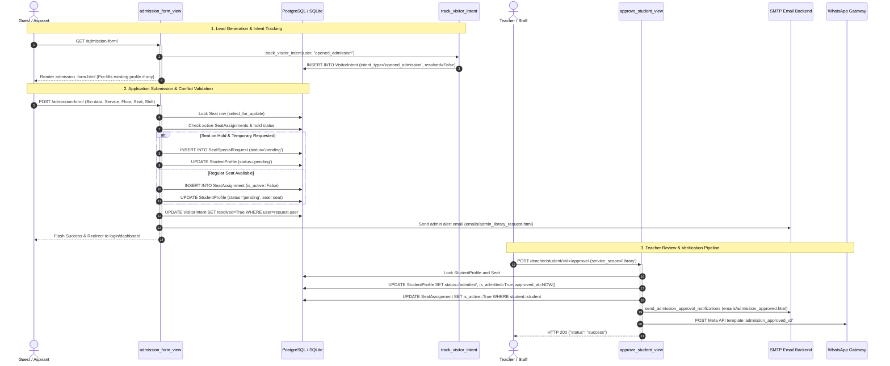

# ABCD Smart Campus — Admission Engine & Visitor CRM Architecture Manual

> **Domain:** Student Admissions, Lead Intent Tracking, Visitor CRM & Teacher Gatekeeping  
> **Target Audience:** Lead Systems Architects, Infrastructure Engineers, Full-Stack Developers  
> **Status:** Production-Ready & Formally Audited  
> **Associated Apps:** `abcd_web/users/`, `abcd_web/templates/`

---

## 1. Executive Summary & Capabilities

The **Admission Engine & Visitor CRM** subsystem is ABCD Smart Campus’s primary conversion, student onboarding, and institutional gatekeeping framework. It manages the entire funnel—from anonymous and guest visitor engagement to formal application submission, library seat conflict resolution, and teacher administrative approvals.

The architecture combines a **Drip Visitor Intent Tracking CRM** (monitoring prospective student actions and triggering timely email follow-ups) with a **Multi-Service Admission Gateway** that supports dual-service enrolments (Coaching and Library) without account duplication.

```
       ┌────────────────────────────────────────────────────────┐
       │             ADMISSION & VISITOR CRM FUNNEL             │
       └────────────────────────────────────────────────────────┘
                                    │
    ┌───────────────────────────────┴───────────────────────────────┐
    ▼                                                               ▼
[VISITOR CRM INTENT ENGINE]                            [STUDENT ADMISSION PIPELINE]
• 6 Granular Intent Types                              • Dual-Service Support (Coaching + Library)
• Time-Delayed Drip Reminders                          • Multi-Shift Library Seat Locking
• Seat Availability Alerts                             • Temporary Allotment on Held Seats
• Teacher Lead Insights Portal                         • Anti-Lock Concurrency Retries (SQLite)
    │                                                               │
    └───────────────────────────────┬───────────────────────────────┘
                                    │
                                    ▼
                      [TEACHER GATEKEEPING & APPROVAL]
                      • Granular Service Approvals (Coaching / Library / Both)
                      • Partial Tenant Exception Handling
                      • One-Click Approval Dispatches (Email + WhatsApp)
                      • Direct Administrative Onboarding (/api/teacher/add-manual/)
```

### Core Features & Capabilities

1. **Intelligent Multi-Service Admission Gateway (`/admission-form/`):**
   - Single unified endpoint handling both **New Student Applications** and **Existing Admitted Students** registering for a second service (e.g., an enrolled Coaching student adding a Library seat).
   - Dynamic service disabling prevents duplicate applications for services already active or pending.
   - Dual-service independence tracking via granular flags (`coaching_pending`, `library_pending`, and `service_type` ['Coaching', 'Library', 'Both']).

2. **Shift-Aware Seat Reservation & Partial Allotment:**
   - Real-time seat locking (`Seat.select_for_update()`) preventing race conditions during form submissions.
   - Ground floor strict shift enforcement (Seats 40–53 support Morning, Evening, and Full-Day shifts independently).
   - **Temporary Allotment Workflow:** If a desired seat is currently on hold, applicant can submit an `is_temporary_request` creating a `SeatSpecialRequest` without crashing validation.

3. **Automated Visitor CRM & Lead Drip Engine (`VisitorIntent`):**
   - Captures anonymous and guest user intent events: `guest_browsed`, `viewed_library`, `opened_admission`, `selected_coaching`, `selected_library`, `selected_library_seat`.
   - Distinguishes between `general` and `specific` intent scopes (e.g., general coaching interest vs. a specific seat on Floor 2).
   - Automated conversion drip commands (`process_visitor_reminders`, `process_seat_availability_reminders`) dispatching responsive HTML conversion emails (`emails/visitor_reminder.html`).
   - Auto-resolution: When a visitor successfully submits an admission form, all pending `VisitorIntent` records for that user are atomically marked `resolved=True`.

4. **Teacher CRM Insights Portal (`/teacher/visitor-insights/`):**
   - High-visibility administrative console tracking un-admitted lead interest, timestamp of last interaction, and metadata.
   - Administrative hygiene controls: One-click clear of resolved/reminded records and multi-select purge actions.

5. **Teacher Gatekeeping & Admission Approval Pipeline:**
   - Dedicated review routes: `approve_student_view` (`/teacher/student/<id>/approve/`) and `seat_action_api` (`/api/teacher/seat_action/`).
   - Supports `skip_seat` and `skip_batch` flags allowing instructors to approve students immediately even if physical allocations are pending.
   - **Partial Tenant Exception:** Automatically detects if a conflicting occupant is an owner on hold, allowing the pending student to be approved as a temporary tenant.
   - Automated multi-channel notification dispatches via background threads (HTML approval emails and Meta WhatsApp template `admission_approved_v2`).

6. **Direct Administrative Onboarding (`/api/teacher/add-manual/`):**
   - Allows teachers to bypass student form submission entirely to manually onboard students or alumni across Coaching, Library, or Hall of Fame.
   - Atomically generates `User`, `StudentProfile`, `SeatAssignment`, and initial ledger fees in a single transaction.

---

## 2. Codebase Touchpoints & File Trace

### Relational Schema & Model Topology

```
+------------------------------------------------------------------------------------+
|                                      auth.User                                     |
+------------------------------------------------------------------------------------+
| id (PK), username, first_name, last_name, email, is_staff, is_active                |
+------------------------------------------------------------------------------------+
       | 1                                        | 1
       |                                          |
       | 1                                        | 0..*
       v                                          v
+--------------------------------------+   +-----------------------------------------+
|         users.StudentProfile         |   |            users.VisitorIntent          |
+--------------------------------------+   +-----------------------------------------+
| id (PK)                              |   | id (PK)                                 |
| user_id (OneToOne -> User)           |   | user_id (FK -> User)                    |
| full_name, sex, dob, photo           |   | intent_type (6 choices)                 |
| mobile_number, whatsapp_number       |   | intent_scope ('general' | 'specific')   |
| email, address                       |   | metadata (JSONField)                    |
| service_type ('Coaching'|'Library'|  |   | reminder_sent, reminder_sent_at         |
|               'Both')                |   | resolved, resolved_at                   |
| status ('pending'|'admitted'|'hold') |   | created_at                              |
| is_admitted (BooleanField)           |   +-----------------------------------------+
| coaching_pending (BooleanField)      |
| library_pending (BooleanField)       |
| batch (CharField)                    |
| seat_id (FK -> Seat, nullable)       |
| shift ('full'|'morning'|'evening')   |
| admission_type ('new' | 'existing')  |
| approved_at, created_at              |
+--------------------------------------+
       | 1                       | 1
       |                         |
       | 0..*                    | 0..*
       v                         v
+------------------------+  +--------------------------------------------------------+
|  users.SeatAssignment  |  |                users.SeatSpecialRequest                |
+------------------------+  +--------------------------------------------------------+
| id (PK)                |  | id (PK)                                                |
| seat_id (FK -> Seat)   |  | student_id (FK -> StudentProfile), seat_id (FK -> Seat)|
| student_id (FK)        |  | requested_shift ('morning'|'evening'|'full')            |
| shift_type             |  | status ('pending'|'approved'|'rejected')               |
| is_active (Boolean)    |  +--------------------------------------------------------+
| is_partial (Boolean)   |
| hold_status            |
+------------------------+
```

### Complete File & Endpoint Traceability Table

| Endpoint / Route | View Handler | HTTP Methods | Auth / RBAC Layer | Template / Response | Primary Functional Purpose |
| :--- | :--- | :--- | :--- | :--- | :--- |
| `/admission-form/` | `admission_form_view` | `GET`, `POST` | `@login_required` (Guest / Student) | `users/admission_form.html` | Multi-service student application form with seat picker, shift logic, and SQLite anti-lock retry. |
| `/teacher/student/<int:student_id>/approve/` | `approve_student_view` | `POST` | `@login_required`, Teacher/Staff | Redirect / JSON | Approves pending admissions, resolves seat/batch conflicts, and dispatches approval emails/WhatsApp. |
| `/api/teacher/seat_action/` | `seat_action_api` | `POST` | `@login_required`, Teacher/Staff | JSON | High-concurrency seat manager endpoint handling `approve_pending`, `approve_without_seat`, and `free`. |
| `/teacher/visitor-insights/` | `visitor_insights_view` | `GET` | `@login_required`, Teacher/Staff | `users/visitor_insights.html` | Teacher CRM dashboard tracking unconverted prospective student intents and interactions. |
| `/teacher/visitor-insights/clear/` | `clear_visitor_intents` | `POST` | `@login_required`, Teacher/Staff | Redirect | Flushes old resolved or reminded visitor records from the CRM database. |
| `/teacher/visitor-insights/delete-selected/` | `delete_selected_visitor_intents` | `POST` | `@login_required`, Teacher/Staff | Redirect | Multi-select deletion of visitor intent records. |
| `/api/teacher/add-manual/` | `teacher_add_manual_api` | `POST` | `@login_required`, Teacher/Staff | JSON | Direct administrative onboarding bypassing the public form across Coaching, Library, and Alumni. |
| `/api/seat-interest/` | `seat_interest_api` | `POST` | Public / Any | JSON | Records guest user interest on an occupied library seat (`selected_library_seat` intent). |

---

## 3. Complete Data & Logic Flow Mermaid Diagram



---

## 4. State Machines & Edge Case Logic

### Student Admission Status State Machine

```
               ┌───────────────────────────┐
               │    UNREGISTERED GUEST     │
               │  (VisitorIntent active)   │
               └───────────────────────────┘
                             │
                             │ Submits /admission-form/
                             ▼
               ┌───────────────────────────┐
               │          PENDING          │
               │ • VisitorIntents resolved │
               │ • SeatAssignment inactive │
               └───────────────────────────┘
                      │             │
       Teacher        │             │ Teacher Rejects
       Approves       │             │ (delete_student_view)
                      ▼             ▼
         ┌────────────────┐    ┌───────────────────────────────────┐
         │    ADMITTED    │    │          REJECTED / PURGED        │
         │ • Full access  │    │ • Assigned seat freed             │
         │ • Seat active  │    │ • Media files deleted             │
         │ • Ledger active│    │ • Fallback to Guest/Other Service │
         └────────────────┘    └───────────────────────────────────┘
                 │
                 │ Admitted student applies for second service
                 ▼
         ┌────────────────────────────────────────────────────────┐
         │              DUAL-SERVICE TRANSITIONAL                 │
         │ • status = 'admitted' (Keeps current service active)   │
         │ • coaching_pending = True OR library_pending = True    │
         │ • Upgraded to service_type = 'Both' upon approval      │
         └────────────────────────────────────────────────────────┘
```

### Critical Edge Cases & Architectural Defenses

1. **Dual-Service Status Isolation:**
   - *Problem:* When an admitted Coaching student applies for the Library, changing their top-level `status` to `pending` would lock them out of their active coaching classes and dashboard.
   - *Defense:* The system retains `status = 'admitted'` and sets `library_pending = True` (or `coaching_pending = True`). The student retains full access to their existing service while the new service awaits teacher approval.

2. **SQLite Database Lock Concurrency Retry Loop:**
   - *Problem:* Under high traffic, concurrent writes to `StudentProfile` and `SeatAssignment` on SQLite produce `OperationalError: database is locked`.
   - *Defense:* `admission_form_view` wraps the entire mutation block in a 3-attempt retry loop:
     ```python
     for attempt in range(3):
         try:
             with transaction.atomic():
                 # DB mutations
             break
         except OperationalError as e:
             if "database is locked" in str(e) and attempt < 2:
                 time.sleep(0.1 * (attempt + 1))
                 continue
             raise
     ```
     Deferred actions (email dispatches, WebSocket invalidations) are queued and executed *outside* the atomic transaction block to minimize lock hold times.

3. **Owner-on-Hold Partial Tenant Exception:**
   - *Problem:* If a seat is placed on hold by Student A (owner), approving Student B for temporary occupancy would normally trigger a 409 conflict error.
   - *Defense:* `approve_student_view` checks:
     ```python
     conflict_is_owner_on_hold = (
         conflict_assignment.hold_status == 'active'
         and not conflict_assignment.is_partial
     )
     if conflict_is_owner_on_hold:
         # Allow approval as partial tenant without unseating the owner
     ```
     This allows dual tenant coexistence while the owner's seat hold is active.

4. **Internal Account Exclusion from Visitor Tracking:**
   - *Problem:* Staff members, teachers, alumni, and existing students browsing the public site would pollute the Visitor CRM lead list.
   - *Defense:* `is_excluded_from_visitor_tracking(user)` verifies whether the user is staff, has an active profile, or has an achievement record. If true, intent tracking silently aborts.

5. **Old Photo Physical Cleanup on Update:**
   - *Problem:* When students re-submit admission forms with updated photographs, orphaned image files accumulate in storage.
   - *Defense:* If a new photo is uploaded, the system compares the old photo name against the new photo name and invokes `old_photo.delete(save=False)` directly from physical storage.

---

## 5. User Journey & Feature Step-by-Step

### Journey 1: Guest Exploring Campus and Converting via Admission Form

```
1. Prospective student browses https://abcdcampus.in/courses/
   ├── System executes track_visitor_intent("guest_browsed")
2. Student navigates to /admission-form/
   ├── System executes track_visitor_intent("opened_admission")
   └── Renders multi-step form with service tabs ("Library" / "Coaching" / "Both")
3. Student selects "Library":
   ├── Chooses "First Floor" -> Interactive seat map loads
   ├── Selects Seat 15 (Shift: Full Day)
   ├── Enters personal details, mobile, WhatsApp, and uploads passport photo
   └── Clicks "Submit Admission Form"
4. Backend Pipeline executes:
   ├── Verifies seat is unlocked and available
   ├── Inactivates old VisitorIntent records (resolved=True)
   ├── Creates StudentProfile (status='pending') and SeatAssignment (is_active=False)
   └── Dispatches alert email to teachers (emails/admin_library_request.html)
5. Student sees confirmation message:
   └── "Admission form submitted successfully! Your library seat request is pending approval."
```

### Journey 2: Teacher Reviewing & Approving Admission in Teacher Dashboard

```
1. Teacher logs into Teacher Dashboard (/teacher/dashboard/)
   ├── Notification badge displays "1 New Admission Request"
   └── Admission review table lists student name, selected service, seat, and contact
2. Teacher inspects student credentials:
   ├── Verifies photo quality and mobile number
   ├── Checks Seat 15 availability
3. Teacher clicks "Approve Student":
   ├── System acquires 10-second request deduplication lock
   ├── Executes safe_atomic_transaction()
   ├── Updates StudentProfile: status = 'admitted', approved_at = now()
   ├── Activates SeatAssignment: is_active = True
   ├── Emits real-time WebSocket seat update to broadcast_all
   ├── Background thread dispatches congratulations HTML email
   └── Dispatches WhatsApp message via Meta Cloud API template admission_approved_v2
4. Teacher sees success notification:
   └── "Admission for Student approved. Seat 15 is now occupied."
```

### Journey 3: Automated CRM Lead Follow-up for Unconverted Visitor

```
1. Visitor browses Library seats but leaves without submitting application
   ├── Intent recorded: selected_library_seat (metadata: Floor 2, Seat 12)
2. Cron job triggers process_visitor_reminders management command:
   ├── Checks intent age: created_at + 24 hours <= now
   ├── Verifies visitor has NOT converted (resolved=False)
   ├── Verifies visitor is not staff or enrolled student
3. System compiles personalized reminder email:
   ├── Subject: "Your Preferred Library Seat Is Still Available"
   ├── Template: emails/visitor_reminder.html
   └── Embeds direct one-click link back to /admission-form/
4. Visitor receives email, clicks link, and completes admission
   └── On submission, intent status automatically marks resolved = True
```

---

## 6. Video Script Anchor Points

| Timestamp | Visual / Screen Focus | Script Narration & Architectural Anchor |
| :--- | :--- | :--- |
| **00:00 - 00:45** | Public landing page transitioning to Admission Form (`/admission-form/`). | *"Welcome to the Admission Engine & Visitor CRM of ABCD Smart Campus. From the moment a prospective student visits the campus site, our CRM tracks engagement signals, tracking service choices and seat preferences with zero intrusion."* |
| **00:45 - 01:30** | Interactive library seat picker on Admission Form; selecting shift. | *"Notice the intelligence embedded in our admission form. Students selecting library access can pick specific floors, seats, and shifts in real-time. If a seat is on hold, the system allows them to request temporary allotment rather than dead-ending the conversion."* |
| **01:30 - 02:15** | Teacher Dashboard review queue showing pending admission badges. | *"On the administrative side, teachers maintain absolute gatekeeping control. Review queues aggregate pending applicants with instant credential checks, photo previews, and automated conflict detection across seat assignments."* |
| **02:15 - 03:00** | Clicking "Approve Student" and showing simultaneous email & WhatsApp alerts. | *"When a teacher approves an admission, the engine executes an atomic status transition. It stamps approval timestamps, updates the global seat matrix via WebSockets, and immediately dispatches branded HTML emails and Meta WhatsApp confirmations."* |
| **03:00 - 03:45** | Teacher Visitor Insights Console (`/teacher/visitor-insights/`). | *"Finally, our automated Lead CRM ensures no student slips through the cracks. The Visitor Insights console displays un-admitted lead interest, while automated drip workers send timely seat-availability reminders, driving higher campus conversions."* |
