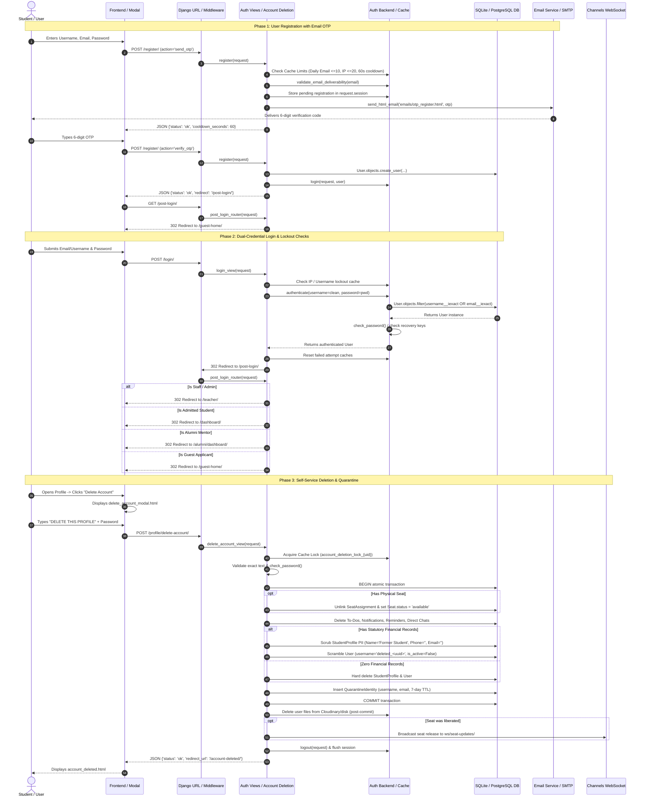

# ABCD Smart Campus — Systems Architecture Manual
## Domain: Authentication, Access Control & Profile Hub (`auth_profiles`)

---

### 1. Executive Summary & Capabilities

The **Authentication, Access Control & Profile Hub (`auth_profiles`)** serves as the security perimeter, identity broker, and user lifecycle manager for the ABCD Smart Campus platform. It supports four distinct stakeholder personas: **Prospective Students / Guests**, **Admitted Students**, **Alumni Mentors**, and **Teachers / Administrators**.

#### 1.1 Complete Feature Inventory
- **Dual-Credential Authentication:** Allows users to log in with either their alphanumeric `username` or registered `email` address interchangeably via a custom Django authentication backend (`EmailOrUsernameModelBackend`).
- **Interactive Multi-Step Registration:**
  - Client-side and server-side live validation of username availability and email deliverability (`validate_email_api`).
  - Two-phase registration gating: Generates a cryptographically randomized 6-digit OTP stored in the session, dispatched via HTML email (`emails/otp_register.html`) with an atomic 60-second cooldown and 10-minute validity.
  - Rate limiting against registration floods: max 10 OTP requests/day per email, max 20 OTP requests/day per IP, and max 20 accounts created per IP/hour.
- **Federated Google OAuth2 Integration:**
  - Zero-friction "Sign in with Google" integrated with `social_django`.
  - Custom pipeline stage (`link_existing_account_by_email`) that prevents split accounts by linking verified Google emails to existing local accounts without creating duplicates.
  - Automatically provisions admin privileges if logging in via pre-authorized institutional accounts (`abcd2013baq@gmail.com` or `vd19055@gmail.com`).
  - Active barrier against 7-day identity quarantine bypasses.
- **Dynamic Post-Login & Smart Navigation Routing:**
  - `post_login_router`: Context-aware post-authentication engine that evaluates user privileges, student admission status, and alumni achievements to route users to `/teacher/`, `/alumni/dashboard/`, `/dashboard/`, or `/guest-home/`.
  - `smart_back_router`: Prevents the standard "back button entrapment" and session disorientation by intercepting browser navigation and smoothly returning users to their respective home base.
  - `switch_dashboard_view`: Instagram-style dashboard switcher for dual-identity alumni/students who maintain both an active student record and verified alumni mentorship achievements.
- **Forgot Password & Security Recovery Flow:**
  - Zero-page-reload modal flow (`password_reset_modal.html`).
  - Phase 1: Email lookup across `User`, `StudentProfile`, and `StudentAchievement`.
  - Phase 2: 6-digit OTP delivery with strict anti-brute-force rate limiting (invalidated after 5 consecutive failed attempts).
  - Phase 3: New password submission enforced against Django core password validators (`MinimumLengthValidator`, `CommonPasswordValidator`, `NumericPasswordValidator`), preventing password reuse, with automatic session authentication hash update (`update_session_auth_hash`).
- **In-App Password Change:**
  - Dedicated endpoint (`/profile/change-password/`) requiring old password validation, preventing session hijacking from left-open workstations.
- **Self-Service Account Deletion & 7-Day Identity Quarantine:**
  - Full adherence to digital privacy regulations (GDPR/DPDP principles) with complete self-service deletion (`/profile/delete-account/`).
  - Dual-gate confirmation: requires typing exact case-sensitive string `"DELETE THIS PROFILE"` plus current password (or verified 6-digit email OTP for passwordless Google OAuth accounts).
  - Atomic transaction scrubbing: removes personal study tasks, learning reminders, visitor intent records, push notification subscriptions, 1-on-1 and solo group chat histories, and student material interactions.
  - Seat detachment: automatically unassigns physical library seats, clears hold states, and immediately broadcasts real-time seat availability to all clients via Channels WebSocket.
  - Statutory accounting retention & PII scrubbing: if financial records (`FeeTransaction`, `Payment`) exist, legal auditing standards mandate ledger persistence. The system anonymizes the profile into an irreversible pseudo-identity (`full_name="Former Student"`, phone/email/DOB/photo/gender erased, `User.is_active=False`, username randomized to `deleted_<uuid>`).
  - 7-Day Identity Quarantine (`QuarantineIdentity`): places deleted usernames and emails into a 7-day holding block to eliminate instant username poaching, identity theft, and impersonation.
- **Centralized Avatar Asset Pipeline:**
  - Base64 canvas crop and multipart upload handling (`upload_profile_photo`).
  - MIME validation, EXIF orientation correction, Pillow re-encoding, and virus/payload safety checks (`sanitize_and_prepare_image`).
  - Rate limiting on avatars: 10-second rapid-click cooldown and 10 avatar modifications per day per user.
  - Multi-tier fallback resolver (`get_profile_photo_url`): Custom Teacher photo -> Student/Alumni uploaded photo (with timestamped cache-busting `?v=<timestamp>`) -> Google OAuth profile image -> Dynamic SVG UI-Avatar.

#### 1.2 Security Constraints & Permission Layers
| Layer | Mechanism | Implementation Detail |
| :--- | :--- | :--- |
| **Brute-Force Login Lockout** | Progressive Sliding-Window Rate Limiter | Tracks failed attempts per IP and per username in 15-minute cache windows. At 5 failures, applies tiered locks: Phase 1 (5 mins), Phase 2 (15 mins), Phase 3 (24 hours). Legacy 24-hour ceiling limits users to 5 wrong passwords daily. |
| **Emergency Recovery Keys** | Environment Variable Fallback Bypass | `VAKU_RECOVERY_KEY` and `SANDY_RECOVERY_KEY` configured in `.env`. Enables emergency administrative restoration directly via the web login form if database credentials become corrupted. |
| **Administrative Shielding** | Self-Deletion Blockade | `is_staff` and `is_superuser` accounts are strictly prevented from invoking self-service account deletion endpoints. |
| **Concurrency Guard** | Cache Lock on Deletion | Uses `account_deletion_lock_{user.id}` (60s TTL) to prevent double-click race conditions and orphaned transactions. |
| **Cloudinary File Isolation** | Out-of-Transaction Media Purging | Physical file deletion from Cloudinary/local disk occurs *after* the database transaction commits, preventing orphaned state or rollbacks on remote failures. |

---

### 2. Codebase Touchpoints & File Trace

#### 2.1 Database Models Schema Breakdown

```
+----------------------------------------------------------------------------------------------------+
|                                    django.contrib.auth.models.User                                 |
+----------------------------------------------------------------------------------------------------+
| id (AutoField, PK)                                                                                 |
| username (CharField 150, unique=True, db_index=True)                                               |
| email (EmailField 254, db_index=True)                                                              |
| password (CharField 128, hashed via PBKDF2/Argon2)                                                  |
| first_name, last_name (CharField 150)                                                                |
| is_staff, is_superuser, is_active (BooleanField)                                                   |
| date_joined, last_login (DateTimeField)                                                            |
+---------------------------------+----------------------------------+-------------------------------+
                                  | 1:1                              | 1:1                           | 1:1
                                  v                                  v                               v
+---------------------------------+-------+ +------------------------+------+ +-----------------------+
|           users.StudentProfile          | |         users.TeacherProfile          | |  users.QuarantineIdentity   |
+-----------------------------------------+ +---------------------------------------+ +-----------------------------+
| id (BigAutoField, PK)                   | | id (BigAutoField, PK)                  | | id (BigAutoField, PK)        |
| user (OneToOneField -> User, CASCADE)   | | user (OneToOneField -> User, CASCADE)  | | username_normalized (150)   |
| full_name (CharField 100)               | | display_name (CharField 100)           | | email_normalized (254)      |
| dob (DateField, nullable)               | | role_title (CharField 100)             | | deleted_at (DateTimeField)  |
| sex (CharField: Male/Female/Other)      | | mobile_number (CharField 15)            | | quarantine_until (DateTime) |
| sex_other (CharField 50, optional)      | | detail1, detail2, detail3 (150)        | | user_role (CharField 20)     |
| email (EmailField, optional)            | | about (TextField)                      +-----------------------------+
| photo (ImageField -> student_photos/)   | | photo (ImageField -> teacher_photos/) | (Standalone audit table)
| mobile_number, whatsapp_number (15)     | | emails, mobile_numbers, whatsapp_...  |
| service_type (Coaching/Library/Both)    +-----------------------------------------+
| batch (CharField 50, optional)          |
| seat (ForeignKey -> Seat, SET_NULL)     |
| shift (CharField: full/morning/evening) |
| admission_type (new/existing)           |
| status (pending/admitted/on_hold)       |
| is_admitted, is_manual_pending (Bool)   |
| hold_start_date, hold_end_date (Date)   |
| fee_expiry_date (DateField, overall)    |
| coaching_fee_expiry_date (DateField)    |
| library_fee_expiry_date (DateField)     |
| created_at, approved_at (DateTime)      |
| password_last_updated (DateTime)        |
+-----------------------------------------+
```

#### 2.2 Views, Routes & API Endpoints

| Route / URL Pattern | View Function | Method | Auth / Permission | Payload / Query Params | Response Structure |
| :--- | :--- | :--- | :--- | :--- | :--- |
| `/register/` | `register` | `GET` / `POST` | Public (`never_cache`) | `action`: `send_otp` / `resend_otp` / `verify_otp`<br>`username`, `email`, `password1`, `otp` | JSON: `{'status': 'ok'/'error', 'message': str, 'cooldown_seconds': int, 'redirect': str}` |
| `/login/` | `login_view` | `GET` / `POST` | Public (`never_cache`) | `username` (or email), `password`, `csrfmiddlewaretoken` | Form render or 302 Redirect to `/post-login/` |
| `/logout/` | `logout_view` | `GET` / `POST` | Authenticated | None | 302 Redirect to `/` |
| `/forgot-password/` | `forgot_password_request` | `POST` | Public | `{'email': str}` | JSON: `{'status': 'ok', 'message': str, 'clean_email': str}` |
| `/verify-otp/` | `verify_otp_view` | `POST` | Public | `{'email': str, 'otp': str}` | JSON: `{'status': 'ok', 'message': 'OTP verified'}` |
| `/reset-password/` | `reset_password_view` | `POST` | Session Gated (`pwreset_user_id`) | `{'new_password': str, 'confirm_password': str}` | JSON: `{'status': 'ok', 'message': 'Password reset successful!'}` |
| `/post-login/` | `post_login_router` | `GET` | Authenticated | None | 302 / Smart Replace Redirect (`users:teacher_dashboard`, `users:student_dashboard`, `users:alumni_dashboard`, or `users:guest_page`) |
| `/smart-back/` | `smart_back_router` | `GET` | Authenticated (`never_cache`) | None | 302 Redirect to verified active user dashboard |
| `/dashboard/switch/<role>/` | `switch_dashboard_view` | `GET` | Authenticated (`login_required`) | Route param `role` (`student` or `alumni`) | 302 Redirect to selected role dashboard |
| `/profile/` | `profile_view` | `GET` | Authenticated (`login_required`) | None | 302 Redirect to role-specific profile (`teacher/profile/`, `profile/guest/`, or `my-details/`) |
| `/profile/guest/` | `guest_profile_details_view` | `GET` | Authenticated (`login_required`) | None | HTML Render (`guest_profile_details.html`) |
| `/teacher/profile/` | `teacher_profile_details_view` | `GET` | Staff / Admin (`login_required`) | None | HTML Render (`teacher_profile_details.html`) |
| `/my-details/` | `student_details_S_view` | `GET` | Student (`login_required`) | None | HTML Render (`student_details_S.html`) |
| `/profile/change-password/` | `change_password_view` | `POST` | Authenticated (`login_required`) | `old_password`, `new_password1`, `new_password2` | Form redirect with Django messages |
| `/profile/delete-account/` | `delete_account_view` | `POST` | Authenticated (`login_required`) | `{'confirmation_text': 'DELETE THIS PROFILE', 'password': str, 'otp': str}` | JSON: `{'status': 'ok', 'redirect_url': '/account-deleted/'}` |
| `/profile/delete-account/request-otp/` | `request_delete_account_otp_view` | `POST` | Authenticated (`require_POST`) | None (extracts from `request.user`) | JSON: `{'status': 'ok', 'message': str, 'cooldown_seconds': int}` |
| `/profile/delete-account/verify-otp/` | `verify_delete_account_otp_view` | `POST` | Authenticated (`require_POST`) | `{'otp': str}` | JSON: `{'status': 'ok', 'message': 'Verification code confirmed.'}` |
| `/profile/otp-status/` | `otp_status_view` | `GET` | Authenticated | None | JSON: `{'active': bool, 'seconds_remaining': int}` |
| `/api/validate-email/` | `validate_email_api` | `GET` | Public | Query param `?email=...` | JSON: `{'valid': bool, 'message': str, 'suggestion': str}` |
| `/student/<id>/photo/upload/` | `upload_profile_photo` | `POST` | Student Owner or Staff | Multipart `photo` file OR base64 payload `photo_base64` | JSON: `{'status': 'success', 'photo_url': str}` |
| `/student/<id>/photo/delete/` | `delete_profile_photo` | `POST` | Student Owner or Staff | None | 302 Redirect to profile details |
| `/delete-account/` | `delete_account_info_view` | `GET` | Public / Informational | None | HTML Render (`delete_account_info.html`) |
| `/account-deleted/` | `account_deleted_view` | `GET` | Public / Post-Action | None | HTML Render (`account_deleted.html`) |

#### 2.3 Frontend Templates & UI Partials Trace
- `users/templates/users/register.html`: Multi-step interactive registration interface with live email deliverability checks, real-time OTP countdown timer, and celebratory registration completion animation.
- `users/templates/home_page.html`: Global public landing page housing embedded modal triggers for quick dual-credential login, Google OAuth buttons, and forgot-password modals.
- `users/templates/partials/delete_account_modal.html`: Self-service deletion interface. Features red-alert warnings, input for `"DELETE THIS PROFILE"`, conditional password prompt (or inline 6-digit email OTP for Google users), and confirmation processing states.
- `users/templates/partials/password_reset_modal.html`: 3-stage floating modal covering email dispatch, OTP verification, and new password generation with live strength indicators.
- `users/templates/users/student_details_S.html`: Comprehensive student profile view featuring editable contact numbers, profile photo crop modal, seat assignment details, fee history link, and account deletion trigger.
- `users/templates/users/guest_profile_details.html`: Dedicated profile view for guests and newly registered applicants who have not yet submitted or received admission approval.
- `users/templates/users/teacher_profile_details.html`: Teacher management profile interface showing role title, contact channels, biography, and credentials.
- `users/templates/partials/_photo_broad_view.html`: Full-screen modal viewer allowing students and administrators to inspect high-resolution profile photos with zoom controls.
- `users/templates/partials/_smart_back_redirect.html`: Lightweight JavaScript snippet executing `history.replaceState` to neutralize infinite redirection loops during browser back-navigation.
- `users/templates/emails/otp_register.html`: Branded transactional HTML email template carrying registration verification codes.
- `users/templates/emails/otp_security.html`: Transactional HTML email conveying password reset codes.
- `users/templates/emails/account_deletion_otp.html`: Urgent transactional HTML email containing account deletion verification codes.
- `users/templates/emails/welcome_email.html`: Onboarding email dispatched upon successful admission verification.

#### 2.4 Supporting Services, Modules & Workers
- `users.auth_backends.EmailOrUsernameModelBackend`: Central dual-credential authentication backend with environmental recovery fallback keys (`VAKU_RECOVERY_KEY`, `SANDY_RECOVERY_KEY`).
- `users.account_deletion`: Standalone service module handling 7-day identity quarantine, multi-model cascade deletion, legal financial anonymization, and seat unlinking.
- `users.email_service.send_html_email`: Multi-provider transactional email dispatcher supporting template caching, preheaders, and socket-timeout resilience.
- `users.email_validator.validate_email_deliverability`: Real-time email validation verifying RFC compliance, DNS MX records, disposable email blocklists, and typo recommendations (e.g. `gmai.com` -> `gmail.com`).
- `users.utils.sanitize_and_prepare_image`: Strict image processor enforcing RGB conversion, stripping malicious EXIF tags, checking 5MB thresholds, and recompressing via Pillow.
- `social_core.pipeline`: Social auth execution chain executing `link_existing_account_by_email` and `set_new_user_flag`.

---

### 3. Complete Data & Logic Flow



---

### 4. State Machines & Edge Case Logic

#### 4.1 Account Lifecycle State Machine

```
                   +----------------------------------+
                   |           Unregistered           |
                   +-----------------+----------------+
                                     | Submit Registration Form
                                     v
                   +----------------------------------+
                   |       Pending Registration       |
                   |      (Session OTP Validation)    |
                   +-------+------------------+-------+
       OTP Expired |                          | Verified OTP
                   v                          v
       +--------------------+      +------------------+
       |   Session Cleared  |      |   Active Guest   |
       +--------------------+      +--------+---------+
                                            | Admission Approved
                                            v
                                   +------------------+
                                   | Admitted Student |
                                   +--------+---------+
                                            | Graduates / Milestone Achieved
                                            v
                                   +------------------+
                                   |  Alumni Mentor   |
                                   +--------+---------+
                                            |
                                            | Self-Service Deletion Triggered
                                            v
                       +--------------------+--------------------+
                       |                                         |
     Has Accounting Records? (Yes)             Has Accounting Records? (No)
                       |                                         |
                       v                                         v
         +---------------------------+             +---------------------------+
         |     PII Anonymization     |             |        Hard Deletion      |
         | (Name: "Former Student",  |             | (StudentProfile & User    |
         |  User: deleted_<uuid>)    |             |  purged from DB)          |
         +-------------+-------------+             +-------------+-------------+
                       |                                         |
                       +--------------------+--------------------+
                                            |
                                            v
                               +---------------------------+
                               |    Quarantined Identity   |
                               | (7 Days Locked in Cache/DB|
                               |  blocks reuse in signup)  |
                               +-------------+-------------+
                                             | Quarantine Expired (quarantine_until <= now)
                                             v
                               +---------------------------+
                               |     Recycled / Clean      |
                               +---------------------------+
```

#### 4.2 Rate Limiting & Lockout Matrix

| Security Guard | Key Format | Threshold | Window / Timeout | Action on Breach |
| :--- | :--- | :--- | :--- | :--- |
| **Registration OTP Cooldown** | `reg_otp_cooldown_{ip}` | 1 request | 60 seconds | Returns HTTP 429: "Please wait {remaining}s before requesting a new code." |
| **Daily Registration per Email** | `reg_daily_email_{email}` | 10 requests | 24 hours (86400s) | Returns HTTP 429: "Verification code limit reached (max 10 per day for this email)." |
| **Daily Registration per IP** | `reg_daily_ip_{ip}` | 20 requests | 24 hours (86400s) | Returns HTTP 429: "Verification code limit reached for this device (max 20 per day)." |
| **Hourly Account Creations** | `account_creations_count_{ip}` | 20 creations | 1 hour (3600s) | Returns HTTP 429: "Too many accounts created from this network. Limit is 20 per hour." |
| **Login Failure (Short-term)** | `login_failed_ip_{ip}` / `_user_{u}` | 5 failed attempts | 15 minutes (900s) | Activates progressive lockout phase. |
| **Login Lockout Phase 1** | `login_lock_until_ip_{ip}` | 1st breach | 5 minutes (300s) | Rejects login attempt with lock duration notice. |
| **Login Lockout Phase 2** | `login_lock_until_ip_{ip}` | 2nd breach | 15 minutes (900s) | Rejects login attempt with 15-minute lock notice. |
| **Login Lockout Phase 3** | `login_lock_until_ip_{ip}` | 3rd+ breach | 24 hours (86400s) | Rejects login attempt with 24-hour lock notice. |
| **Daily Login Cap per User** | `login_attempts_{user.pk}` | 5 failed attempts | 24 hours (86400s) | Account locked for remainder of 24-hour cycle. |
| **Password Reset OTP Limit** | `pwreset_otp_fails_{user.pk}` | 5 failed codes | 5 minutes (300s) | Code immediately deleted from cache; requires re-requesting. |
| **Profile Photo Rate Limit** | `photo_cooldown_user_{uid}` | 1 update | 10 seconds | Returns HTTP 429: "Please wait 10 seconds before changing photo." |
| **Daily Photo Updates** | `photo_daily_count_user_{uid}_{date}` | 10 updates | Calendar Day | Returns HTTP 429: "Daily photo update limit reached (max 10 changes per day)." |

---

### 5. User Journey & Feature Step-by-Step

#### 5.1 New Student Registration & Verification Journey
1. **Accessing Registration:** The user navigates to `/register/`. The page loads the high-conversion registration form (`register.html`).
2. **Real-Time Deliverability Check:** As the user enters their email, client-side debouncing queries `/api/validate-email/?email=...`. If a typo like `user@gmai.com` is detected, a smart suggestion prompt appears: *"Did you mean gmail.com?"*
3. **Triggering OTP Dispatch:** The user clicks *"Send Verification Code"*. An asynchronous AJAX request sends `action=send_otp`. The server validates deliverability, verifies the username and email are not quarantined, generates a 6-digit code, and sends `emails/otp_register.html`.
4. **Code Entry & Verification:** A 60-second animated circular countdown activates on the button. The user pastes the 6-digit OTP and clicks *"Verify & Create Account"*.
5. **Instant Provisioning:** The server compares the submitted OTP against `request.session['pending_registration']`. Upon match, the `User` is created inside a database transaction, the session flags `show_registration_animation = True`, and the user is logged in automatically.
6. **Smart Routing:** The client is redirected to `/post-login/`, which assesses admission state and lands the user on `/guest-home/` to complete their formal campus application.

#### 5.2 Returning User Login & Dashboard Routing Journey
1. **Entering Credentials:** The user accesses `/login/` (or opens the quick-login modal on the homepage) and enters either their email (`john@example.com`) or handle (`john123`) with their password.
2. **Backend Authentication:** `EmailOrUsernameModelBackend` normalizes the credential, queries `User`, and validates the password hash.
3. **Security Screening:** If the user mistypes their password, the failure count increments. Once failures exceed 5, the progressive lockout engages.
4. **Post-Login Routing Execution:** Upon valid credentials, the browser redirects to `/post-login/`:
   - If the user is staff/superuser (`Sandy` or `Vaku`), they route directly to `/teacher/`.
   - If the user is an admitted student with dual alumni status, the router inspects `request.session['active_dashboard']` to honor their previous context.
   - If the student is admitted, they route to `/dashboard/`.
   - If pending/guest, they route to `/guest-home/`.

#### 5.3 Password Recovery Modal Journey
1. **Modal Trigger:** The user clicks *"Forgot Password?"* on any login screen. The CSS/JS modal overlay (`password_reset_modal.html`) animates into view.
2. **Account Identification:** The user enters their email. The server queries across `User`, `StudentProfile`, and `StudentAchievement`.
3. **OTP Security Dispatch:** A 6-digit OTP is generated and cached under `pwreset_otp_{user.pk}` with a 10-minute expiry.
4. **Code Verification:** The user submits the code. The view utilizes constant-time string comparison (`hmac.compare_digest`) to prevent timing attacks. On success, `pwreset_user_id` is written to the session.
5. **New Password Creation:** The modal advances to Stage 3. The user inputs their new password twice. The server tests password strength via Django's auth validators, updates the password hash, purges cached reset tokens, and displays a success toast.

#### 5.4 Self-Service Account Deletion Journey
1. **Initiating Deletion:** The student navigates to `/my-details/` and clicks the destructive action *"Delete Account"*.
2. **Warning Modal Presentation:** The modal (`delete_account_modal.html`) renders an alert explaining irreversible data loss, seat liberation, and the 7-day quarantine period.
3. **Two-Factor Authentication Check:**
   - Standard password users enter their current login password.
   - Passwordless Google OAuth users click *"Send Verification Code"*, receive `emails/account_deletion_otp.html`, and input the 6-digit code.
4. **Typing Confirmation:** The user must explicitly type `DELETE THIS PROFILE`.
5. **Atomic Execution:** The client posts to `/profile/delete-account/`. The server checks the concurrency lock, executes `perform_account_deletion()`, liberates physical seats, broadcasts WebSocket updates, archives statutory ledgers with PII scrubbing, logs the identity quarantine, and calls `logout()`.
6. **Confirmation Screen:** The browser redirects to `/account-deleted/`, confirming full data erasure and displaying the quarantine expiration date.

---

### 6. Video Script Anchor Points

- **Dual-Credential Freedom:** Show a side-by-side demonstration logging into the same account using `alex_student` first, logging out, and then logging in using `alex@gmail.com` with the identical password.
- **Smart Typo & Deliverability Detection:** Type `student@gmal.com` into the registration box and zoom in on the animated amber alert proposing the instant fix: *"Did you mean gmail.com?"*.
- **The 60-Second Registration Gate:** Showcase the 6-digit OTP delivery email, highlighting the animated circular cooldown ring on the submission button and the celebratory confetti animation triggered upon first post-login entry.
- **Google OAuth Instant Linkage:** Demonstrate clicking *"Continue with Google"* with an email that already holds a password-based student record, showing that it immediately opens their existing dashboard without creating duplicate ghost accounts.
- **Anti-Brute Force Protection:** Enter 5 intentional incorrect passwords in rapid succession to reveal the high-security system lockout badge warning: *"Too many failed login attempts. Account locked for 5 minutes."*
- **Role Switching in Real-Time:** Log into an alumni account that also holds an admitted student profile. Click the profile avatar and toggle between *"Student View"* and *"Alumni View"*, highlighting how header themes, navigation links, and permissions swap dynamically.
- **Live Avatar Cropping & Cache Busting:** Upload a raw photo, adjust the circular crop box, and save. Point out the instant update in the top navigation bar without needing a browser hard-refresh (`Ctrl+F5`).
- **Irreversible Account Deletion & Live Seat Release:** Open two browser windows side by side:
  - *Window 1 (Public Library Availability Grid):* Shows Seat #42 marked as red (Occupied).
  - *Window 2 (Student Dashboard):* Student occupying Seat #42 completes the `"DELETE THIS PROFILE"` deletion flow.
  - *Visual Climax:* As soon as Window 2 confirms deletion, Window 1 instantly turns Seat #42 green (Available) via WebSocket without refreshing.
- **The 7-Day Quarantine Gate:** Immediately attempt to re-register using the just-deleted username and email to showcase the security message: *"This username is securely locked for 7 more days to protect the previous owner's identity."*
