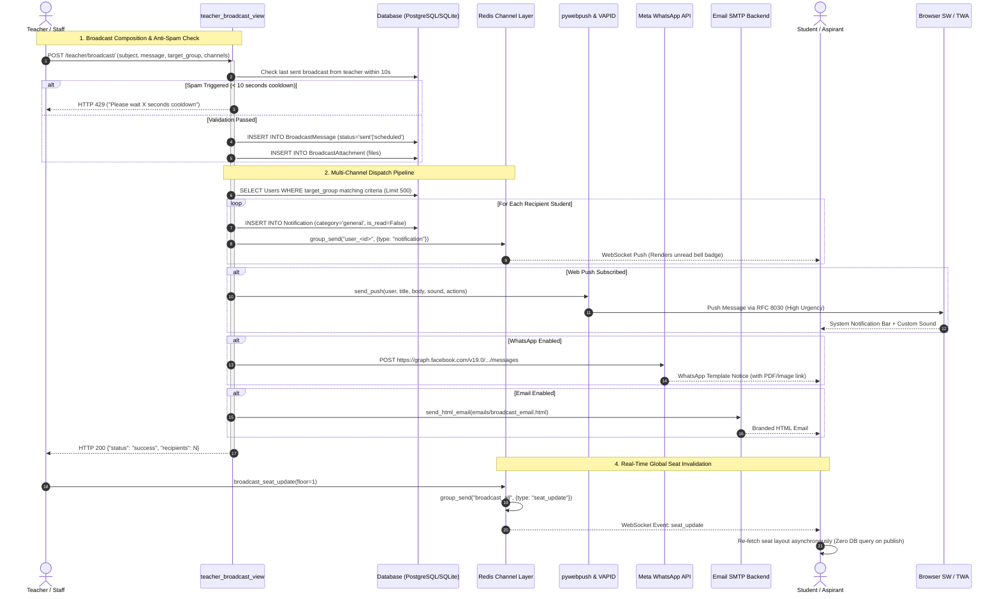

# ABCD Smart Campus — Broadcast & Multi-Channel Notifications Architecture Manual

> **Domain:** Broadcast Messages, Ads Banners, WebPush, WebSockets & Multi-Channel Alerts  
> **Target Audience:** Lead Systems Architects, Infrastructure Engineers, Full-Stack Developers  
> **Status:** Production-Ready & Formally Audited  
> **Associated Apps:** `abcd_web/users/`, `abcd_web/teachers/`, `abcd_web/templates/`

---

## 1. Executive Summary & Capabilities

The **Broadcast & Multi-Channel Notifications** subsystem is ABCD Smart Campus’s omni-channel communication, alert dispatch, and marketing engagement backbone. It coordinates real-time state delivery, administrative announcements, time-sensitive academic alarms, and transactional updates across four primary output channels:

1. **In-App Persistent Notifications & UI Badging** (Database backed with auto-cleanup)
2. **Real-Time Asynchronous WebSockets** (Django Channels & Redis channel layers)
3. **PWA / TWA Web Push Notifications** (VAPID, RFC 8030 Push with custom audio)
4. **External Communications** (Meta WhatsApp Cloud API v19.0 & Transactional SMTP HTML Emails)

```
                       ┌──────────────────────────────────────────────────┐
                       │          BROADCAST & NOTIFICATION HUB            │
                       └──────────────────────────────────────────────────┘
                                                │
         ┌───────────────────┬──────────────────┼──────────────────┬──────────────────┐
         ▼                   ▼                  ▼                  ▼                  ▼
  [IN-APP ALERTS]     [WEBSOCKET LAYER]    [WEB PUSH / PWA]    [META WHATSAPP]    [HTML EMAILS]
  • 10 Categories     • NotificationSocket • VAPID Subscriptions • Meta Cloud v19.0 • Responsive HTML
  • Role-Aware Views  • Channels + Redis   • TWA vs Mobile Dedupe • PDF Documents    • Attachment Links
  • Read-State Purge  • Zero-Query Events  • Context Actions   • Strict 91 E.164  • CTA Action Buttons
```

### Core Features & Capabilities

1. **Omni-Channel Broadcast Engine (`/teacher/broadcast/`):**
   - Supports dual publication modes: Standard **Broadcast Messages** (text/document notices) and **Ads Banners** (visual modal popups with CTA buttons).
   - Fine-grained audience targeting: `everyone`, `all_students`, `library_students` (filterable by floor), `coaching_students` (filterable by batch), `alumni`, or explicit `individuals`.
   - Scheduling support: Teacher specifies execution timestamp (`send_at`); processed asynchronously via `process_scheduled_broadcasts()`.
   - Multi-file attachment uploads managed through `BroadcastAttachment` with post-delete storage cleanup.
   - Built-in 10-second anti-spam cooldown protection preventing accidental double-posts.

2. **Student Dashboard Ads Banner Engine (`/api/student/active-banner/`):**
   - Renders interactive promotional or informational modal banners on student logins.
   - Persistent dismissal logging via `BannerViewLog` ensuring students do not see duplicate dismissals.
   - 4-hour cooldown enforcement: If any banner was displayed to the user within the last 4 hours, new banners are suppressed to preserve student UX.

3. **High-Performance Web Push Notification Pipeline (`send_push`):**
   - Standardized VAPID WebPush compliant with RFC 8030 urgency headers and topic collapsing.
   - **TWA-Aware Client Deduplication:** Prunes duplicate alerts on devices running both a Trusted Web Activity (Android PWA app) and a mobile browser by prioritizing active TWA sessions.
   - Anti-spam sanitization: `format_push_title` and `strip_emojis_and_pipes` scrub symbols that trigger Android OS notification throttling.
   - Context-aware notification actions (e.g., Stop/Snooze for alarms, Open Course, Open Guidy).
   - Dynamic custom sound routing based on event category (`alarm.mp3`, `receive.mp3`, `PWA.mp3`, `alarms and reminders.mp3`).

4. **Real-Time WebSocket Layer (`NotificationConsumer`):**
   - Handles multiplexed WebSocket connections over `ws/notifications/`.
   - Real-time client group subscriptions: `user_<id>`, `broadcast_all`, and `staff_group` / `teachers`.
   - Zero-database-query Redis broadcast mechanism (`broadcast_seat_update`) triggering instant seat matrix re-renders campus-wide.
   - User heartbeat presence tracking with 35-second TTL cache keys (`site_presence_<user_id>`).

5. **Meta WhatsApp Cloud API v19.0 Integration:**
   - Transactional document dispatching for official PDF receipts (`fee_receipt_v2` template).
   - Multi-attachment broadcast messaging with auto-generated campus URLs (`ensure_campus_url`).
   - Strict Indian phone number normalization (`sanitize_whatsapp_number` strips `0`/`00` prefixes and ensures 12-digit `91...` format).

---

## 2. Codebase Touchpoints & File Trace

### Relational Schema & Model Topology

```
+------------------------------------------------------------------------------------+
|                                      auth.User                                     |
+------------------------------------------------------------------------------------+
| id (PK)                                                                            |
| username, first_name, last_name, email, is_staff                                   |
+------------------------------------------------------------------------------------+
       | 1                   | 1                      | 1                     | 1
       |                     |                        |                       |
       | 0..*                | 0..*                   | 0..*                  | 0..*
       v                     v                        v                       v
+------------------+  +-------------------+  +-------------------+  +--------------------+
|   Notification   |  |  PushSubscription |  |  BroadcastMessage |  |   BannerViewLog    |
+------------------+  +-------------------+  +-------------------+  +--------------------+
| id (PK)          |  | id (PK)           |  | id (PK)           |  | id (PK)            |
| user_id (FK)     |  | user_id (FK)      |  | sender_id (FK)    |  | broadcast_id (FK)  |
| title            |  | endpoint (UNIQUE) |  | subject, message  |  | user_id (FK)       |
| message, link    |  | keys (JSONField)  |  | target_group      |  | viewed_at          |
| category         |  | client_type       |  | floor, batch      |  +--------------------+
| meta (JSONField) |  | created_at        |  | message_type      |       (UNIQUE user,
| is_read, read_at |  | last_active_at    |  | banner_type       |        broadcast)
| created_at       |  +-------------------+  | banner_image      |
+------------------+                         | banner_buttons    |
                                             | send_whatsapp     |
                                             | send_email        |
                                             | send_at           |
                                             | expires_at        |
                                             | status, is_draft  |
                                             | failed_user_ids   |
                                             +-------------------+
                                                       | 1
                                                       | 0..*
                                                       v
                                             +--------------------+
                                             | BroadcastAttachment|
                                             +--------------------+
                                             | id (PK)            |
                                             | broadcast_id (FK)  |
                                             | file, created_at   |
                                             +--------------------+
```

### Complete File & Endpoint Traceability Table

| Endpoint / Route | View Handler | HTTP Methods | Auth / RBAC Layer | Template / Response | Primary Functional Purpose |
| :--- | :--- | :--- | :--- | :--- | :--- |
| `/teacher/broadcast/` | `teacher_broadcast_view` | `GET`, `POST` | `@login_required`, Teacher/Staff | `users/teacher_broadcast.html` | Broadcast & Ads Banner composer, multi-audience filtering, file uploads, and scheduling. |
| `/teacher/broadcast/history/` | `broadcast_history_view` | `GET` | `@login_required`, Teacher/Staff | JSON / Paginated Table | Historical log of sent, scheduled, and failed broadcasts with recipient counts. |
| `/teacher/broadcast/drafts/` | `get_drafts_api` | `GET` | `@login_required`, Teacher/Staff | JSON | Returns saved message/banner drafts for the logged-in instructor. |
| `/teacher/broadcast/resend/<int:broadcast_id>/` | `resend_failed_broadcast` | `POST` | `@login_required`, Teacher/Staff | JSON | Re-dispatches failed emails to users stored in `failed_user_ids`. |
| `/teacher/broadcast/delete/<int:pk>/` | `delete_broadcast_view` | `POST` | `@login_required`, Teacher/Staff | JSON | Deletes a broadcast and purges linked physical attachment assets from storage. |
| `/teacher/broadcast/bulk-delete/` | `bulk_delete_broadcasts_view` | `POST` | `@login_required`, Teacher/Staff | JSON | Bulk deletion of broadcast records and associated attachment files. |
| `/api/student/active-banner/` | `get_active_student_banner_api` | `GET` | Public / `@login_required` | JSON | Delivers active Ads Banner modal data to student dashboard respecting 4-hr cooldown. |
| `/api/student/banner/dismiss/<int:banner_id>/` | `dismiss_student_banner_api` | `POST` | `@login_required` | JSON | Records user dismissal in `BannerViewLog` to prevent repetitive popup displays. |
| `/api/save-push-subscription/` | `save_push_subscription` | `POST` | `@csrf_exempt`, Authenticated | JSON | Registers/updates Web Push VAPID endpoints, detects TWA/desktop, prunes stale subs (max 2). |
| `/api/push-subscription/disassociate/` | `disassociate_push_subscription` | `POST` | `@csrf_exempt` | JSON | Deletes push subscription on user logout to prevent cross-account push leakage. |
| `/api/vapid-public-key/` | `vapid_public_key_api` | `GET` | Public | JSON | Provides public VAPID key to browser service worker during push subscription initialization. |
| `/api/notifications/` | `notifications_api_view` | `GET` | `@login_required` | JSON | Aggregated notifications hub. Serves role-tailored queues for Teachers vs Students. |
| `/notifications/mark-all-read/` | `mark_all_notifications_read_view` | `POST` | `@login_required` | Redirect / JSON | Marks all unread `Notification` records as read and stamps `read_at = now()`. |
| `/notifications/delete/<int:notification_id>/` | `delete_notification_view` | `POST` | `@login_required` | Redirect / JSON | Deletes a specific in-app notification record owned by the current user. |
| `/notifications/bulk-delete/` | `bulk_delete_notifications_view` | `POST` | `@login_required` | Redirect / JSON | Bulk purge of user-selected notifications. |
| `ws/notifications/` | `NotificationConsumer` | WebSocket | ASGI Authenticated | JSON Messages | Real-time push for notifications, seat updates, badges, and presence heartbeats. |

---

## 3. Complete Data & Logic Flow Mermaid Diagram



---

## 4. State Machines & Edge Case Logic

### Broadcast & Scheduled Message Lifecycle

```
       ┌────────────────────────┐
       │   DRAFT COMPOSITION    │
       └────────────────────────┘
                    │
                    │ Teacher clicks "Save Draft"
                    ▼
       ┌────────────────────────┐
       │      DRAFT STATE       │
       │ (Hidden from students) │
       └────────────────────────┘
                    │
                    │ Teacher schedules or sends
                    ├────────────────────────────────────────┐
                    │ Status = "sent"                        │ Status = "scheduled"
                    ▼                                        ▼
       ┌────────────────────────┐               ┌────────────────────────┐
       │   IMMEDIATE DISPATCH   │               │       SCHEDULED        │
       │ (Multi-channel publish)│               │ (Waiting for send_at)  │
       └────────────────────────┘               └────────────────────────┘
                    │                                        │
                    │ All channels complete                  │ Cron / View calls
                    │                                        │ process_scheduled_broadcasts()
                    │                                        ▼
                    │                           ┌────────────────────────┐
                    │                           │       PROCESSING       │
                    │                           │ (Atomic lock claimed)  │
                    │                           └────────────────────────┘
                    │                                        │
                    ▼                                        ▼
       ┌────────────────────────────────────────────────────────┐
       │                          SENT                          │
       │ • In-app notifications committed                       │
       │ • WebSockets pushed to user_<id> groups                │
       │ • WhatsApp & HTML Emails dispatched                    │
       │ • failed_user_ids recorded for one-click resend        │
       └────────────────────────────────────────────────────────┘
                    │
                    │ Auto-purge or manual delete
                    ▼
       ┌────────────────────────────────────────────────────────┐
       │                        DELETED                         │
       │ • Physical files unlinked from storage                 │
       │ • Linked BannerViewLogs cascaded                       │
       └────────────────────────────────────────────────────────┘
```

### Critical Edge Cases & Architectural Defenses

1. **Atomic Scheduled Broadcast Claiming:**
   - *Problem:* Multi-threaded workers or concurrent user page loads calling `process_scheduled_broadcasts()` could fire duplicate messages or emails.
   - *Defense:* Atomic state claiming:
     ```python
     claimed = BroadcastMessage.objects.filter(
         id=b.id, status="scheduled"
     ).update(status="processing")
     if not claimed:
         continue  # Another worker already claimed this broadcast
     ```
     Guarantees that exactly one thread processes the broadcast.

2. **TWA vs. Mobile Browser Push Conflict:**
   - *Problem:* An Android student using the ABCD PWA (installed via TWA) and occasionally Chrome browser on the same phone would receive double notifications for every alert.
   - *Defense:* The push router checks `PushSubscription.client_type`. If the user has an active TWA subscription with activity in the last 30 days (`last_active_at >= now - 30d`), mobile browser subscriptions are suppressed while keeping desktop browser subscriptions active.

3. **8-Second Push Cache Deduplication:**
   - *Problem:* Retried network calls or closely fired background tasks could send duplicate WebPush frames to the device.
   - *Defense:* `send_push()` generates a hash key (`push_dedupe_{user.id}_{tag_key}`) and executes `cache.add(dedupe_key, True, timeout=8)`. If the key already exists, the send is silently aborted.

4. **Anti-Spam Text Normalization for Chrome Android:**
   - *Problem:* Pipes (`|`), emojis, and exclamation strings in notification headers trigger on-device spam detection filters in Android Chrome, suppressing alerts.
   - *Defense:* `strip_emojis_and_pipes()` and `format_push_title()` strip all unicode emoji pictograms (`\U00010000-\U0010ffff`), replace pipes with dashes, and normalize titles into clean categories (e.g., "Alarm: Math Quiz", "Library Seat", "Campus Notice").

5. **Failed Email Isolation & Resend Queue:**
   - *Problem:* If 5 out of 100 student emails fail due to SMTP rate limits or bad addresses, the entire broadcast shouldn't crash or fail for the remaining 95.
   - *Defense:* Failed recipients are trapped in `failed_ids` and committed to `BroadcastMessage.failed_user_ids`. Teachers can review the failure count in the history view and trigger `resend_failed_broadcast` with zero impact on successfully delivered users.

6. **Dismissed Fee Alerts State Invalidation:**
   - *Problem:* If a teacher dismisses a fee overdue alert for a student, but that student later gets extended and expires again on a future date, the alert must reappear.
   - *Defense:* `DismissedFeeAlert` tracks `(teacher, student, expiry_date, service)` as a unique composite tuple. When `fee_expiry_date` changes, the existing tuple no longer matches, causing the alert to automatically resurface.

---

## 5. User Journey & Feature Step-by-Step

### Journey 1: Teacher Composing & Dispatching an Emergency Announcement

```
1. Teacher accesses /teacher/broadcast/
   ├── System populates dynamic Library floors, Coaching batches, and individual student lists
   └── Teacher selects Audience: "Library Students" -> Filters to "Floor 2"
2. Teacher chooses Message Type:
   ├── Selects "Broadcast Message"
   ├── Selects Subject Suggestion: "Holiday Notice"
   ├── Enters detailed message body
   ├── Uploads PDF circular via multi-file attachment input
   └── Checks "Send via WhatsApp" and "Send via Email"
3. Teacher submits form:
   ├── Anti-spam validates elapsed time > 10s from previous broadcast
   ├── System creates BroadcastMessage and BroadcastAttachment rows
   ├── Resolves student user IDs enrolled on Floor 2
   ├── Triggers in-app Notification records with real-time WebSocket emits
   ├── Submits Meta WhatsApp template payload with attached PDF link
   └── Dispatches HTML emails via background thread
4. Teacher views confirmation:
   └── Toast confirms "Broadcast posted to 45 recipient(s) successfully!"
```

### Journey 2: Student Receiving & Interacting with an Ads Banner

```
1. Teacher creates an Ads Banner:
   ├── Chooses Message Type: "Ads Banner" -> "Image to Banner"
   ├── Uploads promo graphic and configures CTA buttons:
   │   [{"label": "Register Now", "url": "/courses/special-batch/"}]
   └── Sets expiration to 30 days
2. Student logs into Student Dashboard (/student/dashboard/):
   ├── Dashboard fires background fetch to /api/student/active-banner/
   ├── System checks:
   │   ├── Is banner unexpired? YES
   │   ├── Is user in target audience? YES
   │   ├── Has user viewed/dismissed this banner before? NO
   │   └── Has user seen any banner in the past 4 hours? NO
   ├── Response returns {has_banner: true, banner: {...}}
3. Interactive Modal pops up on student's screen:
   ├── Displays banner image, title, and "Register Now" CTA button
4. Student clicks "Dismiss":
   ├── Modal dispatches POST /api/student/banner/dismiss/<id>/
   ├── Database creates BannerViewLog record
   └── Banner is never shown to this student again
```

### Journey 3: Real-Time Seat Matrix Invalidation

```
1. Seat Manager approves a seat change or hold in the Teacher Dashboard
2. Backend triggers notifications.broadcast_seat_update(floor=1)
3. Django Channels executes:
   └── async_to_sync(cl.group_send)("broadcast_all", {"type": "seat_update", "floor": 1})
4. Zero database queries are performed on the publish side
5. Connected student browsers listening on NotificationConsumer receive {"type": "seat_update", "floor": 1}
6. Client-side seat grid invokes fetchSeatLayout(1) to smoothly update color coding
```

---

## 6. Video Script Anchor Points

| Timestamp | Visual / Screen Focus | Script Narration & Architectural Anchor |
| :--- | :--- | :--- |
| **00:00 - 00:45** | Teacher Broadcast Composer (`/teacher/broadcast/`) showing audience selectors. | *"Welcome to the Broadcast & Multi-Channel Notification engine of ABCD Smart Campus. From here, teachers can broadcast critical updates across in-app alerts, WebSockets, Web Push, WhatsApp, and email—targeted down to specific library floors or coaching batches."* |
| **00:45 - 01:30** | Switching tabs to "Ads Banner" mode, uploading banner image, adding CTA buttons. | *"Beyond simple text notices, the platform features an interactive Ads Banner engine. Instructors can craft high-impact modal banners with custom call-to-action buttons that appear directly on student dashboards with built-in 4-hour fatigue cooldowns."* |
| **01:30 - 02:15** | Simulating a broadcast send; showing student phone receiving WebPush and WhatsApp. | *"Watch the multi-channel pipeline in action. Upon submission, the system triggers VAPID Web Push notifications formatted with custom alert audio, while concurrently dispatching Meta WhatsApp messages with verified document headers."* |
| **02:15 - 03:00** | Inspecting WebSocket frames in browser DevTools and seat grid updating live. | *"Under the hood, real-time sync is powered by Django Channels and Redis. Notice that campus-wide seat map updates require zero publish-side database queries—pure memory channel broadcasting keeps hundreds of concurrent devices in sync."* |
| **03:00 - 03:45** | Broadcast History (`/teacher/broadcast/history/`) and failed recipient resend button. | *"Transparency is paramount. The Broadcast History console logs exact recipient counts and isolates any bounced emails into a dedicated failure queue, allowing instructors to trigger one-click retries without spamming existing recipients."* |
