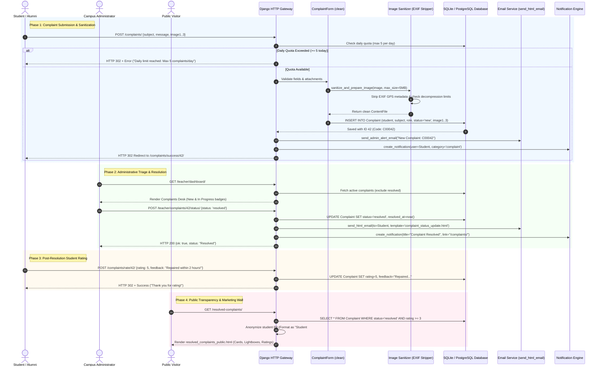

# ABCD Smart Campus — Systems Architecture Manual
## Domain: Anonymous Complaint Engine & Grievance Redressal (`complaints`)

---

### 1. Executive Summary & Capabilities

The **Anonymous Complaint Engine & Grievance Redressal System (`complaints`)** is ABCD Smart Campus’s institutional quality control, facility maintenance, and student feedback channel. Engineered to overcome the hesitation students face when reporting infrastructure or peer issues, the engine allows enrolled students and alumni to submit categorized grievances with photographic evidence while enforcing privacy safeguards, daily submission quotas, image EXIF sanitization, real-time teacher alerts, post-resolution student ratings, and a public transparency showcase.

#### 1.1 Complete Feature Inventory
- **Categorized Grievance Ingestion:**
  - Standardized subject taxonomy covering physical campus facilities and services:
    - **Wi-Fi / Internet:** Connectivity, login portal, bandwidth latency.
    - **Noise / Disturbance:** Reading room decorum, loud conversations, corridor noise.
    - **Cleaning / Housekeeping:** Desk dusting, trash bins, floor mopping.
    - **Washroom / Sanitation:** Water shortage, cleanliness, toiletries.
    - **Lost & Found:** Misplaced study materials, belongings, chargers.
    - **Drinking Water:** Water cooler cooling, filter maintenance, hygiene.
    - **Custom Subject ("Anything else"):** Custom text entry guarded by conditional validation (`custom_subject`).
- **Role-Aware Submission (Student & Alumni Modes):**
  - Adapts to active session role (`current_role` in `['student', 'alumni']`), recording the complainant's institutional status at the moment of filing while provisioning shadow profiles via `_get_or_create_complainant_profile` if alumni lack standard student rows.
- **Evidence Attachment & Privacy Sanitization Pipeline:**
  - Multi-image upload supporting up to 3 photographic attachments (`image1`, `image2`, `image3`).
  - **EXIF Metadata Stripping:** All uploaded images pass through `sanitize_and_prepare_image(max_size_mb=5)` in `users/forms.py`. Strips GPS coordinates, device serials, and timestamps, preventing unintended physical location leaks.
  - **Decompression Bomb Guard:** Enforces Pillow image dimension and byte limits, neutralizing decompression memory exhaustion attacks.
- **Rate-Limiting & Anti-Spam Throttling:**
  - Hard cap of **5 complaints per user per calendar day** (`daily_count >= 5` check against midnight start), preventing denial-of-service spam while exempting campus staff.
- **Administrative Triage & Status Workflow:**
  - Three-stage lifecycle managed from the Teacher Dashboard:
    - `new`: Initial submission; pending administrative inspection.
    - `in_progress`: Under active investigation or vendor repair (e.g., technician called).
    - `resolved`: Rectified; auto-populates `resolved_at` timestamp.
  - Generates unique institutional tracking codes: `C00042` (`code` property formatted as `f"C{self.id:05d}"`).
- **Real-Time Multi-Channel Notification Pipeline:**
  - **On Filing:** Instant HTML alert email dispatched to campus administration (`emails/admin_complaint_raised.html`) + in-app notification confirming receipt.
  - **On Status Transition:** Instant transactional email dispatched to student (`emails/complaint_status_update.html`) + in-app dashboard badge alert.
- **Post-Resolution Rating & Feedback Loop:**
  - Students rate the resolution quality (1 to 5 stars) and submit qualitative feedback via `submit_complaint_rating`.
  - Resolution turnaround duration is dynamically calculated via `timesince(created_at, updated_at)`.
- **Public Grievance Transparency Showcase (`public_resolved_complaints`):**
  - Dedicated public transparency page (`/resolved-complaints/`) displaying successfully resolved issues.
  - **Quality Floor:** Only grievances resolved with **rating ≥ 3 stars** are shown publicly, filtering malicious spam while demonstrating campus responsiveness.
  - **Identity Redaction:** The student's real name, email, roll number, and phone number are completely scrubbed, displaying solely `"Student #<ID>"`.
  - **Live Aggregate API (`complaint_ratings_api`):** JSON endpoint returning average resolution score, total resolved count, and carousel items for the main institutional homepage.

#### 1.2 Security Constraints & Access Control Breakdown
| Security Layer | Enforcing Function / Middleware | Enforcement Mechanism |
| :--- | :--- | :--- |
| **Authentication & Profile Gate** | `student_complaints_view` | Requires `@login_required` and strictly checks that `request.user` possesses an active `StudentProfile` or approved `StudentAchievement`. Rejects unlinked accounts with HTTP 403 Forbidden. |
| **Rate Throttling Guard** | `student_complaints_view` | Queries `Complaint.objects.filter(student=student, created_at__gte=today_start).count()`. Aborts with flash error if count exceeds 5 per day. |
| **EXIF & Image Payload Scrubbing** | `ComplaintForm.clean()` | Passes all files through `sanitize_and_prepare_image()`. Strips camera metadata, GPS tags, validates file format, and limits byte size to 5MB. |
| **Teacher Administrative Gate** | `update_complaint_status_view` / `delete_complaint` | Guarded by `is_teacher(request.user)` and `@user_passes_test(lambda u: u.is_staff)`. Unauthorized attempts return JSON HTTP 403 Forbidden. |
| **Public PII Anonymization** | `resolved_complaints_public.html` | Excludes personal student profile attributes from context and template rendering. Renders pseudo-anonymous tokens (`Student #<ID>`), masking real identities from public visitors and search engine crawlers. |
| **Physical Storage Cleanup** | `delete_complaint` & Django Signals | Physical files on disk or Cloudinary storage for `image1`, `image2`, `image3` are unlinked upon model deletion or replacement. |

---

### 2. Codebase Touchpoints & File Trace

#### 2.1 Database Models Schema Breakdown (`abcd_web/users/models.py`)

```
===================================================================================================
                                  COMPLAINT ENGINE DATA SCHEMA
===================================================================================================

  +--------------------------------+               +--------------------------------------+
  |         StudentProfile         |               |              Complaint               |
  +--------------------------------+               +--------------------------------------+
  | id: AutoField (PK)             | 1           * | id: AutoField (PK)                   |
  | user_id: OneToOne -> User      |<------------->| student_id: FK -> StudentProfile(CAS)|
  | full_name: CharField(150)      |               | role: CharField(10)                  |
  | mobile_number: CharField(15)   |               |   ('student', 'alumni') [def='stud'] |
  | status: CharField(20)          |               | subject: CharField(50) [CHOICES]     |
  | is_admitted: BooleanField      |               |   ('wifi', 'noise', 'cleaning',      |
  +--------------------------------+               |    'washroom', 'lost_found',         |
                                                   |    'water', 'other')                 |
                                                   | custom_subject: CharField(120) [OPT] |
                                                   | message: TextField                   |
                                                   | image1: ImageField ('complaints/')   |
                                                   | image2: ImageField ('complaints/')   |
                                                   | image3: ImageField ('complaints/')   |
                                                   | status: CharField(20) [CHOICES]      |
                                                   |   ('new', 'in_progress', 'resolved') |
                                                   | created_at: DateTimeField            |
                                                   | updated_at: DateTimeField            |
                                                   | resolved_at: DateTimeField [OPT]     |
                                                   | rating: PositiveSmallInt (1-5) [OPT] |
                                                   | feedback: TextField [OPT]            |
                                                   +--------------------------------------+
                                                                      |
                                                                      +--- Computed Properties:
                                                                           * code -> "C00042"
                                                                           * display_subject
```

#### 2.2 Complete File & Endpoint Traceability Table

| Category | File Path | Identifier / Name | Description & Architectural Responsibility |
| :--- | :--- | :--- | :--- |
| **Model** | [users/models.py](file:///B:/ABCD/abcd_web/users/models.py#L674-L759) | `Complaint` | Core complaint entity storing subject taxonomy, evidence image links, status states, rating, feedback, and formatting properties (`code`, `display_subject`). |
| **Form** | [users/forms.py](file:///B:/ABCD/abcd_web/users/forms.py#L449-L508) | `ComplaintForm` | Submission form with clean methods validating conditional `custom_subject` and invoking `sanitize_and_prepare_image` for EXIF scrubbing and 5MB size enforcement. |
| **Form** | [users/forms.py](file:///B:/ABCD/abcd_web/users/forms.py#L510-L530) | `ComplaintRatingForm` | Post-resolution student feedback form capturing 1–5 star ratings and narrative resolution commentary. |
| **View (Student)** | [users/views.py](file:///B:/ABCD/abcd_web/users/views.py#L5131-L5205) | `student_complaints_view` (`/complaints/`) | Main student portal view. Enforces 5-complaint daily quota, validates attachments, sends admin email alerts, and lists student's past complaints. |
| **View (Student)** | [users/views.py](file:///B:/ABCD/abcd_web/users/views.py#L5210-L5230) | `student_complaints_success_view` (`/complaints/success/<id>/`) | Confirmation page rendering tracking code `C00042`, review ETA, and uploaded evidence thumbnails. |
| **View (Rating)** | [users/views.py](file:///B:/ABCD/abcd_web/users/views.py#L5235-L5264) | `submit_complaint_rating` (`/complaints/rate/<id>/`) | Rating submission view. Restricts rating strictly to `status == 'resolved'` items. |
| **View (Teacher)** | [users/views.py](file:///B:/ABCD/abcd_web/users/views.py#L5270-L5318) | `update_complaint_status_view` (`/teacher/complaints/<id>/status/`) | AJAX status update endpoint for instructors. Sets `resolved_at`, triggers student HTML emails, and emits dashboard notifications. |
| **View (Teacher)** | [users/views.py](file:///B:/ABCD/abcd_web/users/views.py#L5434-L5451) | `delete_complaint` (`/teacher/complaint/delete/<id>/`) | Teacher hard-deletion view. Unlinks physical images from storage and deletes complaint row. |
| **View (Public)** | [users/views.py](file:///B:/ABCD/abcd_web/users/views.py#L5418-L5430) | `public_resolved_complaints` (`/resolved-complaints/`) | Public transparency page displaying paginated resolved complaints with `rating >= 3`, anonymizing student PII. |
| **API (Public)** | [users/views.py](file:///B:/ABCD/abcd_web/users/views.py#L5322-L5392) | `complaint_ratings_api` (`/api/complaint-ratings/`) | JSON API returning average rating, resolved counts, and recent verified resolution snippets for the public landing page. |
| **Template** | [users/templates/users/student_complaints.html](file:///B:/ABCD/abcd_web/users/templates/users/student_complaints.html) | Student Filing UI | Responsive submission form with dynamic category selector, evidence file picker, and timeline history table. |
| **Template** | [users/templates/users/student_complaint_success.html](file:///B:/ABCD/abcd_web/users/templates/users/student_complaint_success.html) | Filing Success UI | Receipt screen presenting the tracking ticket code, administrative SLA notice, and uploaded photos. |
| **Template** | [users/templates/users/student_complaint_rate.html](file:///B:/ABCD/abcd_web/users/templates/users/student_complaint_rate.html) | Rating Feedback UI | Post-resolution feedback form with interactive star selector and satisfaction comments. |
| **Template** | [users/templates/users/resolved_complaints_public.html](file:///B:/ABCD/abcd_web/users/templates/users/resolved_complaints_public.html) | Public Showcase UI | Institutional transparency wall showcasing resolved issues, resolution times, student star ratings, and photo lightboxes. |
| **Email Template**| [users/templates/users/emails/admin_complaint_raised.html](file:///B:/ABCD/abcd_web/users/templates/users/emails/admin_complaint_raised.html) | Admin Alert Email | Urgent administrative email alerting teachers to newly submitted student complaints. |
| **Email Template**| [users/templates/users/emails/complaint_status_update.html](file:///B:/ABCD/abcd_web/users/templates/users/emails/complaint_status_update.html) | Student Update Email | Transactional email notifying students when their complaint advances to `In Progress` or `Resolved`. |

---

### 3. Complete Data & Logic Flow Mermaid Diagram



---

### 4. State Machines & Edge Case Logic

#### 4.1 Complaint Redressal Lifecycle State Machine

```
               [Student Files Form]
                         |
                         v
              +---------------------+
              |    Status: 'new'    |
              |   Code: C00042      |
              +---------------------+
                         |
                         | [Teacher Begins Work]
                         v
              +---------------------+
              | Status:             |
              |   'in_progress'     |
              +---------------------+
                         |
                         | [Issue Rectified]
                         v
              +---------------------+
              | Status: 'resolved'  |
              | resolved_at = now() |
              +---------------------+
                         |
                         | [Student Rates Resolution]
                         v
              +---------------------+
              | Rating: 1 to 5 Stars|
              | Qualitative Feedback|
              +---------------------+
                         |
            +------------+------------+
            |                         |
     [Rating >= 3 Stars]       [Rating < 3 Stars]
            |                         |
            v                         v
+-----------------------+   +-----------------------+
| Public Transparency   |   | Internal Review Only  |
| Wall (/resolved-      |   | (Hidden from Public   |
| complaints/)          |   | Showcase)             |
| Anonymized Student #ID|   +-----------------------+
+-----------------------+
```

#### 4.2 Comprehensive Edge Cases & System Handlers

1. **Daily Spam Flooding & Denial of Service:**
   - Handled inside `student_complaints_view`.
   - Before accepting any submission, the view checks `Complaint.objects.filter(student=student, created_at__gte=today_start).count()`.
   - If `daily_count >= 5`, submission is rejected with a user-friendly error message: `"Daily limit reached: You can submit at most 5 complaints per day. Please try again tomorrow."` Campus staff and superusers are exempt.
2. **Decompression Bomb & Malicious Image Uploads:**
   - Students could attempt to upload oversized PNGs or zip-bombs disguised as images.
   - Handled inside `users/forms.py` via `sanitize_and_prepare_image(img_file, max_size_mb=5)`:
     - Enforces a 5MB maximum file size.
     - Strips all EXIF metadata (camera model, software, GPS coordinates) using Pillow.
     - Verifies valid image byte structure, catching decompression bombs before saving to disk.
3. **Dual / Ambiguous Subject Injection:**
   - If a student chooses `'wifi'` but simultaneously fills out the `'custom_subject'` input, `ComplaintForm.clean()` resolves ambiguity:
     ```python
     if subject == Complaint.SUBJECT_OTHER:
         if not custom_subject:
             self.add_error("custom_subject", "Please enter a subject when choosing 'Anything else'.")
     else:
         cleaned["custom_subject"] = ""
     ```
   - Automatically zeroes out manual text when selecting standard categories, keeping database records clean.
4. **Alumni Submissions Without Direct Student Rows:**
   - Alumni users filing complaints might not have an active `StudentProfile`.
   - Handled by `_get_or_create_complainant_profile(user)`:
     - Checks `user.achievements.first()`.
     - Automatically provisions a shadow `StudentProfile` with `status='alumni'` and `is_admitted=False`, preventing foreign key constraint failures.
5. **Orphaned Media Cleanup on Hard Deletion:**
   - When a teacher deletes a complaint via `delete_complaint`, attached files could linger on disk.
   - The deletion view explicitly loops over `image1`, `image2`, and `image3`:
     ```python
     for img_field in (complaint.image1, complaint.image2, complaint.image3):
         if img_field:
             img_field.delete(save=False)
     complaint.delete()
     ```
   - Clears physical files from storage immediately.

---

### 5. User Journey & Feature Step-by-Step

#### 5.1 Student Journey: Filing, Tracking & Rating
1. **Navigating to the Complaint Desk:**
   - The student logs in and clicks **"Complaints"** from the sidebar (`/complaints/`).
   - The welcome banner displays their quota and past complaint history.
2. **Filling Out the Grievance Form:**
   - The student selects **"Wi-Fi / Internet issue"** from the dropdown.
   - They enter details: *"Ground floor reading hall Wi-Fi disconnects frequently during video lectures."*
   - They attach a screenshot of the speed test (`image1`).
   - The form strips GPS tags and submits to `/complaints/`.
3. **Confirmation & Receipt:**
   - The student is redirected to `/complaints/success/<id>/`.
   - The screen confirms tracking code `C00042` and notifies them that an administrator has been alerted.
4. **Receiving Status Updates:**
   - Two hours later, a technician fixes the router. The teacher marks the ticket `In progress`, then `Resolved`.
   - The student receives an in-app banner and transactional email (`emails/complaint_status_update.html`).
5. **Submitting Feedback:**
   - The student clicks the alert and opens `/complaints/rate/42/`.
   - They select **5 Stars** and leave feedback: *"Resolved very quickly, Wi-Fi speed is excellent now!"*
   - Because the rating is 5 stars, the resolved complaint is automatically approved for the public transparency wall.

#### 5.2 Teacher Journey: Triage, Investigation & Public Showcase
1. **Admin Alert & Dashboard Inspection:**
   - The teacher receives an email (`emails/admin_complaint_raised.html`) with subject *"New Complaint: Wi-Fi / Internet issue"*.
   - They open the **Complaints** drawer on `/teacher/dashboard/`.
2. **Investigation & Status Transitions:**
   - The teacher inspects the attached screenshot, identifies the router issue, and changes status to `In progress`.
   - Once resolved, they select `Resolved` from the status dropdown.
   - The system triggers an AJAX call to `/teacher/complaints/42/status/`, stamping `resolved_at=timezone.now()`.
3. **Public Transparency Showcase:**
   - Prospective students and parents visit `/resolved-complaints/`.
   - They see ticket `C00042` with 5 stars and student feedback, but the complainant's name is anonymized to `"Student #18"`.

---

### 6. Video Script Anchor Points

For architectural demos, stakeholder presentations, or system walkthroughs, use these timestamped talking points and visual focal areas:

| Timestamp | Screen / Visual State | Anchor Script & Architectural Commentary |
| :--- | :--- | :--- |
| **00:00 – 01:15** | `/complaints/` (Student Complaint Box) | *"Here is the ABCD Smart Campus Grievance Redressal Engine. Designed for psychological safety, students can file infrastructure, peer, or facility complaints without fear of reprisal. Notice the spam protection: our backend enforces an automated 5-complaint daily quota per student to prevent griefing."* |
| **01:15 – 02:30** | Attachment Upload & Form Validation | *"When attaching photos, privacy is critical. Our backend image pipeline strips all EXIF metadata, GPS coordinates, and camera serials on upload using Pillow. Furthermore, decompression bomb guards restrict file byte streams to 5MB, neutralizing memory-exhaustion exploits."* |
| **02:30 – 03:45** | `/teacher/dashboard/` (Complaints Drawer) | *"On the teacher dashboard, complaints are triaged in real time. Instructors can filter by New or In-Progress status, inspect uploaded photos, and update resolution states via AJAX. Every status transition triggers automated transactional emails and in-app alerts to the student."* |
| **03:45 – 04:45** | `/complaints/rate/<id>/` (Student Rating Modal) | *"Once an issue is resolved, students rate the resolution quality from 1 to 5 stars. Turnaround duration is automatically logged, giving campus leadership clear metrics on facility maintenance response times."* |
| **04:45 – 06:00** | `/resolved-complaints/` (Public Showcase) | *"Finally, our public transparency wall at `/resolved-complaints/` showcases resolved grievances to prospective students. To protect student dignity, personal information is pseudo-anonymized as 'Student #ID'. Only grievances resolved with 3 stars or higher are displayed publicly, turning resolved feedback into proof of administrative accountability."* |
