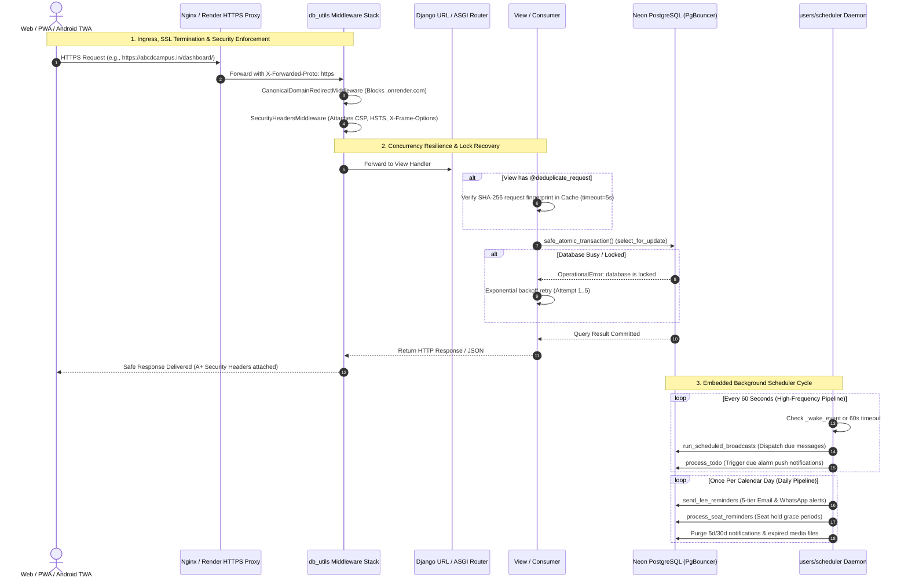

# ABCD Smart Campus — Core Platform & Infrastructure Architecture Manual

> **Domain:** Core Infrastructure, Security Layer, Asynchronous Runtime & Platform Engineering  
> **Target Audience:** Principal Systems Architects, DevOps/SRE Engineers, Platform Developers  
> **Status:** Production-Ready & Formally Audited  
> **Associated Apps:** `abcd_web/`, `abcd_web/users/`, `static/`, `templates/`

---

## 1. Executive Summary & Capabilities

The **Core Platform & Infrastructure** subsystem forms the foundational operating environment of ABCD Smart Campus. It powers all domain subsystems (Library, Fees, Courses, Mentorship, Complaints, Productivity, Hall of Fame, and CRM) with enterprise-grade resilience, high-concurrency database shielding, zero-crash exception trapping, asynchronous real-time WebSockets, and PWA/TWA offline capabilities.

Designed to operate seamlessly on production cloud environments (such as Render, Railway, or VPS) without requiring external paid worker dynos, the platform embeds an **In-Memory Background Scheduler Daemon**, a **Strict Security Middleware Pipeline (A+ rating)**, and a **Neon PostgreSQL PgBouncer Connection Pooler Bridge**.

```
                       ┌────────────────────────────────────────────────────────┐
                       │          ABCD SMART CAMPUS RUNTIME TOPOLOGY            │
                       └────────────────────────────────────────────────────────┘
                                                   │
         ┌─────────────────────────────────────────┴─────────────────────────────────────────┐
         ▼                                                                                   ▼
  [ASGI PROTOCOL ROUTER]                                                              [WSGI COMPATIBILITY]
  • Daphne HTTP & WebSocket Engine                                                    • Synchronous Fallback
  • AuthMiddlewareStack (Session / Auth)                                              • Django 5.2 Core
         │                                                                                   │
         ├─────────────────────────────────────────┬─────────────────────────────────────────┘
         ▼                                         ▼
  [SECURITY & RESILIENCE MIDDLEWARES]       [PERSISTENT INFRASTRUCTURE]
  • SecurityHeadersMiddleware (CSP, HSTS)   • Neon PostgreSQL (PgBouncer Pooled)
  • GlobalCrashPreventionMiddleware         • Cloudinary Media CDN (Smart Storage)
  • CanonicalDomainRedirectMiddleware       • WhiteNoise Compressed Manifest (Static)
  • GZip Dynamic Compression Engine         • Redis Channel Layer / RAM Cache
         │                                         │
         └────────────────────┬────────────────────┘
                              │
                              ▼
               [EMBEDDED AUTOMATION & PWA LAYER]
               • In-Memory Scheduler Daemon (60s High-Freq / Daily Rollover)
               • Zero-DB Uptime Watchdog (/healthz, /api/cron/maintenance/)
               • Root-Scoped Service Worker (/sw.js) with TWA IndexedDB Bridge
```

### Core Features & Capabilities

1. **Protocol Multiplexing & Asynchronous WebSocket Mesh:**
   - Powered by **Daphne** and **Django Channels 4** via `abcd_web/asgi.py`.
   - Distributes real-time events over Redis (`channels_redis.core.RedisChannelLayer`) with zero-downtime fallback to `InMemoryChannelLayer`.
   - Distinct consumer routing across 1-to-1/Group Mentorship Chat (`ws/guidy/chat/`), Notifications & Presence (`ws/guidy/notifications/`), and Public Seat Maps (`ws/seat-updates/`).

2. **High-Resilience Concurrency & Zero-Crash Shield:**
   - **`GlobalCrashPreventionMiddleware`:** Automatically traps database lock exceptions (`OperationalError`), performing exponential backoff retries (up to 5 attempts) and rolling back atomic blocks safely to prevent 500 crashes.
   - **`safe_atomic_transaction` & `retry_on_db_lock`:** Custom ORM decorators protecting transactional pipelines against database locks.
   - **`deduplicate_request(timeout=5)`:** SHA-256 fingerprinting of `user_id | path | method | body` to intercept and drop rapid multi-click submissions.

3. **A+ Grade Security & SEO Infrastructure:**
   - **`SecurityHeadersMiddleware`:** Enforces strict Content-Security-Policy (CSP), Permissions-Policy, Referrer-Policy, HSTS (`max-age=31536000; includeSubDomains; preload`), and clickjacking protection (`X-Frame-Options: SAMEORIGIN`).
   - **`CanonicalDomainRedirectMiddleware`:** Enforces canonical domain `https://abcdcampus.in` via 301 Permanent Redirects for all staging or `.onrender.com` URLs (exempting health check endpoints).

4. **Neon PostgreSQL PgBouncer Connection Optimization:**
   - Auto-detects Neon serverless database endpoints and dynamically injects `-pooler` subdomains.
   - Automatically sets `conn_max_age = 0` when connecting via transaction pooling, preventing worker restarts from exhausting backend Postgres slots.
   - Ephemeral disk wipe protection: Raises `ImproperlyConfigured` on startup if running in production without `DATABASE_URL`.

5. **24/7 Embedded Scheduler Daemon (`users/scheduler.py`):**
   - In-process background worker running inside the main Daphne web dyno without requiring expensive secondary processes.
   - High-frequency pipeline (60s tick): Broadcast delivery, To-Do alarm polling, offline learning reminders, and smart auto-replies.
   - Daily maintenance pipeline: 5-tier fee reminders, 4-stage seat hold lifecycles, birthday wishes, and 5-day / 30-day automated storage cleanup.
   - Adaptive RAM wake-up events (`notify_scheduler_task_changed()`) waking the thread instantly when new time-sensitive tasks are created.

6. **Full PWA & Trusted Web Activity (TWA) Integration:**
   - Root-scoped Service Worker served at `/sw.js` with `Service-Worker-Allowed: /`.
   - Android TWA verification via `/.well-known/assetlinks.json` with embedded SHA-256 keystore fingerprints.
   - IndexedDB native alarm synchronization (`abcd_sw_state`) preventing duplicate alerts on devices running both native alarms and web push notifications.

---

## 2. Codebase Touchpoints & File Trace

### Relational Schema & Runtime Core Topology

```
+------------------------------------------------------------------------------------+
|                                    abcd_web/asgi.py                                |
+------------------------------------------------------------------------------------+
| ProtocolTypeRouter: 'http' -> django_asgi_app, 'websocket' -> AuthMiddlewareStack  |
+------------------------------------------------------------------------------------+
                                           │
         ┌─────────────────────────────────┴─────────────────────────────────┐
         ▼                                                                   ▼
+----------------------------------+               +---------------------------------+
|        users/routing.py          |               |       abcd_web/settings.py      |
+----------------------------------+               +---------------------------------+
| ws/guidy/chat/ -> GuidyConsumer  |               | MIDDLEWARE, DATABASES, STORAGES |
| ws/guidy/notif/ -> NotifConsumer |               | CHANNEL_LAYERS, CACHES, LOGGING |
| ws/seat-updates/ -> SeatConsumer |               | SECURITY HEADERS, PWA / VAPID   |
+----------------------------------+               +---------------------------------+
                                                                     │
         ┌───────────────────────────────────────────────────────────┴─────────────────┐
         ▼                                                                             ▼
+------------------------------------+                               +---------------------------------+
|         users/db_utils.py          |                               |        users/scheduler.py       |
+------------------------------------+                               +---------------------------------+
| GlobalCrashPreventionMiddleware    |                               | Embedded Background Daemon      |
| SecurityHeadersMiddleware          |                               | High-Frequency Cycle (60s)      |
| CanonicalDomainRedirectMiddleware  |                               | Daily Maintenance Pipeline      |
| safe_atomic_transaction()          |                               | RAM Wake Event (_wake_event)    |
| retry_on_db_lock()                 |                               | run_scheduler_cycle()           |
| deduplicate_request()              |                               +---------------------------------+
+------------------------------------+                                                 │
                                                                                       ▼
                                                                     +---------------------------------+
                                                                     |       users/management/cmd/     |
                                                                     +---------------------------------+
                                                                     | run_scheduled_broadcasts        |
                                                                     | process_todo                    |
                                                                     | process_seat_reminders          |
                                                                     | send_fee_reminders              |
                                                                     | process_visitor_reminders       |
                                                                     | cleanup_notifications / media   |
                                                                     +---------------------------------+
```

### Complete File & Endpoint Traceability Table

| File / Route | Component | Type / Class | Auth / Scope | Purpose & Production Impact |
| :--- | :--- | :--- | :--- | :--- |
| `abcd_web/settings.py` | Platform Config | Django Core Settings | Environment | Central configuration for DB pooling, Cloudinary, WhiteNoise, VAPID, and Security. |
| `abcd_web/asgi.py` | ASGI Entry Point | `ProtocolTypeRouter` | Root Gateway | Routes incoming connections between Daphne HTTP and asynchronous WebSocket consumers. |
| `users/routing.py` | WebSocket Router | URL Patterns | ASGI | Dispatches WebSocket connections to `GuidyChatConsumer`, `NotificationConsumer`, and `PublicSeatUpdateConsumer`. |
| `users/db_utils.py` | Core Utilities | Middlewares & Helpers | Request Lifecycle | Contains `GlobalCrashPreventionMiddleware`, `SecurityHeadersMiddleware`, and `safe_atomic_transaction`. |
| `users/scheduler.py` | Background Engine | Threading Daemon | In-Memory (RAM) | 24/7 background scheduler managing 60-second broadcast/todo tasks and daily maintenance. |
| `users/context_processors.py` | Global Context | `student_context` | Global Templates | Evaluates user roles, unread notification counts, and base template mapping (`student_dashboard`, etc.). |
| `static/sw.js` | Service Worker | JavaScript PWA Worker | Root (`/`) | Handles offline asset caching, RFC 8030 web push payloads, app badging, and TWA alarm sync. |
| `/sw.js` | `service_worker_view` | HTTP GET | Public | Serves `static/sw.js` at root scope with `Service-Worker-Allowed: /` and no-cache headers. |
| `/.well-known/assetlinks.json` | `assetlinks_json_view` | HTTP GET | Public | Serves Google Play Store and Android TWA SHA-256 digital verification fingerprints. |
| `/healthz`, `/health`, `/ping` | `ping_view` | HTTP GET | Public | Zero-database keep-alive endpoint (~30 bytes) for UptimeRobot monitoring. |
| `/api/cron/maintenance/` | `cron_maintenance_view` | HTTP GET / Webhook | Staff / Bearer Key | External cron webhook (/cron-job.org) triggering scheduler cycles or RAM health checks. |
| `/api/diag/email-test/` | `email_diagnostics_view` | HTTP GET | Staff Only | Validates production SMTP and IPv4 network connectivity in real time. |

---

## 3. Complete Data & Logic Flow Mermaid Diagram



---

## 4. State Machines & Edge Case Logic

### Application Concurrency & Lock Resolution State Machine

```
               ┌───────────────────────────┐
               │     INCOMING REQUEST      │
               └───────────────────────────┘
                             │
                             ▼
               ┌───────────────────────────┐
               │    DEDUPLICATION CHECK    │
               │ (Cache SHA-256 hash lock) │
               └───────────────────────────┘
                      │             │
        Already       │             │ Unique
        Processing    │             │ Request
                      ▼             ▼
         ┌────────────────┐    ┌───────────────────────────────────┐
         │  DROP REQUEST  │    │      EXECUTE VIEW TRANSACTION     │
         │ (HTTP 429 Dup) │    └───────────────────────────────────┘
         └────────────────┘                      │
                                                 ▼
                                ┌───────────────────────────────────┐
                                │     DATABASE TRANSACTION RUN      │
                                └───────────────────────────────────┘
                                       │                     │
                        Success        │                     │ OperationalError
                        Committed      │                     │ (DB Lock)
                                       ▼                     ▼
                        ┌────────────────────┐ ┌───────────────────────────┐
                        │  DELIVER RESPONSE  │ │ EXPONENTIAL BACKOFF RETRY │
                        │ (A+ Headers Stamped│ │ (Delay = 0.05s * 2^attempt│
                        └────────────────────┘ └───────────────────────────┘
                                                             │
                                              Attempt <= 5   │   Attempt > 5
                                              (Retry)        │   (Exhausted)
                                                             │
                                                             ▼
                                               ┌───────────────────────────┐
                                               │ GLOBAL CRASH INTERCEPTOR  │
                                               │ • Transaction Rollback    │
                                               │ • Graceful 503 / Redirect │
                                               │ • ZERO Unhandled Crashes  │
                                               └───────────────────────────┘
```

### Critical Edge Cases & Architectural Defenses

1. **Neon PostgreSQL PgBouncer Pooler Exhaustion:**
   - *Problem:* Neon serverless instances operate on strict direct connection limits. If Daphne workers or Celery tasks use persistent database connections (`CONN_MAX_AGE > 0`), all available connection slots are quickly locked.
   - *Defense:* `settings.py` auto-detects `neon.tech` connection strings, automatically swaps the host for the `-pooler` connection pool, and sets `conn_max_age = 0` so pooled connections are returned to the pooler immediately upon query completion.

2. **Ephemeral Cloud Storage Data Wipe Safeguard:**
   - *Problem:* Container platforms (like Render) employ ephemeral file systems. Running SQLite or storing user uploads on local disk in production results in total data loss upon dyno restart.
   - *Defense:* `settings.py` checks `os.environ.get('RENDER')`. If `DATABASE_URL` is omitted in production, it immediately raises `ImproperlyConfigured` and halts deployment. Uploaded student media routes through `SmartMediaCloudinaryStorage`, ensuring physical assets persist on Cloudinary CDN.

3. **Background Scheduler Thread Relay Safety:**
   - *Problem:* When running under development reloader (`manage.py runserver`) or multi-worker WSGI, background threads can spawn multiple duplicate instances, causing double emails and duplicate cron alerts.
   - *Defense:* `users/scheduler.py` uses thread-safe singleton initialization with `_scheduler_lock`. If `_scheduler_started` is already `True`, subsequent initialization calls return immediately.

4. **SEO Duplicate Content & Host Canonicalization:**
   - *Problem:* Search engine web crawlers indexing staging domains (`*.onrender.com`) flag the production site (`https://abcdcampus.in`) for duplicate content penalties.
   - *Defense:* `CanonicalDomainRedirectMiddleware` inspects `request.get_host()`. Any traffic ending in `.onrender.com` is immediately issued an HTTP 301 Permanent Redirect to `https://abcdcampus.in{full_path}`.

5. **TWA On-Device Alarm vs. Web Push Conflict:**
   - *Problem:* When an Android student has native alarms scheduled via the Android app's `AlarmManager`, an incoming Web Push for the same reminder would cause redundant double alarms.
   - *Defense:* The Service Worker (`static/sw.js`) queries its local IndexedDB store (`TWA_NATIVE_TASKS_KEY`). If the task is confirmed as natively scheduled with exact timing (`task.exact === true`), the background push alert is silently suppressed.

---

## 5. User Journey & Feature Step-by-Step

### Journey 1: Anonymous Web Visitor to Secure Authenticated Session

```
1. Visitor navigates to http://abcd-web-platform.onrender.com/
   ├── CanonicalDomainRedirectMiddleware intercepts request
   └── Returns HTTP 301 Redirect to https://abcdcampus.in/
2. Browser connects to https://abcdcampus.in/
   ├── SecurityHeadersMiddleware enforces HSTS, CSP, and X-Frame-Options
   ├── WhiteNoise serves compressed CSS/JS assets (Cache-Control: max-age=1 year)
   └── Page automatically installs Service Worker via /sw.js
3. Visitor clicks "Sign in with Google":
   ├── Social Auth pipeline executes (social_auth.google-oauth2)
   ├── Pipeline links existing user by email via link_existing_account_by_email
   └── Authenticated session created with SESSION_COOKIE_SECURE = True
```

### Journey 2: Zero-DB Health Check & Uptime Monitoring

```
1. UptimeRobot or health monitor pings https://abcdcampus.in/healthz
   ├── CanonicalDomainRedirectMiddleware identifies exempted path
   ├── Request bypasses database entirely (Zero DB queries)
   └── ping_view returns instant JSON: {"status": "ok", "uptime": "active"} (~30 bytes)
2. Cron-Job.org pings https://abcdcampus.in/api/cron/maintenance/?mode=high_frequency
   ├── Endpoint authenticates CRON_SECRET token
   ├── Inspects in-memory scheduler health: get_scheduler_status()
   └── Returns {"status": "standby", "db_queried": false} with zero PostgreSQL load
```

### Journey 3: Autonomous Daily Maintenance Execution

```
1. Midnight date rollover occurs in Asia/Kolkata timezone
2. Scheduler daemon detects rollover and enters execute_daily_tasks():
   ├── Task 1: process_seat_reminders executes seat hold grace periods and auto-promotions
   ├── Task 2: send_fee_reminders calculates 5-tier fee expiry alerts (WhatsApp + Email)
   ├── Task 3: process_visitor_reminders evaluates lead drip emails
   ├── Task 4: process_birthday_wishes dispatches personalized greetings
   └── Task 5: cleanup_notifications purges read notifications older than 5 days
3. Stale database connections safely closed via close_old_connections()
```

---

## 6. Video Script Anchor Points

| Timestamp | Visual / Screen Focus | Script Narration & Architectural Anchor |
| :--- | :--- | :--- |
| **00:00 - 00:45** | Cloud architecture diagram showing Daphne, PostgreSQL, Redis, and Cloudinary. | *"Welcome to the Core Platform & Systems Architecture of ABCD Smart Campus. This infrastructure layer is engineered for enterprise reliability, powering our multi-tenant campus portal with zero-downtime resilience, asynchronous WebSockets, and A+ security."* |
| **00:45 - 01:30** | Inspecting HTTP response headers in browser DevTools showing CSP and HSTS. | *"Security is enforced at every layer. Our custom SecurityHeadersMiddleware automatically attaches comprehensive Content-Security-Policies, Permissions Policies, and HSTS headers, while our canonical redirect engine shields search engine reputation."* |
| **01:30 - 02:15** | Code view of `GlobalCrashPreventionMiddleware` and `safe_atomic_transaction`. | *"High traffic demands uncompromising stability. Our global crash prevention engine wraps database transactions in an exponential backoff retry loop, rolling back atomic blocks safely and preventing 500 crashes during peak admission rushes."* |
| **02:15 - 03:00** | Terminal logs showing the embedded background scheduler daemon ticking. | *"Automation runs entirely in-process. Rather than relying on expensive external worker dynos, our embedded scheduler daemon coordinates 60-second broadcast dispatches and daily fee/seat lifecycles with adaptive RAM wake events."* |
| **03:00 - 03:45** | Demonstrating PWA install prompt, service worker caching, and TWA assetlinks. | *"Finally, our Progressive Web App layer turns the entire platform into an installable mobile application. With root-scoped Service Workers and Digital Asset Links, students enjoy instant offline caching and native Android integration."* |
