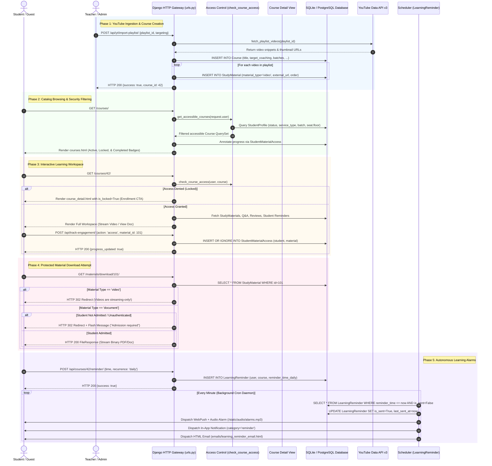

# ABCD Smart Campus — Systems Architecture Manual
## Domain: Course Hub & Study Material Management (`course_hub`)

---

### 1. Executive Summary & Capabilities

The **Course Hub & Study Material Management System (`course_hub`)** is ABCD Smart Campus’s digital academic repository, video streaming engine, and student learning engagement suite. It unifies YouTube API v3 synchronization, multi-format study material delivery, fine-grained multi-tier audience targeting, student progress auditing, peer Q&A discussion boards, course rating/review engines, and persistent learning study alarms.

#### 1.1 Complete Feature Inventory
- **Multi-Source Course Catalog & Ingestion:**
  - **YouTube Playlist Sync:** Automated one-click ingestion of full channel playlists via YouTube Data API v3 (`users/youtube_service.py`), creating corresponding `Course` and child `StudyMaterial` video items.
  - **Custom Curated Video Courses:** Multi-video picker allowing teachers to select individual uploaded channel videos, reorder them, assign custom artwork, and bundle them into cohesive custom syllabi (`yt_create_custom_course_api`).
  - **Multi-Format Study Material Management:** Supports PDF notes, Word docs, spreadsheets, slides, Google Drive embed/preview URLs, raw video files, YouTube streams, Vimeo, DailyMotion, Loom, and external web links (`StudyMaterial.material_type` in `['video', 'document', 'image', 'link']`).
- **Granular Multi-Tier Audience Access Matrix:**
  - Precise targeting engine evaluated at request runtime via `get_accessible_courses()` and `check_course_access()`:
    - **Public / Guest (`target_public=True`):** Visible and accessible to all visitors, unregistered guests, and pending applicants.
    - **Coaching Specific (`target_coaching=True`):** Restricted to enrolled students (`status='admitted'`) with service `Coaching` or `Both`, filterable down to comma-separated specific batches (`target_coaching_batches` e.g., `"all"`, `"Morning-A"`, `"Target-2026"`).
    - **Library Specific (`target_library=True`):** Restricted to enrolled students (`status='admitted'`) with service `Library` or `Both`, filterable down to specific library floors (`target_library_floors` e.g., `"both"`, `"Floor 1"`, `"Floor 2"`).
    - **Alumni Network (`target_alumni=True`):** Restricted to verified alumni with `StudentAchievement` (`status='approved'`).
    - **Private / Internal (`target_private=True`):** Completely hidden from public catalogs, reserved strictly for instructors and campus administrators.
- **Interactive Student Engagement & Progress Tracking:**
  - **Progress Bar & Completion Engine:** Tracks unique student item consumption via `StudentMaterialAccess` (`first_accessed`, `last_accessed`). Automatically calculates dynamic percentage completion (`progress_percent = (completed_count / total_materials) * 100`).
  - **Personal Course Organization:** Student lifecycle toggles for **Favorites** (`is_favorite`) and **Archived** (`is_archived`) stored in `StudentCourseInteraction`. Catalog tabs (`?tab=all`, `?tab=favorites`, `?tab=archived`) isolate curriculum views.
  - **Engagement Analytics & Leaderboard:** Real-time analytics tracking course shares (`CourseShare`) across WhatsApp and native channels, alongside per-material unique student viewership leaderboards (`teacher_course_preview_view`).
- **Interactive Peer & Instructor Q&A System:**
  - Hierarchical, threaded discussion forum per course.
  - Students and teachers post top-level inquiries (`CourseQuestion`) optionally linked to specific study materials (`StudyMaterial`).
  - Nested replies and official instructor responses (`CourseAnswer.is_teacher_answer=True`).
  - Community upvoting matrix (`upvotes` Many-to-Many on Questions and Answers) and resolution toggle (`is_resolved`).
- **Student Reviews & Five-Star Rating Engine:**
  - Authenticated and guest rating mechanism (`CourseReview` with 1–5 star ratings and narrative commentary).
  - Aggregate statistics rendering 5-star distribution breakdowns, average rating score calculation, and review counts.
- **Persistent Multi-Channel Learning Alarms & Reminders:**
  - Study scheduling engine (`LearningReminder`) supporting one-time scheduled alarms (`reminder_time`) and recurring study slots (`daily`, `weekly`, `custom` days of the week).
  - Dispatches browser notifications, native Android push notifications, sound-effects (`/static/audio/alarms and reminders.mp3`), in-app alerts (`Notification`), and responsive HTML study emails (`emails/learning_reminder_email.html`).
- **Strict Content Protection & Anti-Scraping Guards:**
  - Direct raw video downloads are strictly blocked at the HTTP layer (`download_study_material_view`). Videos are locked to streaming-only embeds (`FileResponse` rejected for `material_type='video'`).
  - Document downloads strictly verify student admission status (`StudentProfile.status == 'admitted'`). Unenrolled or pending students are blocked with warning flash messages.

#### 1.2 Security Constraints & Access Control Breakdown
| Security Layer | Enforcing Function / Middleware | Enforcement Mechanism |
| :--- | :--- | :--- |
| **Course Access Control** | `check_course_access(user, course)` | Evaluates user authentication, role (`is_staff`, `is_superuser`), admission status (`admitted` vs `pending`), and profile attributes (`service_type`, `batch`, `floor`) against course targeting flags (`target_public`, `target_coaching`, `target_library`, `target_alumni`, `target_private`). |
| **Material Download Guard** | `download_study_material_view` | Blocks non-authenticated users, blocks pending students, prevents direct video binary scraping by redirecting `video` types to the streaming viewer, and streams authorized documents via secure `FileResponse`. |
| **Teacher Administrative Gate** | `@user_passes_test(is_teacher)` / `request.user.is_staff` | Guarantees that only authorized instructors or campus administrators can invoke sync wizards, modify syllabus ordering, delete courses, or upload study notes. |
| **Idempotent Reminder Claims** | `process_offline_learning_reminders()` | Executes atomic conditional `.update(is_sent=True, last_sent_at=now)` on un-sent reminder rows to prevent duplicate email or push notifications across concurrent worker cycles. |
| **Q&A Moderation Guard** | `delete_qa_item(request)` | Authorizes deletion only if `request.user.is_staff` or if the requesting user is the original author of the question/answer. |

---

### 2. Codebase Touchpoints & File Trace

#### 2.1 Database Models Schema Breakdown (`abcd_web/users/models.py`)

```
===================================================================================================
                                   COURSE HUB DATA SCHEMA
===================================================================================================

  +--------------------------------+               +--------------------------------------+
  |         CourseCategory         |               |                Course                |
  +--------------------------------+               +--------------------------------------+
  | id: AutoField (PK)             | 1           * | id: AutoField (PK)                   |
  | name: CharField(100) [UQ]      |<------------->| category_id: FK -> CourseCategory    |
  | slug: SlugField [UQ]           |               | title: CharField(255)                |
  | order: PositiveIntegerField    |               | playlist_id: CharField(200) [UQ,OPT] |
  | is_active: BooleanField        |               | description: TextField               |
  +--------------------------------+               | video_url: URLField                  |
                                                   | is_active: BooleanField              |
                                                   | created_by_id: FK -> User            |
                                                   | created_at: DateTimeField            |
                                                   | video_count: PositiveIntegerField    |
                                                   | video_ids: TextField (CSV YT IDs)    |
                                                   | last_synced_at: DateTimeField        |
                                                   | thumbnail: ImageField                |
                                                   | target_public: BooleanField (def=T)  |
                                                   | target_coaching: BooleanField (def=F)|
                                                   | target_coaching_batches: TextField   |
                                                   | target_alumni: BooleanField (def=F)  |
                                                   | target_library: BooleanField (def=F) |
                                                   | target_library_floors: TextField     |
                                                   | target_private: BooleanField (def=F) |
                                                   +--------------------------------------+
                                                                      |
                   +--------------------------------------------------+--------------------------------------+
                   |                        |                         |                                      |
                   | 1                      | 1                       | 1                                    | 1
                   v *                      v *                       v *                                    v *
  +--------------------------------+  +---------------------+  +----------------------+  +-----------------------------------+
  |         StudyMaterial          |  |    CourseReview     |  |     CourseShare      |  |     StudentCourseInteraction      |
  +--------------------------------+  +---------------------+  +----------------------+  +-----------------------------------+
  | id: AutoField (PK)             |  | id: AutoField (PK)  |  | id: AutoField (PK)   |  | id: AutoField (PK)                |
  | course_id: FK -> Course (CAS)  |  | course_id: FK(CAS)  |  | course_id: FK(CAS)   |  | student_id: FK -> StudentProfile  |
  | title: CharField(200)          |  | student_id: FK(STN) |  | student_id: FK(SETN) |  | course_id: FK -> Course (CAS)     |
  | file: FileField [OPT]          |  | rating: SmallInt(1-5|  | platform: CharField  |  | is_favorite: BooleanField (def=F) |
  | external_url: URLField [OPT]   |  | comment: TextField  |  | created_at: DateTime |  | is_archived: BooleanField (def=F) |
  | uploaded_by_id: FK -> User     |  | guest_name: Char(100|  +----------------------+  | updated_at: DateTimeField         |
  | material_type: CharField(20)   |  | created_at: DateTime|                            | [UQ: (student_id, course_id)]     |
  |   ('video','document',         |  +---------------------+                            +-----------------------------------+
  |    'image','link')             |
  | order: PositiveIntegerField    |               +--------------------------------------+  +-------------------------------+
  | thumbnail: ImageField [OPT]    |               |            CourseQuestion            |  |       LearningReminder        |
  | is_public: BooleanField        |               +--------------------------------------+  +-------------------------------+
  | description: TextField [OPT]   | 1           * | id: AutoField (PK)                   |  | id: AutoField (PK)            |
  | created_at: DateTimeField      |<------------->| course_id: FK -> Course (CAS)        |  | user_id: FK -> User (CAS)     |
  +--------------------------------+               | student_id: FK -> StudentProfile     |  | course_id: FK -> Course (CAS) |
             |                                     | material_id: FK -> StudyMaterial(OPT)|  | title: CharField(200)         |
             | 1                                   | question: TextField                  |  | reminder_time: DateTime [OPT] |
             v *                                   | is_resolved: BooleanField            |  | recurrence_type: CharField    |
  +-------------------------------------+          | upvotes: M2M -> User                 |  |   ('once','daily',            |
  |        StudentMaterialAccess        |          | created_at, updated_at: DateTime     |  |    'weekly','custom')         |
  +-------------------------------------+          +--------------------------------------+  | reminder_time_daily: TimeField|
  | id: AutoField (PK)                  |                             | 1                    | days_of_week: CharField(CSV)  |
  | student_id: FK -> StudentProfile    |                             v *                    | is_sent: BooleanField (def=F) |
  | material_id: FK -> StudyMaterial    |          +--------------------------------------+  | last_sent_at: DateTimeField   |
  | first_accessed: DateTimeField       |          |             CourseAnswer             |  | created_at: DateTimeField     |
  | last_accessed: DateTimeField        |          +--------------------------------------+  +-------------------------------+
  | [UQ: (student_id, material_id)]     |          | id: AutoField (PK)                   |
  +-------------------------------------+          | question_id: FK -> CourseQuestion    |
                                                   | user_id: FK -> User (SET_NULL)       |
                                                   | parent_id: FK -> self (replies)      |
                                                   | answer_text: TextField               |
                                                   | is_teacher_answer: BooleanField      |
                                                   | upvotes: M2M -> User                 |
                                                   | created_at: DateTimeField            |
                                                   +--------------------------------------+
```

#### 2.2 Complete File & Endpoint Traceability Table

| Category | File Path | Identifier / Name | Description & Architectural Responsibility |
| :--- | :--- | :--- | :--- |
| **Model** | [users/models.py](file:///B:/ABCD/abcd_web/users/models.py#L768-L868) | `CourseCategory`, `Course` | Core catalog taxonomy and course entities containing YouTube metadata, syllabus counters, and audience target flags. |
| **Model** | [users/models.py](file:///B:/ABCD/abcd_web/users/models.py#L869-L991) | `StudyMaterial` | Multi-format curriculum items supporting video streaming links, uploaded binaries, Google Drive embed derivation, and sequence orders. |
| **Model** | [users/models.py](file:///B:/ABCD/abcd_web/users/models.py#L2175-L2236) | `CourseQuestion`, `CourseAnswer`, `CourseReview` | Peer Q&A discussion board, instructor verified replies, upvoting graph, and 5-star student review aggregator. |
| **Model** | [users/models.py](file:///B:/ABCD/abcd_web/users/models.py#L2241-L2326) | `CourseShare`, `StudentMaterialAccess`, `StudentCourseInteraction`, `LearningReminder` | Learning analytics, completion tracking, personal library state (favorites/archived), and study alarm schedule storage. |
| **Service** | [users/youtube_service.py](file:///B:/ABCD/abcd_web/users/youtube_service.py#L1-L102) | `get_youtube_client`, `fetch_playlists`, `fetch_playlist_videos`, `fetch_channel_videos` | Low-level Google API Client wrapper with token pagination and upload-playlist extraction. |
| **Service** | [users/utils.py](file:///B:/ABCD/abcd_web/users/utils.py#L265-L350) | `sync_courses_from_youtube`, `get_playlist_videos_for_course` | Automated channel playlist ingestion, caching, and YouTube thumbnail multi-resolution downloader. |
| **Worker** | [users/utils.py](file:///B:/ABCD/abcd_web/users/utils.py#L1477-L1570) | `process_offline_learning_reminders` | Background scheduler worker dispatching audio alerts, in-app notifications, and HTML emails for due study reminders. |
| **View (Student)** | [users/views.py](file:///B:/ABCD/abcd_web/users/views.py#L526-L617) | `courses_view` (`/courses/`) | Main public/student course catalog. Evaluates access permissions, filters favorites/archived, and calculates per-course progress bars. |
| **View (Student)** | [users/views.py](file:///B:/ABCD/abcd_web/users/views.py#L621-L716) | `course_detail_view` (`/courses/<id>/`) | Comprehensive syllabus workspace with universal video/doc embed player, material tree, Q&A thread, review modal, and study timer setup. |
| **View (Security)** | [users/views.py](file:///B:/ABCD/abcd_web/users/views.py#L1262-L1320) | `download_study_material_view` (`/materials/download/<id>/`) | Content protection gateway. Enforces admission check for document downloads and blocks raw video binary file exports. |
| **API (Engagement)** | [users/views.py](file:///B:/ABCD/abcd_web/users/views.py#L1390-L1440) | `track_engagement_api` (`/api/track-engagement/`) | Telemetry endpoint recording course share events and unique student material consumption. |
| **API (Interactive)** | [users/views.py](file:///B:/ABCD/abcd_web/users/views.py#L722-L865) | `save_learning_reminder`, `delete_learning_reminder`, `get_due_reminders`, `active_reminders_api` | REST endpoints managing one-off and recurring study alarms. |
| **API (Community)** | [users/views.py](file:///B:/ABCD/abcd_web/users/views.py#L870-L985) | `submit_course_question`, `submit_course_answer`, `upvote_qa_api`, `delete_qa_item`, `submit_course_review` | Q&A submission, threaded replies, community upvoting, item deletion, and student rating submission. |
| **View (Teacher)** | [users/views.py](file:///B:/ABCD/abcd_web/users/views.py#L1326-L1387) | `teacher_courses_view`, `teacher_course_preview_view` | Instructor dashboard listing all courses, audience rules, sync wizards, and detailed student viewership leaderboard. |
| **API (Wizard)** | [users/views.py](file:///B:/ABCD/abcd_web/users/views.py#L1773-L1950) | `yt_fetch_playlists_api`, `yt_fetch_videos_api`, `yt_import_playlist_api`, `yt_create_custom_course_api` | YouTube sync modal AJAX backend allowing interactive playlist importing and custom multi-video course creation. |
| **Template** | [users/templates/users/courses.html](file:///B:/ABCD/abcd_web/users/templates/users/courses.html) | Main Catalog UI | Responsive card layout with category filter tabs, favorite/archive toggles, progress bars, and lock badges. |
| **Template** | [users/templates/users/course_detail.html](file:///B:/ABCD/abcd_web/users/templates/users/course_detail.html) | Course Player Workspace | Split-screen video/doc embed frame, collapsible curriculum sidebar, Q&A discussion tab, and review desk. |
| **Template** | [users/templates/users/teacher_courses.html](file:///B:/ABCD/abcd_web/users/templates/users/teacher_courses.html) | Instructor Course Console | Administrative grid, YouTube wizard modal, course toggles, and curriculum editor links. |
| **Template** | [users/templates/users/teacher_course_preview.html](file:///B:/ABCD/abcd_web/users/templates/users/teacher_course_preview.html) | Analytics & Leaderboard | Real-time views leaderboard per material, share counts, and rating breakdown graphs. |

---

### 3. Complete Data & Logic Flow Mermaid Diagram



---

### 4. State Machines & Edge Case Logic

#### 4.1 Course Audience Targeting & Visibility State Machine

A course evaluates its visibility and interactive access dynamically on every request:

```
                           +------------------------+
                           |  Course Created (DB)   |
                           +------------------------+
                                        |
               +------------------------+------------------------+
               |                        |                        |
       [target_public=True]    [target_private=True]     [Targeted Flags]
               |                        |                        |
               v                        v                        v
     +-------------------+    +--------------------+   +-------------------+
     |   Public Catalog  |    |  Completely Hidden |   | Segment Check     |
     |   (All Visitors & |    |  (Staff/Superuser  |   | (Admitted Only)   |
     |   Guests Allowed) |    |   Only)            |   +-------------------+
     +-------------------+    +--------------------+             |
                                               +-----------------+-----------------+
                                               |                                   |
                                      [target_coaching=True]              [target_library=True]
                                               |                                   |
                                    +----------------------+            +----------------------+
                                    | Matches Student Batch|            | Matches Seat Floor   |
                                    | ('all' or profile)   |            | ('both' or floor)    |
                                    +----------------------+            +----------------------+
                                               \                                   /
                                                \                                 /
                                                 v                               v
                                        +-----------------------------------------------+
                                        |               ACCESS GRANTED                  |
                                        | (Stream Videos, View Docs, Post Q&A, Remind)  |
                                        +-----------------------------------------------+
                                                                 |
                                              [Download Requested for Document]
                                                                 |
                                               +-----------------+-----------------+
                                               |                                   |
                                     [Status != 'admitted']              [Status == 'admitted']
                                               |                                   |
                                               v                                   v
                                    +----------------------+            +----------------------+
                                    |   DOWNLOAD BLOCKED   |            |  BINARY DISPATCHED   |
                                    | (Flash Warning Msg)  |            | (FileResponse Stream)|
                                    +----------------------+            +----------------------+
```

#### 4.2 Comprehensive Edge Cases & System Handlers

1. **YouTube API Quota Exceeded / Bad API Key:**
   - Handled inside `users/youtube_service.py` and `users/views.py`.
   - If `YOUTUBE_API_KEY` is invalid or Google returns HTTP 403 (Quota Exceeded), `yt_fetch_playlists_api` catches `Exception` and returns a graceful JSON payload `{"error": str(e)}` with status 500, preventing server crash.
   - For channel video syncing, `fetch_channel_videos()` prioritizes fetching the channel's `uploads` playlist via `contentDetails`, which consumes only 1 quota point, rather than expensive full search queries (100 quota points).
2. **Unsupported / Malformed Video URLs:**
   - In `StudyMaterial.youtube_id`, robust regex matching extracts 11-character video tokens from `youtu.be`, `youtube.com/watch?v=`, `youtube.com/embed/`, or `youtube.com/shorts/`.
   - If an instructor supplies a non-YouTube URL (Vimeo, Dailymotion, Loom, or Google Drive), `embed_url` dynamically parses the vendor ID and formats a valid sandboxed iframe URL with `autoplay=1`.
3. **Concurrent Download & Anti-Leech Protection:**
   - Students cannot bypass the web UI to mass-download video binaries. If a malicious user inspects network traffic and crafts a direct GET request to `/materials/download/<id>/` pointing to a video material, the endpoint inspects `material.material_type == 'video'`. It abruptly aborts the download, generates a warning notification, and redirects to the web viewer.
4. **Duplicate Reminder Race Condition:**
   - When the background scheduler worker `process_offline_learning_reminders()` scans for due study alarms, multiple worker threads could simultaneously pick up the same due row.
   - Guarded by atomic row-level claiming:
     ```python
     claimed = LearningReminder.objects.filter(id=r.id, is_sent=False).update(is_sent=True, last_sent_at=now)
     if not claimed:
         continue
     ```
   - Only the specific thread that successfully updates `is_sent` from `False` to `True` acquires the lock to dispatch the email, audio alert, and push notification.
5. **Deleted / Orphaned Study Materials Progress Cleanup:**
   - `StudentMaterialAccess` and `StudentCourseInteraction` link to `StudyMaterial` and `Course` via `on_delete=models.CASCADE`.
   - If an instructor deletes a lecture or removes an entire course, all associated access telemetry, discussion answers, upvotes, and reminders are automatically cleaned up in an atomic transaction.

---

### 5. User Journey & Feature Step-by-Step

#### 5.1 Student Journey: End-to-End Course Consumption
1. **Catalog Exploration:**
   - The student navigates to `/courses/`.
   - The view executes `get_accessible_courses()`. The student sees active courses categorized into tabs: **All**, **Favorites**, and **Archived**.
   - Courses not matching their enrollment tier display a frosted card with a golden **Lock** icon and an "Enrollment Required" tooltip.
2. **Syllabus Deep Dive:**
   - The student clicks an unlocked course and enters `/courses/<id>/`.
   - The left pane renders the universal embed player (streaming the first lecture video), while the right pane renders an accordion syllabus list.
   - When the student clicks a video item, client-side AJAX invokes `/api/track-engagement/` with `{action: 'access', material_id: X}`.
   - The database records the access timestamp; the progress bar immediately updates from 0% toward 100%.
3. **Accessing Study Notes:**
   - The student clicks a PDF document material in the curriculum.
   - If they click "Download Notes", the browser calls `/materials/download/<id>/`.
   - The backend checks their profile; if `status == 'admitted'`, the file streams directly to their local device with original attachment naming.
4. **Community Discussion:**
   - Facing a difficult topic, the student scrolls to the **Q&A Discussion** tab and types a question linked to the current lecture.
   - Submitting triggers POST to `/api/courses/<id>/question/`. The question instantly appears at the top of the feed.
   - Later, a teacher replies; the response displays an official **ABCD Teacher** verified badge. Peers upvote the response.
5. **Setting a Study Alarm:**
   - The student sets a daily revision alarm for 7:00 PM via the "Set Study Reminder" modal.
   - At 7:00 PM, the system sounds an audio alert, pops an in-app banner, and delivers a formatted revision prompt to their inbox.

#### 5.2 Teacher Journey: YouTube Sync & Curriculum Authoring
1. **Sync Wizard Initialization:**
   - The teacher opens `/teacher/courses/` and clicks **"Sync YouTube Courses"**.
   - The AJAX wizard calls `/api/yt/playlists/` and renders cards representing the channel's YouTube playlists with live video counts and thumbnails.
2. **Targeting & Ingestion Configuration:**
   - The teacher selects a playlist (e.g., "Advanced Mathematics 2026").
   - A modal requests audience parameters:
     - Target Audience: *Coaching Students Only*
     - Batches: *Morning-A, Evening-B*
     - Thumbnail: *Use YouTube High-Res Artwork*
   - Clicking **"Import Course"** calls `/api/yt/import-playlist/`.
3. **Automated Curriculum Ingestion:**
   - The server contacts YouTube API v3, reads all playlist items, creates the `Course` model, generates ordered `StudyMaterial` entries for all videos, and triggers background student notifications.
4. **Enriching Curriculum with Supplemental PDFs:**
   - The teacher visits `/teacher/courses/<id>/materials/` and clicks **"Add Study Material"**.
   - They upload assignment PDFs and reference documents, setting their sequence orders (`order=2`, `order=4`) to interleave between video lectures.
5. **Monitoring Viewership & Engagement:**
   - The teacher opens `/teacher/courses/<id>/preview/`.
   - They review the **Lecture Viewership Leaderboard** to identify which lectures students have completed, check course share metrics, and inspect average student star ratings.

---

### 6. Video Script Anchor Points

For technical demo recordings, architectural presentations, or stakeholder walkthroughs, use these exact timestamped talking points and visual focal areas:

| Timestamp | Screen / Visual State | Anchor Script & Architectural Commentary |
| :--- | :--- | :--- |
| **00:00 – 01:15** | `/courses/` (Student Catalog View) | *"Welcome to the ABCD Smart Campus Course Hub. Unlike basic static LMS lists, this catalog is powered by a real-time audience targeting matrix. Notice how our guest user sees public lectures, but internal coaching batches and library floors are dynamically filtered or locked. Each card displays live progress bars calculated on-the-fly via unique student material access queries."* |
| **01:15 – 02:45** | `/courses/<id>/` (Course Detail & Player) | *"Inside the course workspace, we have a unified media delivery pipeline. YouTube lectures, Vimeo embeds, and Google Drive documents are normalized into responsive, secure iframes. Notice our content protection guard: while PDF lecture notes can be downloaded by admitted students, video binaries are strictly locked to online streaming to prevent unmetered content scraping."* |
| **02:45 – 04:00** | `/courses/<id>/` (Q&A & Study Alarms) | *"Here we see our collaborative learning layer. Students post questions linked to specific curriculum items, receive verified teacher responses, and upvote community solutions. Furthermore, students can schedule persistent learning reminders. Our background scheduler evaluates these cron rules and triggers audio alerts, in-app notifications, and responsive emails when study sessions are due."* |
| **04:00 – 05:30** | `/teacher/courses/` (YouTube Sync Wizard) | *"Switching to the instructor console: adding content is effortless. Our YouTube Sync Wizard interfaces directly with the YouTube Data API v3. Instructors can import full playlists or cherry-pick individual uploads into custom syllabi. Notice the targeting controls: instructors can restrict materials down to specific coaching batches or library floors with a single click."* |
| **05:30 – 06:45** | `/teacher/courses/<id>/preview/` (Engagement Analytics) | *"Finally, the instructor preview dashboard delivers actionable student analytics. Instructors can inspect exact material completion counts, viewership leaderboards, social share metrics, and rating breakdowns, providing comprehensive visibility into academic engagement across the campus."* |
