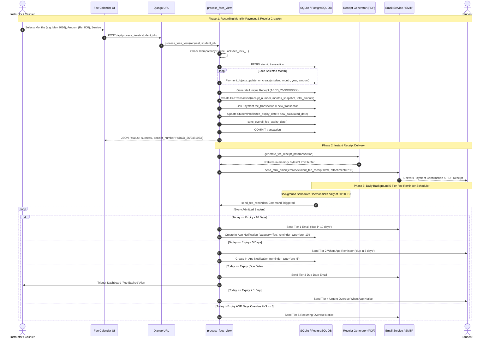

# ABCD Smart Campus — Systems Architecture Manual
## Domain: Fee & Ledger Accounting System (`fee_ledger`)

---

### 1. Executive Summary & Capabilities

The **Fee & Ledger Accounting System (`fee_ledger`)** serves as the financial backbone, revenue ledger, and audit tracker for ABCD Smart Campus. It implements an isolated, double-layered accounting matrix: an operational **Payment Calendar Grid** (for interactive day-to-day attendance-linked payment marking) and an immutable **Fee Transaction & Receipt Layer** (for statutory invoicing, revisions auditing, and financial reporting).

#### 1.1 Complete Feature Inventory
- **Service-Aware Dual-Track Billing Matrix:**
  - Full structural support for three enrollment models: **Coaching Only**, **Library Only**, and **Dual Service ("Both")**.
  - Dual-service students maintain two completely independent financial tracks: `coaching_fee_expiry_date` and `library_fee_expiry_date`.
  - Independent monthly fee calendar tabs (`?service=coaching` vs `?service=library`), ensuring payments, receipts, and expiry dates never collide across educational coaching and physical library seating.
  - Automatic synchronization: `sync_overall_fee_expiry_date()` calculates `min(coaching_expiry, library_expiry)` to drive central campus gate alerts and dashboard badges.
- **Interactive Visual Fee Calendar (`fee_calendar_view`):**
  - Full 12-month calendar desk rendered per calendar year.
  - Interactive status badges per month: **Paid**, **Unpaid**, **Partial Payment**, and **Advance Payment**.
  - Visual timeline highlighting: computes date ranges across consecutive paid months with hold-period exclusions.
  - Dynamic In-Place Expiry Adjustment: enables administrators to specify explicit expiration dates or toggle auto-calculation based on month cycles.
- **Transaction Receipt Engine (`FeeTransaction`):**
  - Unique institutional receipt identifier format: `ABCD_YY/RANDOM7` (e.g., `ABCD_26/0481923`), generated via `FeeTransaction.generate_receipt_number()`.
  - Complete historical freezing: stores JSON snapshot `months_snapshot` containing month names, individual amounts, and payment dates alongside frozen student metadata (`student_name_snapshot`, `roll_number_snapshot`, `mobile_snapshot`, `course_snapshot`) to guarantee immutable historical accuracy even if student profiles mutate or delete.
- **Vector-Decorated PDF Receipt Generator (`receipt_generator.py`):**
  - In-memory streaming PDF generation via ReportLab with zero server disk footprint.
  - Designed with mathematical vector wave decoration, institutional crest, tax breakdown, tabular months statement, QR code verification, cashier watermark, and digital signature stamps.
- **Two-Tier Deletion & Multi-Tenant Audit Ledger:**
  - **"Delete for Me Only" (`TeacherHiddenFeeTransaction`):** Allows an instructor to hide specific transactions from their personal view without altering statutory totals, affecting other teachers, or altering student records.
  - **"Delete for Everyone" / Soft Delete (`FeeTransaction.deleted_at`):** Reversible soft-deletion with mandatory logging into `FeeTransactionAudit` recording timestamp, actor ID, affected receipt number, and reason.
  - **Restoration Engine (`teacher_restore_fees_action`):** Allows administrative undeletion of soft-deleted receipts.
- **In-Place Revision History Tracking (`FeeTransactionRevision`):**
  - Tracks every administrative correction to fee receipts.
  - Preserves snapshots of `old_amount` vs `new_amount`, `old_months` vs `new_months`, and `old_payment_date` vs `new_payment_date`, visible via revision history modals.
- **Student Personal Fee Portal (`student_fee_record_view`):**
  - Student self-service financial ledger displaying complete transaction history, download links for PDF receipts, and privacy toggles (`is_hidden_by_student`).
- **Automated 5-Tier Fee Reminder Scheduler (`send_fee_reminders.py`):**
  - Daily automated background cron daemon driven strictly by `fee_expiry_date`.
  - Service-isolated reminder pipelines evaluating Coaching and Library expiry independently.
  - **Tier 1 (10 Days Before Expiry):** Pre-expiry email reminder (`emails/fee_notification.html`) + In-App notification.
  - **Tier 2 (5 Days Before Expiry):** Pre-expiry WhatsApp alert + In-App notification.
  - **Tier 3 (Due Date / 0 Days):** Due day alert dispatched via Email + In-App notification + Teacher dashboard alert badge.
  - **Tier 4 (1 Day Overdue):** Urgent WhatsApp overdue notice with payment gateway link.
  - **Tier 5 (Recurring Overdue):** Dispatched every 3 days (`days_overdue % 3 == 0`) via Email + In-App notification until payment is recorded.
- **Smart Alert Dismissal Engine (`DismissedFeeAlert`):**
  - Allows instructors to dismiss overdue fee alerts for specific students on their dashboard.
  - Scoped by `(teacher, student, expiry_date, service)`. If the student's fee is later renewed and expires on a *subsequent* date, the alert automatically un-dismisses and re-engages.

#### 1.2 Security Constraints & Permission Layers
| Layer | Mechanism | Implementation Detail |
| :--- | :--- | :--- |
| **Submission Idempotency** | Hash-Based Cache Lock | Generates a 10-second locking key `fee_lock_{teacher}_{student}_{service}_{months}_{amount}` inside `process_fees_view` to eliminate duplicate payment postings caused by network lag or rapid clicking. |
| **Statutory Data Retention** | PII Anonymization Protocol | Upon student account deletion (`perform_account_deletion`), students with financial records are *never* purged. Financial records persist permanently; PII is scrubbed (`full_name="Former Student"`), protecting historical accounting audits. |
| **Atomic Ledger Mutation** | `transaction.atomic()` | Bundles Payment creation, FeeTransaction snapshot generation, receipt number allocation, student expiry recalculation, and notification scheduling in a single database transaction. |
| **Audit Immutability** | Read-Only Audit Model | `FeeTransactionAudit` rows are write-once records tracking actor, IP, timestamp, and payload changes without update endpoints. |

---

### 2. Codebase Touchpoints & File Trace

#### 2.1 Database Models Schema Breakdown

```
+----------------------------------------------------------------------------------------------------+
|                                           users.Payment                                            |
+----------------------------------------------------------------------------------------------------+
| id (BigAutoField, PK)                                                                               |
| student (ForeignKey -> StudentProfile, SET_NULL, nullable)                                         |
| service (CharField 20: 'coaching' | 'library' | NULL)                                             |
| month (CharField 20: 'January', 'February', ...)                                                   |
| year (IntegerField, e.g., 2026)                                                                    |
| amount (DecimalField 8, 2)                                                                         |
| date_paid (DateField, defaults to localdate)                                                       |
| fee_transaction (ForeignKey -> FeeTransaction, SET_NULL, nullable, related_name='payments')         |
| created_at (DateTimeField, auto_now_add=True)                                                      |
+------------------------------------+---------------------------------------------------------------+
                                     | N:1
                                     v
+------------------------------------+---------------------------------------------------------------+
|                                      users.FeeTransaction                                          |
+----------------------------------------------------------------------------------------------------+
| id (BigAutoField, PK)                                                                               |
| student (ForeignKey -> StudentProfile, SET_NULL, nullable)                                         |
| teacher (ForeignKey -> User, SET_NULL, nullable, captures processing admin)                        |
| service (CharField 20: 'coaching' | 'library')                                                     |
| receipt_number (CharField 30, unique=True, indexed, e.g., 'ABCD_26/0481923')                         |
| payment_date (DateField)                                                                           |
| expiry_date (DateField, nullable, student's resulting expiry)                                      |
| service_snapshot (TextField, frozen description)                                                   |
| months_snapshot (JSONField, format: [{'month': '...', 'amount': ..., 'status': '...'}])            |
| total_amount (DecimalField 10, 2)                                                                  |
| email_sent, whatsapp_sent (BooleanField, tracking dispatch)                                        |
| is_hidden_by_student (BooleanField, default=False)                                                 |
| deleted_at (DateTimeField, nullable, soft delete marker)                                           |
| deleted_by (ForeignKey -> User, SET_NULL, nullable)                                                |
| student_name_snapshot, roll_number_snapshot, mobile_snapshot, course_snapshot (CharField)           |
| last_modified_at (DateTimeField), last_modified_by (ForeignKey -> User)                            |
| revision_count (PositiveIntegerField, default=0)                                                  |
| created_at (DateTimeField, auto_now_add=True)                                                      |
+-------------------+-----------------------------------+--------------------+-----------------------+
                    | 1:N                               | 1:N                | 1:N
                    v                                   v                    v
+-------------------+-------------------+ +-------------+--------+ +---------+-----------------------+
|  users.TeacherHiddenFeeTransaction    | | users.FeeTransAudit  | | users.FeeTransactionRevision    |
+---------------------------------------+ +----------------------+ +---------------------------------+
| id (BigAutoField, PK)                 | | id (BigAutoField, PK)| | id (BigAutoField, PK)           |
| teacher (ForeignKey -> User, CASCADE) | | transaction_id (Int) | | transaction (FK -> FeeTrans)    |
| transaction (ForeignKey -> FeeTrans)  | | receipt_number (50)  | | revision_number (PositiveInt)   |
| hidden_at (DateTimeField)             | | student_name, amount | | old_amount, new_amount (Decimal)|
+---------------------------------------+ | action ('delete'...) | | old_months, new_months (JSON)   |
                                          | actor (FK -> User)   | | old_payment_date, new_payment_d |
                                          | timestamp (DateTime) | | actor (ForeignKey -> User)      |
                                          | reason (TextField)   | | created_at (DateTimeField)      |
                                          +----------------------+ +---------------------------------+

+----------------------------------------------------------------------------------------------------+
|                                      users.DismissedFeeAlert                                       |
+----------------------------------------------------------------------------------------------------+
| id (BigAutoField, PK)                                                                               |
| teacher (ForeignKey -> User, CASCADE, related_name='dismissed_fee_alerts')                          |
| student (ForeignKey -> StudentProfile, CASCADE, related_name='dismissed_fee_alerts')                |
| service (CharField 20: 'coaching' | 'library' | NULL)                                             |
| expiry_date (DateField)                                                                            |
| created_at (DateTimeField, auto_now_add=True)                                                      |
| Constraints: unique_together = ('teacher', 'student', 'expiry_date', 'service')                    |
+----------------------------------------------------------------------------------------------------+
```

#### 2.2 Views, Routes & API Endpoints

| Route / URL Pattern | View Function | Method | Auth / Permission | Payload / Query Params | Response Structure |
| :--- | :--- | :--- | :--- | :--- | :--- |
| `/teacher/student/<id>/fees/` | `fee_calendar_view` | `GET` | Staff (`is_staff`) | `student_id`, query params `?service=coaching\|library&year=YYYY` | HTML Render (`fee_calendar.html`) |
| `/api/process_fees/<id>/` | `process_fees_view` | `POST` | Staff (`is_staff`) | `student_id`, payload: `{'actions': [{'action': 'add_fee', 'month': 'May', 'year': 2026, 'amount': 800, 'payment_date': '...'}], 'expiry_date': '...', 'service': '...'}` | JSON: `{'status': 'success', 'receipt_number': str, 'fee_expiry_date': str, 'transaction_id': int}` |
| `/api/delete_payment/<id>/<year>/<month>/` | `delete_payment_view` | `POST` | Staff (`is_staff`) | Route params: `student_id`, `year`, `month_name` | JSON: `{'status': 'success', 'message': str}` |
| `/teacher/dismiss-fee-expired/` | `dismiss_fee_expired_alerts` | `POST` | Staff (`is_staff`) | `{'student_id': int, 'service': str, 'expiry_date': 'YYYY-MM-DD'}` | JSON: `{'status': 'success'}` |
| `/teacher/fees-record/` | `fees_record_view` | `GET` | Staff (`is_staff`) | Query params: `?q=...&service=...&month=...&year=...&tab=active\|deleted` | HTML Render (`fees_record.html`) |
| `/teacher/fees-record/bulk-delete/` | `bulk_delete_fees_action` | `POST` | Staff (`is_staff`) | `{'transaction_ids': [int], 'delete_type': 'me_only'\|'everyone', 'reason': str}` | JSON: `{'status': 'success', 'deleted_count': int}` |
| `/teacher/fees-record/restore/` | `teacher_restore_fees_action` | `POST` | Staff (`is_staff`) | `{'transaction_ids': [int]}` | JSON: `{'status': 'success', 'restored_count': int}` |
| `/teacher/fees-record/download/<id>/` | `download_fee_receipt_view` | `GET` | Staff (`is_staff`) | Route param `transaction_id` | Streaming `HttpResponse` (`application/pdf`) with attachment header |
| `/student/fees/` | `student_fee_record_view` | `GET` | Student (`login_required`) | None | HTML Render (`student_fee_record.html`) |
| `/student/fees/delete/` | `student_hide_fee_transaction` | `POST` | Student (`login_required`) | `{'transaction_id': int}` | JSON: `{'status': 'success'}` |
| `/student/fees/restore/` | `student_restore_fee_transaction` | `POST` | Student (`login_required`) | `{'transaction_id': int}` | JSON: `{'status': 'success'}` |
| `/student/fees/download/<id>/` | `student_download_fee_receipt_view` | `GET` | Student (`login_required`) | Route param `transaction_id` | Streaming `HttpResponse` (`application/pdf`) |

#### 2.3 Frontend Templates & UI Partials Trace
- `users/templates/users/fee_calendar.html`: Central 12-month interactive desk with year switcher, dual-service tabs (`Coaching` vs `Library`), dynamic total calculator, advance payment toggles, date-range timeline visualization, and live expiry preview.
- `users/templates/users/fees_record.html`: Administrative master ledger accounting center with search bar, service filters, date range filters, tabbed view (`Active Records` vs `Trash/Restore`), bulk selection checkboxes, revision modal viewer, and receipt PDF downloads.
- `users/templates/users/student_fee_record.html`: Student-facing accounting log displaying paid receipts, fee periods covered, transaction statuses, and on-demand receipt PDF downloads.
- Transactional Email Templates:
  - `emails/fee_notification.html`: 5-tier dynamic fee notice email with personalized greeting, days-remaining badge, payment UPI QR code, and institute contact links.
  - `emails/student_fee_receipt.html`: Instant receipt dispatch email delivering payment confirmation, invoice summary, and PDF download button upon transaction processing.
  - `emails/teacher_fee_receipt_alert.html`: Internal confirmation sent to staff capturing the transaction metadata and cashier signature.

#### 2.4 Supporting Services, Modules & Workers
- `users/utils/receipt_generator.py`: Generates ReportLab PDF fee receipts with custom canvas backgrounds, dynamic typography, QR validation codes, and institutional seals.
- `users/management/commands/send_fee_reminders.py`: Daily scheduler command evaluating `StudentProfile` fee expiry dates across the 5 reminder tiers.
- `users/scheduler.py`: Embedded 24/7 background scheduler invoking `send_fee_reminders` once per calendar day.
- `users/notifications.py` (`send_fee_reminder_email`, `send_fee_reminder_whatsapp`): Dispatches multi-channel notices via SendGrid/SMTP and WhatsApp Business API.

---

### 3. Complete Data & Logic Flow



---

### 4. State Machines & Edge Case Logic

#### 4.1 Payment Lifecycle & Multi-Tier Audit State Machine

```
                   +----------------------------------+
                   |             Unpaid               |
                   +-------+------------------+-------+
                           |                  |
              Partial Paid |                  | Full Paid
                           v                  v
        +--------------------------+    +--------------------------+
        |         Partial          |    |          Paid            |
        +-------------+------------+    +-------------+------------+
                      |                               |
                      | Advance Deposit Recorded      |
                      v                               v
        +----------------------------------------------------------+
        |                Active FeeTransaction                     |
        |              (Receipt ABCD_YY/XXXXXXX)                   |
        +-------------+----------------------------+---------------+
                      |                            |
       In-Place Edit  |                            | Deletion Triggered
                      v                            v
        +--------------------------+    +------------------------------------+
        |  FeeTransactionRevision  |    |                                    |
        | (Immutable Delta Audit:  |    | Choice: Teacher Only vs Everyone?  |
        |  amounts, months, date)  |    +---------+----------------+---------+
        +--------------------------+              |                |
                                        Teacher   |                | Everyone
                                        Only      v                v
                                   +-------------------+    +----------------+
                                   | TeacherHidden     |    | Soft Delete    |
                                   | FeeTransaction    |    | (deleted_at)   |
                                   | (Hidden for self) |    +-------+--------+
                                   +-------------------+            |
                                                                    | Logged in
                                                                    v
                                                            +----------------+
                                                            | FeeTransaction |
                                                            | Audit (Logs ID,|
                                                            | actor, reason) |
                                                            +-------+--------+
                                                                    | Admin Restore
                                                                    v
                                                            +----------------+
                                                            | Restored Record|
                                                            +----------------+
```

#### 4.2 5-Tier Fee Reminder Matrix

| Reminder Tier | Trigger Condition | Delivery Channel | Action & Payload Details |
| :--- | :--- | :--- | :--- |
| **Tier 1 (Early Notice)** | `today == expiry - 10 days` | **Email + In-App** | Friendly heads-up: *"Your monthly fee is due in 10 days"*. Includes UPI link. |
| **Tier 2 (Approaching)** | `today == expiry - 5 days` | **WhatsApp + In-App** | WhatsApp alert: *"Reminder: 5 days left until fee expiry date ({date})"*. |
| **Tier 3 (Due Date)** | `today == expiry` | **Email + In-App + Admin** | Due date notice sent to student; adds red alert badge to Teacher Dashboard. |
| **Tier 4 (Overdue Grace)**| `today == expiry + 1 day` | **WhatsApp + In-App** | Urgent alert: *"Your fee expired yesterday. Please clear dues to avoid seat holds"*. |
| **Tier 5 (Recurring)** | `days_overdue > 1 and days_overdue % 3 == 0` | **Email + In-App** | Persistent 3-day recurring notice until renewal payment is recorded. |

---

### 5. User Journey & Feature Step-by-Step

#### 5.1 Teacher Fee Processing & Receipt Generation Journey
1. **Accessing Student Calendar:** From `/teacher/`, the instructor clicks *Manage Fees* for Student #52. The browser loads `/teacher/student/52/fees/`.
2. **Dual-Service Switching:** If the student is enrolled in Both, the teacher selects the *Library* tab. The page switches context cleanly without altering coaching data.
3. **Selecting Billing Months:** The teacher clicks *May 2026* and *June 2026*. The floating action drawer highlights the selected cards, automatically tallying the fee (e.g., Rs. 1,600).
4. **Submitting Payment:** The teacher clicks *"Save & Generate Receipt"*.
5. **Atomic Execution:** The client posts JSON to `/api/process_fees/52/`. The server verifies the idempotency token, saves individual `Payment` records, generates receipt `ABCD_26/0481923`, compiles the frozen JSON snapshot, updates the student's `library_fee_expiry_date`, and synchronizes overall expiry.
6. **Instant Receipt Delivery:** The system builds the ReportLab PDF in memory and immediately emails it to the student. The calendar UI updates with green payment badges and a success banner.

#### 5.2 Teacher Fee Auditing, Deletion & Restoration Journey
1. **Navigating to Master Ledger:** The teacher visits `/teacher/fees-record/`.
2. **Reviewing Receipts:** The table lists all issued receipts with receipt numbers, student names, services, and amounts.
3. **Handling Accidental Submissions:** An instructor discovers a duplicate entry for Rs. 800.
4. **Selecting Deletion Mode:** The teacher checks the receipt and clicks *Delete Selected*:
   - Option A (*"Delete for me only"*): Hides the entry from this teacher's view via `TeacherHiddenFeeTransaction`.
   - Option B (*"Delete for everyone"*): Requires entering an administrative reason (e.g., *"Duplicate entry corrected"*). The server sets `deleted_at = timezone.now()` and creates an immutable entry in `FeeTransactionAudit`.
5. **Auditing & Restoration:** Later, an administrator clicks the *Trash / Deleted* tab, inspects the audit reason and author, and clicks *Restore*, instantly returning the receipt to active accounting standing.

#### 5.3 Student Self-Service Fee Statement Journey
1. **Accessing Personal Statement:** A student logs in and navigates to `/student/fees/`.
2. **Viewing Invoices:** The page displays a chronological table of all approved transactions with receipt numbers and paid amounts.
3. **Downloading Official Receipt:** The student clicks *Download Receipt* on receipt `ABCD_26/0481923`. The browser streams the vector-styled official PDF file (`/student/fees/download/128/`) ready for printing or reimbursement filing.

---

### 6. Video Script Anchor Points

- **Dual-Service Track Separation:** Showcase a student enrolled in Both (Coaching + Library). Toggle between the *Coaching* and *Library* tabs on the Fee Calendar to demonstrate completely independent expiry dates and payment matrices.
- **Dynamic 12-Month Range Selection:** Select three consecutive months on the Fee Calendar. Point out the real-time timeline highlight that visually connects the months, and zoom in on the automatically calculated new expiry date.
- **The 10-Second Idempotency Shield:** Double-click the submit button rapidly and point out in the server logs how the duplicate submission is blocked cleanly without creating phantom double charges.
- **The Vector PDF Receipt Showcase:** Open a newly generated PDF receipt and zoom in to highlight the ReportLab vector wave geometry, institutional seal, QR code, and structured fee schedule.
- **"Delete for Me" vs "Delete for Everyone" Demonstration:** Open two teacher windows side-by-side:
  - Teacher A hides a receipt using *"Delete for Me Only"*.
  - Show Teacher B's screen: the transaction remains visible and active.
  - Now delete with *"Delete for Everyone"* and show both screens move the transaction to the Trash tab while logging an immutable audit record.
- **The 5-Tier Automated Reminder Dispatch:** Show the background terminal log executing `send_fee_reminders`, displaying the sequential dispatch across Email and WhatsApp as students approach or cross their expiry dates.
