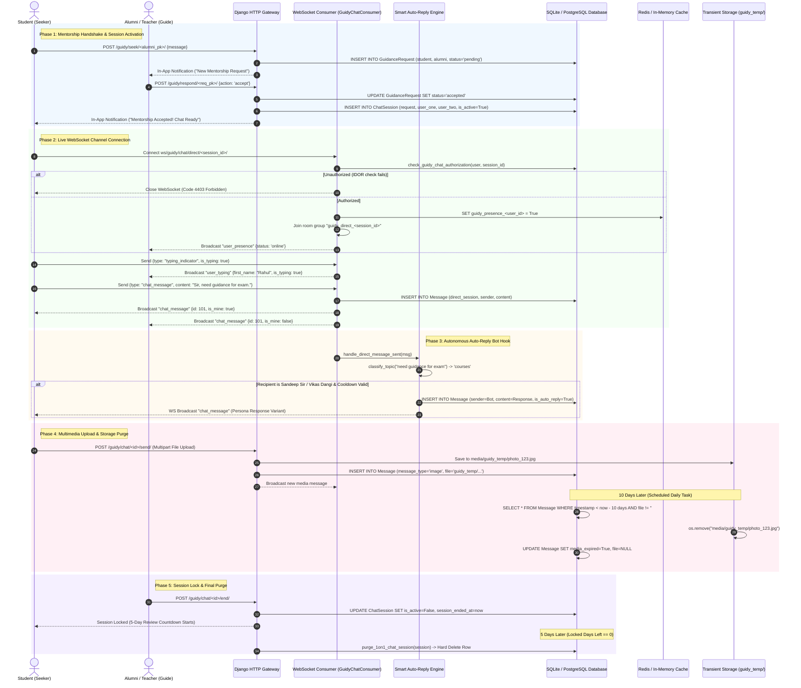

# ABCD Smart Campus — Systems Architecture Manual
## Domain: Guidy Mentorship & Real-Time Chat Network (`guidy_chat`)

---

### 1. Executive Summary & Capabilities

The **Guidy Mentorship & Real-Time Chat Network (`guidy_chat`)** is ABCD Smart Campus’s proprietary, closed-circuit academic messaging platform. Engineered as a secure alternative to commercial social messaging apps, Guidy enables controlled 1-on-1 alumni-student mentorship, direct faculty-student consultations, multi-member study groups, and deterministic automated assistance while preserving institutional boundaries, content privacy, and storage discipline.

#### 1.1 Complete Feature Inventory
- **Multi-Role Academic Mentorship & Guidance Requests:**
  - **Connection Handshake:** Students discover verified alumni via the Hall of Fame and submit a formal `GuidanceRequest` with an introductory message.
  - **Alumni Decision Matrix:** Alumni can accept, reject, or restrict students (`RestrictedStudent`). Upon acceptance, a dedicated `ChatSession` is atomically instantiated.
  - **Direct Messaging (`DirectChatSession`):** Direct 1-on-1 channels between students, alumni guides, and faculty members without requiring formal request handshakes.
- **Dual-Engine Real-Time Transport Architecture:**
  - **Primary Transport (WebSockets):** Built on Django Channels (`GuidyChatConsumer` on `ws/guidy/chat/<chat_type>/<session_id>/`), providing sub-50ms message delivery, live typing indicators, delivery confirmations, read receipts, and real-time user presence tracking (`guidy_presence_<user_id>` in cache).
  - **HTTP Polling Fallback:** Redundant polling endpoints (`guidy_poll_messages`, `guidy_send_message`, `guidy_send_typing`) that automatically engage if WebSocket handshakes fail or drop under unstable campus network conditions.
- **Rich Messaging & Multimedia Suite:**
  - Full support for formatted text, audio voice notes, documents (PDF/Word), images, and video clips (`Message.message_type` in `['text', 'image', 'video', 'document', 'audio', 'system']`).
  - Threaded replies (`reply_to`), message pinning (`is_pinned`), personal message starring (`is_starred_by_sender` / `is_starred_by_receiver`), full-text search, and multi-message selection.
- **Storage Protection & 10-Day Ephemeral Media Purge:**
  - All binary media attachments are stored in a dedicated transient buffer (`upload_to='guidy_temp/'`).
  - Scheduled background maintenance (`users/scheduler.py` via `users/views.py`) hard-deletes media files older than 10 days from physical disk/storage, clears the database pointer (`msg.file = None`), and sets `media_expired = True`. Text transcripts remain permanently intact, displaying a `"⏳ Media expired"` placeholder.
- **Two-Tier Message & Session Deletion Protocol:**
  - **"Delete for Me Only" (`Message.deleted_by` M2M):** Soft-hides the message for the requesting user while leaving it visible to the conversation partner.
  - **"Delete for Everyone" (`Message.is_deleted_for_all=True`):** Replaces content with `"This message was deleted"` across all client feeds.
  - **5-Day Session Lock & Auto-Purge:** When an alumni or student ends a chat session (`session_ended_at`), the chat locks for 5 days (`locked_days_left`), allowing users to review academic advice. On the 5th day, the background engine permanently purges the session to prevent orphaned records.
- **Multi-Member Group Study Channels (`GroupChatSession`):**
  - Alumni and faculty can create structured study groups with custom avatars, descriptions, and member rosters.
  - Supports system event messages (`message_type='system'`, e.g., member added, role updated, title changed), group-wide read-tracking (`read_by` M2M), and selective group exit.
- **Deterministic Smart Auto-Reply Engine (`users/auto_reply.py`):**
  - Non-AI, rule-based auto-reply system operating on behalf of campus leadership (Sandeep Sir and ABCD Asst. Vikas Dangi).
  - 10 distinct academic and administrative classification topics (`emergency`, `fees_dispute`, `complaint`, `fees`, `seats`, `timings`, `admission`, `auth`, `courses`, `greeting`).
  - Rotating response variants (≥3 per topic, never repeating back-to-back in the same conversation).
  - **Distress Protocol:** Detects mental health distress keywords, provides immediate Tele-MANAS (14416) national helpline routing, triggers high-priority staff in-app alerts, and provides direct telephone contact fallback.
  - **Burst Protection:** Enforces a 6-hour burst cooldown per topic per conversation to prevent spam loops.
- **Bidirectional Blocking & Moderation Framework:**
  - Bidirectional blocking (`GuidyBlock` and `BlockedGuidance`) halts all inbound direct messages and WebSocket room entry immediately.
  - Restricting students (`RestrictedStudent`) allows alumni to freeze ongoing conversations without harsh blocking, preventing future connection requests while preserving chat history.

#### 1.2 Security Constraints & Permission Layers
| Security Layer | Enforcing Function / Middleware | Enforcement Mechanism |
| :--- | :--- | :--- |
| **IDOR Protection on WebSockets** | `check_guidy_chat_authorization()` | Intercepts WebSocket handshake in `GuidyChatConsumer.connect()`. Verifies that `request.user` is a legitimate participant of the direct session or group before joining channel groups. Rejects unauthorized connections with code `4403`. |
| **Message Access Scoping** | `guidy_poll_messages` / `guidy_send_message` | Validates session membership on every HTTP request. If user is neither `user1`, `user2`, group member, nor staff, returns HTTP 403 Forbidden. |
| **Block Enforcement Gate** | `save_chat_message()` / `guidy_send_message` | Queries `GuidyBlock.objects.filter()` prior to message creation. If blocked, returns HTTP 403 / WebSocket error and terminates delivery. |
| **Strict File Type Validation** | `guidy_send_message` | Enforces media type constraints, checks file size ceilings, and sanitizes filenames prior to writing to `guidy_temp/`. |
| **Ephemeral File Scrubbing** | Scheduled Maintenance / Daily Cron | Files in `guidy_temp/` are physically deleted from disk after 10 days via `os.remove()`, eliminating disk storage bloat. |

---

### 2. Codebase Touchpoints & File Trace

#### 2.1 Database Models Schema Breakdown (`abcd_web/users/models.py`)

```
===================================================================================================
                                   GUIDY CHAT DATA SCHEMA
===================================================================================================

  +-------------------------------+                 +-----------------------------------+
  |        GuidanceRequest        |                 |            ChatSession            |
  +-------------------------------+                 +-----------------------------------+
  | id: AutoField (PK)            | 1             1 | id: AutoField (PK)                |
  | student_id: FK -> User        |<--------------->| request_id: OneToOne (OPT)        |
  | alumni_id: FK -> Achievement  |                 | user_one_id: FK -> User (OPT)     |
  | status: ('pending', 'accepted'|                 | user_two_id: FK -> User (OPT)     |
  |          'rejected')          |                 | is_active: BooleanField (def=T)   |
  | message: TextField            |                 | created_at: DateTimeField         |
  | created_at, updated_at: DT    |                 | ended_by_id: FK -> User (OPT)     |
  | [UQ: (student_id, alumni_id)] |                 | session_ended_at: DateTime (OPT)  |
  +-------------------------------+                 +-----------------------------------+
                                                                      | 1
                                                                      |
                                                                      | *
  +-------------------------------+                 +-----------------------------------+
  |       DirectChatSession       |                 |              Message              |
  +-------------------------------+                 +-----------------------------------+
  | id: AutoField (PK)            | 1             * | id: AutoField (PK)                |
  | user1_id: FK -> User          |<--------------->| session_id: FK -> ChatSession     |
  | user2_id: FK -> User          |                 | direct_session_id: FK -> DirectCS |
  | is_active: BooleanField       |                 | sender_id: FK -> User             |
  | created_at: DateTimeField     |                 | content: TextField                |
  | ended_by_id: FK -> User (OPT) |                 | message_type: ('text','image',    |
  | session_ended_at: DateTime    |                 |   'video','document','audio')     |
  | [UQ: (user1_id, user2_id)]    |                 | file: FileField ('guidy_temp/')   |
  +-------------------------------+                 | file_name: CharField(255)         |
                                                    | reply_to_id: FK -> self (replies) |
                                                    | is_pinned: BooleanField           |
  +-------------------------------+                 | is_starred_by_sender: Boolean     |
  |       GroupChatSession        |                 | is_starred_by_receiver: Boolean   |
  +-------------------------------+                 | is_deleted_for_all: Boolean       |
  | id: AutoField (PK)            | 1             * | media_expired: BooleanField       |
  | name: CharField(100)          |<--------------->| deleted_at: DateTimeField         |
  | created_by_id: FK -> User     |                 | timestamp: DateTimeField          |
  | members: M2M -> User          |                 | is_delivered: BooleanField        |
  | photo: ImageField             |                 | is_read: BooleanField             |
  | description: TextField        |                 | is_auto_reply: BooleanField       |
  | is_active: BooleanField       |                 | auto_reply_topic: CharField(50)   |
  | deleted_by_user_id: FK -> User|                 | deleted_by: M2M -> User           |
  | deleted_at: DateTimeField     |                 +-----------------------------------+
  | deleted_for_users: M2M -> User|
  +-------------------------------+                 +-----------------------------------+
                 | 1                                |            GuidyBlock             |
                 |                                  +-----------------------------------+
                 v *                                | id: AutoField (PK)                |
  +-------------------------------+                 | blocker_id: FK -> User            |
  |         GroupMessage          |                 | blocked_id: FK -> User            |
  +-------------------------------+                 | created_at: DateTimeField         |
  | id: AutoField (PK)            |                 | [UQ: (blocker_id, blocked_id)]    |
  | group_id: FK -> GroupChat     |                 +-----------------------------------+
  | sender_id: FK -> User         |
  | content: TextField            |                 +-----------------------------------+
  | message_type: ('text','image',|                 |         RestrictedStudent         |
  |   'video','document','audio', |                 +-----------------------------------+
  |   'system')                   |                 | id: AutoField (PK)                |
  | file: FileField ('guidy_temp/')                 | alumni_id: FK -> StudentAchieve   |
  | reply_to_id: FK -> self       |                 | student_id: FK -> User            |
  | is_pinned: BooleanField       |                 | reason: TextField                 |
  | is_deleted_for_all: Boolean   |                 | created_at: DateTimeField         |
  | media_expired: BooleanField   |                 | [UQ: (alumni_id, student_id)]     |
  | read_by: M2M -> User          |                 +-----------------------------------+
  | deleted_by: M2M -> User       |
  | starred_by: M2M -> User       |
  +-------------------------------+
```

#### 2.2 Complete File & Endpoint Traceability Table

| Category | File Path | Identifier / Name | Description & Architectural Responsibility |
| :--- | :--- | :--- | :--- |
| **Model** | [users/models.py](file:///B:/ABCD/abcd_web/users/models.py#L2533-L2738) | `GuidanceRequest`, `ChatSession`, `DirectChatSession`, `Message` | Core mentorship, 1-on-1 direct chat entities, message flags, transient file handles, and read/delivery states. |
| **Model** | [users/models.py](file:///B:/ABCD/abcd_web/users/models.py#L2740-L2811) | `BlockedGuidance`, `RestrictedStudent` | Mentorship restriction records and administrative block graphs between students and alumni. |
| **Model** | [users/models.py](file:///B:/ABCD/abcd_web/users/models.py#L2813-L2936) | `GroupChatSession`, `GroupMessage` | Multi-member study group rooms, system notifications, participant management, and group message logs. |
| **Model** | [users/models.py](file:///B:/ABCD/abcd_web/users/models.py#L3279-L3291) | `GuidyBlock` | Universal bidirectional user blocking model guarding direct chats and WebSocket room access. |
| **Consumer** | [users/consumers.py](file:///B:/ABCD/abcd_web/users/consumers.py#L532-L865) | `GuidyChatConsumer` (`ws/guidy/chat/...`) | WebSocket consumer managing real-time chat broadcast, presence caching, typing indicators, and read confirmations. |
| **Routing** | [users/routing.py](file:///B:/ABCD/abcd_web/users/routing.py#L4-L8) | `websocket_urlpatterns` | ASGI URL patterns mapping WebSocket endpoints for Guidy chat, notifications, and seat updates. |
| **Service** | [users/auto_reply.py](file:///B:/ABCD/abcd_web/users/auto_reply.py#L1-L718) | `handle_direct_message_sent`, `classify_topic` | Deterministic smart auto-reply engine with persona routing, distress handling, and rotating variants. |
| **View (Main)** | [users/views.py](file:///B:/ABCD/abcd_web/users/views.py#L14404-L15165) | `guidy_home` (`/guidy/`) | Primary Guidy chat workspace. Resolves active sessions, builds sidebar conversation lists, and loads chat history. |
| **View (Handshake)**| [users/views.py](file:///B:/ABCD/abcd_web/users/views.py#L15167-L15230) | `guidy_seek_guidance`, `guidy_respond`, `guidy_pending_requests_api` | Guidance request dispatch, alumni accept/reject action, and pending counter APIs. |
| **View (Messaging)**| [users/views.py](file:///B:/ABCD/abcd_web/users/views.py#L15400-L15650) | `guidy_send_message`, `guidy_poll_messages` | Dual HTTP transport endpoints for sending messages, uploading attachments, and polling unread feeds. |
| **View (Actions)** | [users/views.py](file:///B:/ABCD/abcd_web/users/views.py#L15660-L15820) | `guidy_delete_message`, `guidy_pin_message`, `guidy_star_message`, `guidy_clear_chat` | Interactive message operations supporting soft-deletion, universal recall, starring, and chat history clearing. |
| **View (Lifecycle)**| [users/views.py](file:///B:/ABCD/abcd_web/users/views.py#L15830-L15950) | `guidy_end_session`, `guidy_delete_session_permanently` | Session termination triggering the 5-day lock countdown and immediate session hard-purge. |
| **View (Groups)** | [users/views.py](file:///B:/ABCD/abcd_web/users/views.py#L17100-L17500) | `guidy_create_group`, `guidy_group_send_message`, `guidy_group_poll`, `guidy_group_manage_members` | Full group chat management: roster modifications, group settings, and group message transmission. |
| **View (Safety)** | [users/views.py](file:///B:/ABCD/abcd_web/users/views.py#L17550-L17650) | `guidy_block_user`, `guidy_unblock_user`, `guidy_blocked_list` | User safety endpoints managing bidirectional blocks and blocked contact management. |
| **Template** | [users/templates/users/guidy.html](file:///B:/ABCD/abcd_web/users/templates/users/guidy.html) | Main Guidy UI | Full WhatsApp/Telegram-style split interface (12,600+ lines) with sound effects, cropper modals, and media players. |

---

### 3. Complete Data & Logic Flow Mermaid Diagram



---

### 4. State Machines & Edge Case Logic

#### 4.1 Mentorship & Chat Session Lifecycle State Machine

```
       [Student Submits Request]
                   |
                   v
        +---------------------+
        | GuidanceRequest     |
        | status = 'pending'  |
        +---------------------+
           |               |
   [Alumni Rejects] [Alumni Accepts]
           |               |
           v               v
  +----------------+  +-------------------------------------------------+
  | GuidanceRequest|  | ChatSession Created                             |
  | status =       |  | is_active = True                                |
  | 'rejected'     |  +-------------------------------------------------+
  +----------------+           |                                  |
                               | [Alumni Restricts]               | [Message Exchanged]
                               v                                  v
                      +-------------------+              +-------------------+
                      | RestrictedStudent |              | Messages Flowing  |
                      | (Blocks new reqs) |              | (WS / HTTP Poll)  |
                      +-------------------+              +-------------------+
                                                                   |
                                                          [Session Ended]
                                                                   |
                                                                   v
                                                         +-------------------+
                                                         | Session Locked    |
                                                         | (Read-Only 5 Days)|
                                                         +-------------------+
                                                                   |
                                                          [Day 5 Reached]
                                                                   |
                                                                   v
                                                         +-------------------+
                                                         | AUTO PURGE        |
                                                         | (Hard Deleted)    |
                                                         +-------------------+
```

#### 4.2 Comprehensive Edge Cases & System Handlers

1. **IDOR & Unauthorized Channel Snooping:**
   - Evaluated at connection time in `check_guidy_chat_authorization(user_id, chat_type, session_id)`.
   - If an authenticated user attempts to connect to a WebSocket room `guidy_direct_99` where they are neither `user1` nor `user2`, the socket immediately terminates with close code `4403`. HTTP polling endpoints similarly return `JsonResponse({"error": "Forbidden"}, status=403)`.
2. **Mental Health Distress Detection (Emergency Protocol):**
   - In `users/auto_reply.py`, incoming messages are scanned against high-priority distress patterns (`\bsuicide\b`, `\bkill myself\b`, `\bdepress(ed|ion)?\b`, `\bmental health crisis\b`).
   - Bypasses normal waiting periods and delivers an immediate emergency persona response providing the **National Tele-MANAS (14416)** 24x7 toll-free helpline.
   - Dispatches a real-time `Notification` with category `'urgent'` directly to campus administrators.
3. **Ghost Media Storage Leak Prevention:**
   - If a student uploads large PDF notes or audio clips, server disks could quickly exhaust capacity.
   - Resolved by the 10-day cutoff daemon (`purge_expired_guidy_media`):
     ```python
     cutoff = timezone.now() - timedelta(days=10)
     expired = Message.objects.filter(media_expired=False, timestamp__lt=cutoff).exclude(message_type='text')
     for msg in expired:
         if msg.file:
             msg.file.delete(save=False)
         msg.media_expired = True
         msg.file = None
         msg.save(update_fields=['media_expired', 'file'])
     ```
   - Physical storage is cleared while conversation transcripts remain readable.
4. **WebSocket Reconnection & Offline Message Catch-Up:**
   - When a user reconnects after a tunnel or network drop, `GuidyChatConsumer.connect()` automatically executes `mark_all_undelivered_for_user(user.id)`.
   - Any messages sent while the user was offline are marked `is_delivered=True`, and delivery broadcast events (`messages_delivered_broadcast`) are instantly dispatched to original senders.
5. **Bidirectional Blocking Race Conditions:**
   - If User A blocks User B via `/guidy/block/<user_id>/`, a `GuidyBlock` row is committed.
   - Before any message is saved over WebSocket or HTTP, `save_chat_message()` explicitly verifies:
     ```python
     if GuidyBlock.objects.filter(blocker=other, blocked=user).exists():
         return {'error': 'You are blocked by this user.'}
     ```
   - Senders receive an instant error banner, and messages are completely discarded.

---

### 5. User Journey & Feature Step-by-Step

#### 5.1 Student Journey: Seeking Guidance, Messaging & Auto-Reply
1. **Selecting a Mentor:**
   - The student navigates to `/hall-of-fame/` and views alumni cards. Clicking **"Ask for Guidance"** opens a request dialog.
   - The student types an inquiry (e.g., "Need tips for MPPSC Prelims preparation") and submits it, invoking `/guidy/seek/<alumni_pk>/`.
2. **Entering the Guidy Workspace:**
   - Once the alumni accepts, the student receives an in-app alert and opens `/guidy/`.
   - The left sidebar lists active conversations. The green presence indicator confirms the mentor is online.
3. **Interactive Messaging:**
   - The student types a query. Typing triggers real-time debounce signals over WebSocket; the mentor sees `"Rahul is typing..."`.
   - Submitting routes the message through WebSocket (`chat_message`), instantly updating the bubble feed with double checkmarks (`delivered` and `read`).
4. **Interacting with Campus Leadership:**
   - The student starts a direct chat with Sandeep Sir asking about fee receipts.
   - Within 1 minute, the deterministic smart auto-reply engine classifies the query as `fees` and returns a helpful response pointing to the Student Fees portal, confirming that Sandeep Sir will personally review the chat soon.
5. **Reviewing Media Before Expiry:**
   - The student receives an audio explanation. A discreet indicator displays `"Available for 10 days"`.
   - After 10 days, the voice file is purged from disk, and the bubble updates cleanly to `"⏳ Media expired"`.

#### 5.2 Alumni / Teacher Journey: Mentorship Moderation & Group Study
1. **Managing Inbound Requests:**
   - The alumni opens `/guidy/` and sees a **Pending Requests** badge in the sidebar.
   - They inspect introductory notes from students and can accept, reject, or restrict students with a single click.
2. **Conducting 1-on-1 Sessions:**
   - Inside an active session, the alumni answers questions, pins important syllabus links (`is_pinned=True`), and stars essential notes.
3. **Concluding Mentorship:**
   - Once guidance is complete, the alumni clicks **"End Session"**.
   - The session transitions into a 5-day locked archive. The student can re-read messages, but cannot send new ones. On day 5, the session auto-purges cleanly.
4. **Creating a Batch Group Channel:**
   - A teacher clicks **"Create Group"**, selects multiple coaching students, assigns a title ("Batch A Math Circle"), and uploads a custom group crest.
   - System messages broadcast updates to all group members, who can chat concurrently in real time.

---

### 6. Video Script Anchor Points

For architectural walkthroughs, stakeholder demos, or feature reviews, use these timestamped talking points and visual focal areas:

| Timestamp | Screen / Visual State | Anchor Script & Architectural Commentary |
| :--- | :--- | :--- |
| **00:00 – 01:20** | `/guidy/` (Split Sidebar & Welcome State) | *"This is Guidy, ABCD Smart Campus's closed academic messaging ecosystem. Unlike unmonitored WhatsApp groups, Guidy is an institutional network where every student-alumni and student-faculty interaction is authenticated, scoped, and protected against data leaks."* |
| **01:20 – 02:40** | Live Chat Workspace (Real-Time Messaging) | *"Notice the real-time speed. Powered by Django Channels WebSockets, messages, typing indicators, and presence updates dispatch in under 50 milliseconds. If the client experiences network drops, our resilient HTTP polling engine steps in automatically with zero message loss."* |
| **02:40 – 04:00** | Direct Chat with Faculty (Smart Auto-Reply) | *"Here is our deterministic Smart Auto-Reply engine in action. When students message campus leadership, our non-AI rule classifier detects keywords across 10 categories. Notice the emergency safety protocol: distress keywords immediately bypass queues to offer Tele-MANAS mental health support while alerting our staff."* |
| **04:00 – 05:15** | Attachment Drawer & Media Bubble | *"Storage management is critical in campus portals. Guidy implements an automated 10-day ephemeral media retention policy. File attachments are temporarily hosted in a transient buffer and automatically purged after 10 days, preserving server storage while keeping text transcripts intact."* |
| **05:15 – 06:30** | Group Chat & Session Lifecycle Controls | *"Finally, our session lifecycle controls enforce academic hygiene. When mentorship sessions conclude, they lock for 5 days of read-only review before being automatically purged. Faculty can also create structured study groups with real-time system broadcasts and moderation controls."* |
