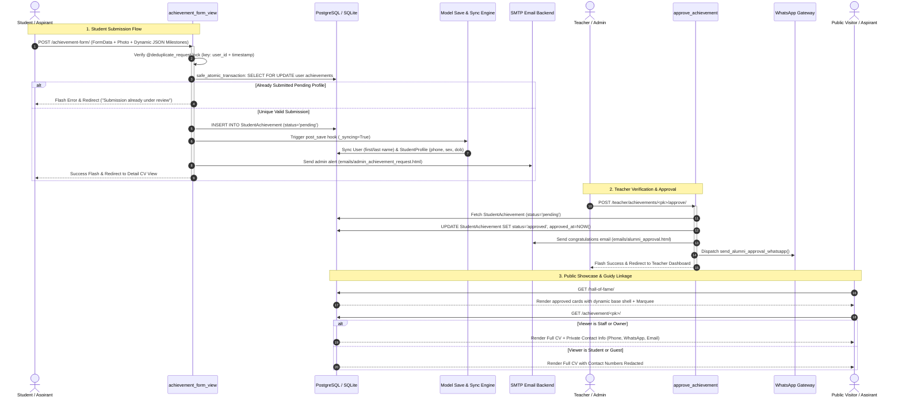

# ABCD Smart Campus — Hall of Fame & Student Achievements Architecture Manual

> **Domain:** Hall of Fame, Alumni Network & Student Achievements  
> **Target Audience:** Lead Systems Architects, Security Engineers, Full-Stack Developers  
> **Status:** Production-Ready & Formally Audited  
> **Associated Apps:** `abcd_web/users/`, `abcd_web/teachers/`, `abcd_web/templates/`

---

## 1. Executive Summary & Capabilities

The **Hall of Fame & Student Achievements** subsystem is ABCD Smart Campus’s prestige and institutional verification engine. It manages the complete lifecycle of competitive exam selections, civil service appointments, and academic achievements earned by ABCD students across Library and Coaching services.

Beyond serving as a public marketing and social proof showcase, the module functions as the administrative gateway that transitions high-achieving students into verified **Alumni Mentors** who interface directly with the **Guidy Mentorship Network**.

```
   ┌────────────────────────────────────────────────────────────────────────┐
   │                   HALL OF FAME & ALUMNI ECOSYSTEM                      │
   └────────────────────────────────────────────────────────────────────────┘
          │                                                    │
          ▼                                                    ▼
   [STUDENT SUBMISSION]                                 [PUBLIC SHOWCASE]
   • Dynamic JSON Milestones                            • Marquee Banner Carousel
   • Service Usage Metrics                              • Dynamic Adaptive Layouts
   • Dual Private/Public Metadata                       • Visitor Intent Telemetry
          │                                                    │
          ▼                                                    ▼
   [TEACHER VERIFICATION]                               [ALUMNI ONBOARDING]
   • Staff Review Workflow                              • Dedicated Alumni Portal
   • Atomic Approval Pipeline                           • Role Elevation & Badging
   • WhatsApp & Email Automation                        • Guidy Mentorship Integration
```

### Core Features & Capabilities

1. **Prestige Portfolio Showcase (`/hall-of-fame/`):**
   - High-impact public and authenticated gallery highlighting selected candidates (MPPSC, UPSC, SSC, Banking, Defense, etc.).
   - Dynamic marquee banner displaying names, current administrative posts, and selection years.
   - Intelligent visitor tracking (`track_visitor_intent("viewed_hall_of_fame")`) capturing admission interest signals.
   - Dynamic base template extension (`teacher_dashboard.html`, `alumni_dashboard.html`, `student_dashboard.html`, or `home_page.html`) preserving UI shell context.

2. **Zero-Duplicate Achievement Submission Pipeline (`/achievement-form/`):**
   - Comprehensive multi-attribute submission capturing biographical data, exam selections, service tenure, ratings, and testimonials.
   - Dynamic tabular JSON milestone builder (`other_achievements`) allowing multiple exam qualifications with custom years.
   - Double-submission shielding via `@deduplicate_request(timeout=2)` and in-lock database re-checking inside safe atomic transactions.

3. **CV-Style Detail & Portfolio Page (`/achievement/<pk>/`):**
   - Publicly accessible professional summary detailing the candidate's journey, preparation duration, and feedback.
   - Deep privacy guard: Personal contact data (mobile, WhatsApp, email) is strictly hidden from students and guests, rendering only for verified staff/teachers and the profile owner.

4. **Bi-Directional Cross-Model Data Synchronization:**
   - Submitting or updating achievements immediately syncs user attributes (`first_name`, `last_name`) across `django.contrib.auth.models.User` and operational profile attributes (`full_name`, `sex`, `dob`, `email`, `whatsapp_number`, `mobile_number`) to `StudentProfile`.
   - Guarded by recursion circuit-breakers (`_syncing = True`) to prevent infinite post-save signal loops.

5. **Staff Moderation & Multi-Channel Notification Dispatch:**
   - Teacher dashboard review queue displaying pending portfolios with detailed verification data.
   - One-click approval stamping (`approved_at = timezone.now()`) with atomic database state commitment.
   - Automated multi-channel notification engine dispatching branded HTML emails (`emails/alumni_approval.html`) and WhatsApp template messages via `send_alumni_approval_whatsapp`.

6. **Dedicated Alumni Dashboard (`/alumni/dashboard/`):**
   - Role-aware workspace (`request.session['active_dashboard'] = 'alumni'`).
   - Self-healing phantom record detection: Automatically resolves state desyncs if an approved alumni profile has dangling pending flags.
   - Direct integration into Guidy Chat mentorship statistics, allowing alumni to review their mentee sessions and answer student queries.

---

## 2. Codebase Touchpoints & File Trace

### Relational Schema & Model Topology

```
+------------------------------------------------------------------------------------+
|                                      auth.User                                     |
+------------------------------------------------------------------------------------+
| id (PK)                                                                            |
| username, first_name, last_name, email, is_staff, is_active                         |
+------------------------------------------------------------------------------------+
          | 1                                               | 1
          |                                                 |
          | 1                                               | 1
          v                                                 v
+------------------------------------+   +-------------------------------------------+
|        users.StudentProfile        |   |          users.StudentAchievement         |
+------------------------------------+   +-------------------------------------------+
| id (PK)                            |   | id (PK)                                   |
| user_id (OneToOne -> User)         |   | user_id (ForeignKey -> User, CASCADE)     |
| full_name, sex, dob, photo         |   | first_name, last_name                     |
| mobile_number, whatsapp_number     |   | about_yourself, current_post              |
| address, enrolled_courses          |   | selection_year, working_city              |
+------------------------------------+   | short_achievement (e.g. "DSP / MPPSC")    |
                                         | gender ('M', 'F', 'O'), dob               |
                                         | photo (upload_to='achievements/')         |
                                         | services_used ('library'|'coaching'|both) |
                                         | duration_years, duration_days             |
                                         | mobile_number, whatsapp_number, email     |
                                         | other_achievements (JSONField)            |
                                         | rating (1-5), abcd_feedback               |
                                         | experience_feedback                       |
                                         | status ('pending'|'approved'|'rejected')   |
                                         | approved_at, created_at, updated_at       |
                                         +-------------------------------------------+
                                                           | 1
                                                           | (Optional Mentorship Link)
                                                           v 0..*
                                         +-------------------------------------------+
                                         |             chat.GuidySession             |
                                         +-------------------------------------------+
                                         | id (PK)                                   |
                                         | student_id, mentor_id (Alumni User)       |
                                         | status ('active'|'closed')                |
                                         +-------------------------------------------+
```

### Complete File & Endpoint Traceability Table

| Endpoint / Route | View Handler | HTTP Methods | Auth / RBAC Layer | Template / Response | Primary Functional Purpose |
| :--- | :--- | :--- | :--- | :--- | :--- |
| `/hall-of-fame/` | `hall_of_fame_view` | `GET` | Public / Any | `users/hall_of_fame.html` | Public gallery of approved alumni with carousel marquee and contextual base layout extension. |
| `/achievement-form/` | `achievement_form_view` | `GET`, `POST` | `@login_required` | `users/achievement_form.html` | Multi-step form submission with deduplication locks, JSON milestone parser, and admin alert emails. |
| `/achievement/<int:pk>/` | `achievement_detail_view` | `GET` | Public / Conditional | `users/achievement_detail.html` | Detailed CV/portfolio view. Shields private contact numbers unless viewed by staff or profile owner. |
| `/alumni/edit/`<br>`/alumni/edit/<int:pk>/` | `edit_alumni_view` | `GET`, `POST` | `@login_required` | `users/edit_alumni.html` | Self-service profile updates for alumni or administrative editing by staff. |
| `/teacher/achievements/<int:pk>/approve/` | `approve_achievement` | `POST` | `@login_required`, Staff/Teacher | Redirect (`teacher_dashboard`) | Transitions status to `approved`, stamps timestamp, sends automated HTML email and WhatsApp alert. |
| `/teacher/achievements/<int:pk>/reject/` | `reject_achievement` | `POST` | `@login_required`, Staff/Teacher | Redirect (`teacher_dashboard`) | Sets status to `rejected`, decoupling Guidy sessions while preserving user records. |
| `/achievement/delete/<int:pk>/` | `delete_achievement` | `POST` | `@login_required`, Owner/Staff | Redirect (`hall_of_fame` / Dashboard) | Physically deletes media files, disconnects active Guidy chat links (`session.request = None`), preserves account. |
| `/alumni/dashboard/` | `alumni_dashboard_view` | `GET` | `@login_required`, Approved Alumni | `users/alumni_dashboard.html` | Alumni home dashboard featuring mentorship metrics, marquee feeds, and self-healing pending status. |

---

## 3. Complete Data & Logic Flow Mermaid Diagram



---

## 4. State Machines & Edge Case Logic

### Achievement Lifecycle State Machine

```
              ┌───────────────────────────┐
              │    DRAFT / IN-MEMORY      │
              └───────────────────────────┘
                            │
                            │ Student submits /achievement-form/
                            ▼
              ┌───────────────────────────┐
              │          PENDING          │ ◄─────────────────────────┐
              │ (Hidden from public hall) │                           │
              └───────────────────────────┘                           │
                     │             │                                  │
      Teacher        │             │ Teacher                          │ Phantom
      Approves       │             │ Rejects                          │ Auto-Heal
                     ▼             ▼                                  │
        ┌────────────────┐    ┌────────────────┐                      │
        │    APPROVED    │    │    REJECTED    │                      │
        │ (Public Hall & │    │ (Hidden, Staff │                      │
        │ Alumni Portal) │    │  notified)     │                      │
        └────────────────┘    └────────────────┘                      │
           │           │                                              │
           │           └──────────────────────────────────────────────┘
           │
           │ Owner or Staff calls delete_achievement
           ▼
        ┌─────────────────────────────────────────────────────────────┐
        │                          DELETED                            │
        │ • Physical photo removed from storage                       │
        │ • Active GuidySession linked requests set to NULL (No wipe) │
        │ • User account retained as Standard Student / Guest         │
        └─────────────────────────────────────────────────────────────┘
```

### Critical Edge Cases & Implementation Defenses

1. **Infinite Signal Recursion Circuit-Breaker:**
   - *Problem:* `StudentAchievement.save()` updates `StudentProfile` and `User`. If `StudentProfile.save()` in turn updates `StudentAchievement`, Django signals could enter an infinite stack overflow.
   - *Defense:* The system uses a thread-local model attribute `_syncing = True` during propagation. If `getattr(self, '_syncing', False)` is truthy, cross-model updates exit immediately.

2. **Image Cache Busting with Physical Fallbacks (`photo_url`):**
   - *Problem:* Browsers aggressively cache static and uploaded avatars, displaying stale photos after an alumni updates their profile picture.
   - *Defense:* `StudentAchievement.photo_url` inspects `os.path.getmtime(self.photo.path)` on physical disk and appends an epoch query string (`?v=1712390123`). If no photo exists, it checks `StudentProfile.photo`, finally falling back to gender-specific static defaults (`default_avatar_male.png` / `default_avatar_female.png`).

3. **Guidy Mentorship Preservation on Profile Deletion:**
   - *Problem:* Deleting an alumni record must not purge historical student chat interactions or crash active mentorship threads.
   - *Defense:* `delete_achievement` runs a defensive uncoupling pass:
     ```python
     # Decouple Guidy requests without deleting student chat histories
     active_sessions = GuidySession.objects.filter(mentor=achievement.user)
     for session in active_sessions:
         if hasattr(session, 'request') and session.request:
             session.request = None
             session.save(update_fields=['request'])
     ```
     Physical image assets are unlinked from disk using `achievement.photo.delete(save=False)`.

4. **Double-Submission & Race Condition Guard:**
   - *Problem:* Users double-clicking submission buttons on slow mobile connections could spawn multiple identical pending achievements.
   - *Defense:* Dual protection:
     - `@deduplicate_request(timeout=2)` middleware decorator.
     - Database-level isolation using `safe_atomic_transaction()` that checks `StudentAchievement.objects.filter(user=request.user, status='pending').exists()` inside the row lock before committing.

5. **Self-Healing Phantom Records in Alumni Dashboard:**
   - *Problem:* A student might have both an approved older record and an accidental pending re-submission, causing dashboard view conflicts.
   - *Defense:* `alumni_dashboard_view` auto-heals state by prioritizing `status='approved'`. If approved records exist, stray pending records are flagged for administrative consolidation without locking the user out.

---

## 5. User Journey & Feature Step-by-Step

### Journey 1: Student Aspirant Submitting Achievement

```
1. Student navigates to /achievement-form/
   ├── System validates authentication; redirects guests to login
   └── Form displays pre-filled biographical data from StudentProfile
2. Student fills out selection profile:
   ├── Enters Post (e.g., "Deputy Collector - MPPSC 2024")
   ├── Selects ABCD Services used ("Library", "Coaching", or "Both")
   ├── Specifies duration (Years and Days)
   ├── Enters dynamic milestones via interactive JSON table
   ├── Uploads formal passport photo
   └── Writes personal preparation advice and institutional feedback
3. Clicks "Submit for Verification"
   ├── JavaScript validates required fields and photo size (<5MB)
   ├── POST request handled inside atomic transaction
   ├── System triggers admin notification email
   └── Student is redirected to /achievement/<pk>/ with "Pending Review" banner
```

### Journey 2: Staff / Teacher Review & Verification

```
1. Teacher logs into Teacher Dashboard (/teacher/dashboard/)
   ├── Review queue displays pending achievement badges
   └── Teacher opens achievement review modal
2. Teacher inspects selection proof and details:
   ├── Verifies identity, roll number, and exam selection details
   ├── Checks uploaded photograph quality
   └── Verifies coaching / library tenure records in database
3. Teacher executes decision:
   ├── Action A: APPROVE (/teacher/achievements/<pk>/approve/)
   │   ├── Status shifts to 'approved'; approved_at stamped
   │   ├── Automated email sent to student
   │   ├── WhatsApp notification dispatched
   │   └── Candidate immediately appears on public /hall-of-fame/
   └── Action B: REJECT (/teacher/achievements/<pk>/reject/)
       ├── Status shifts to 'rejected'
       └── Feedback notes recorded for administrative reference
```

### Journey 3: Public Visitor & Aspirant Discovery

```
1. Visitor lands on /hall-of-fame/
   ├── System executes track_visitor_intent("viewed_hall_of_fame")
   ├── Dynamic Marquee ticker displays recent selections across the top
   └── Grid displays approved alumni cards categorized by exam stream
2. Visitor clicks on an Alumni Card:
   ├── Navigates to /achievement/<pk>/
   ├── Reads full interview, study routine, and booklist
   ├── Views dynamic milestone achievements table
   └── Personal contact info (Phone/WhatsApp) is masked for public privacy
3. Visitor clicks "Connect via Guidy":
   └── System routes visitor to Guidy Mentorship Network to initiate advice session
```

### Journey 4: Verified Alumni Managing Mentor Profile

```
1. Selected candidate logs in; navbar displays "Alumni Portal"
2. Candidate accesses /alumni/dashboard/:
   ├── Session sets active_dashboard = 'alumni'
   ├── Dashboard presents Mentorship Requests and Guidy stats
   ├── Provides quick-edit link for current posting and city updates
3. Alumni accesses /alumni/edit/<pk>/:
   ├── Updates Current Working City and Department Promotion
   ├── Appends newly cleared examinations to other_achievements JSON
   └── Saves changes with instant reflection across public showcase
```

---

## 6. Video Script Anchor Points

| Timestamp | Visual / Screen Focus | Script Narration & Architectural Anchor |
| :--- | :--- | :--- |
| **00:00 - 00:45** | Public Hall of Fame (`/hall-of-fame/`) with moving marquee and cards. | *"Welcome to the ABCD Smart Campus Hall of Fame. This module is our prestige engine. Here, every verified selection—from Civil Services to Banking—is showcased with dynamic carousels, responsive cards, and visitor intent tracking."* |
| **00:45 - 01:30** | Student Submitting Form (`/achievement-form/`) with dynamic JSON rows. | *"Students submit their success stories through an atomic, deduplicated submission pipeline. Notice how they can dynamically add multiple examination milestones stored directly as structured JSON, while biographical data syncs across auth and profile models."* |
| **01:30 - 02:15** | Teacher Dashboard approval queue and 1-click verify button. | *"Administrators hold strict gatekeeping control. In the Teacher Dashboard, staff review candidate credentials. With a single click, the record is approved, stamping the timestamp and automatically triggering congratulatory HTML emails and WhatsApp messages."* |
| **02:15 - 03:00** | Detail portfolio view (`/achievement/<pk>/`) comparing Public vs Staff view. | *"Privacy is enforced at the template and ORM layers. While public visitors see inspirational study routines and preparation milestones, private contact details like phone and WhatsApp are strictly redacted unless viewed by authorized staff."* |
| **03:00 - 03:45** | Alumni Dashboard (`/alumni/dashboard/`) and Guidy Chat integration. | *"Once approved, the student’s role elevates into an Alumni Mentor. Through the dedicated Alumni Dashboard, they track mentorship requests from juniors via Guidy Chat, completing the full lifecycle from enrolled aspirant to institutional mentor."* |
