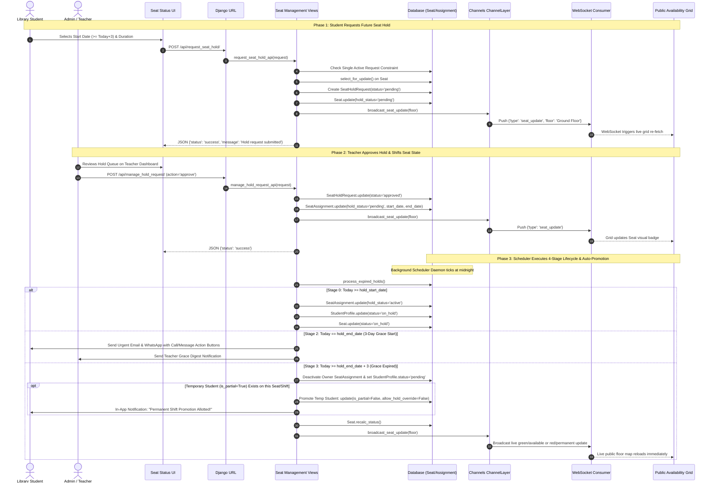

# ABCD Smart Campus — Systems Architecture Manual
## Domain: Library & Seat Allocation Engine (`library_seats`)

---

### 1. Executive Summary & Capabilities

The **Library & Seat Allocation Engine (`library_seats`)** manages the physical seating infrastructure across the ABCD Smart Campus facility. It governs two floors: **Ground Floor (53 Seats)** and **1st Floor (46 Seats)**, supporting fixed full-day seating, split-shift sharing (Morning/Evening), temporary tenant occupancy during member leaves, multi-stage automated seat holds with grace periods, and live real-time visual synchronization via WebSockets.

#### 1.1 Complete Feature Inventory
- **Interactive 2D Visual Floor Grids:**
  - Distinct architectural layouts for **Ground Floor** (Seats 1–53) and **1st Floor** (Seats 1–46).
  - Shift-enabled seating on Ground Floor Seats 40–53 allowing independent allocations for **Morning Shift (8:00 AM – 2:00 PM)**, **Evening Shift (2:00 PM – 8:00 PM)**, or **Full Day**.
  - Visual status color indicators:
    - **Green:** Available for selection.
    - **Red:** Occupied by an active permanent student.
    - **Amber / Yellow:** On hold (original occupant temporarily away).
    - **Blue:** Pending admission approval.
    - **Bi-Color Split (Diagonal / Vertical Halves):** One shift occupied/on-hold and the opposite shift available or occupied by another student.
    - **Padlock Badge:** Seat or specific shift locked by the administrator.
- **Real-Time WebSocket Synchronization:**
  - Django Channels ASGI consumer (`PublicSeatUpdateConsumer`) on endpoint `ws/seat-updates/` connected to Redis group `broadcast_all`.
  - Zero-latency broadcast triggered by `broadcast_seat_update(floor)` whenever any seat status, allocation, hold, or lock mutates, prompting connected browsers to update layouts instantly without page reloads.
- **Student Personal Seat Center (`your_seat_status_view`):**
  - Displays the student's assigned seat number, floor, shift, hold status, and expiry timeline.
  - **Seat Hold Request:** Students can schedule future leaves (minimum 3 days advance notice, duration 15 to 90 days). Includes cancellation workflow for pending or teacher-scheduled holds.
  - **Seat / Shift Switch Request:** Admitted students with active seats can request relocation to an available seat or alternate shift.
  - **Seat Leave / Withdrawal Request:** Temporary students or graduating members can request voluntary seat relinquishment.
  - **Hold Modification (Expand / Shorten):** Students currently on hold can petition to adjust their return date (minimum 2 days, maximum 90 days from request date).
  - **Single Active Request Rule:** Strict mutual-exclusion guard enforcing that a student may maintain only one pending administrative request at a time.
- **Teacher Master Seat Manager (`teacher_seat_status_view`):**
  - Real-time command dashboard with floor switching and search filtering.
  - Modal student inspector displaying occupant photo, full name, mobile number, service type, admission date, and fee expiry status.
  - **One-Click Manual Allotment:** Allot available seats to registered candidates, with reassign protection against double-booking.
  - **Seat Liberation (`free`):** Clears active assignments, detaches student pointers, and reverts seat state to available.
  - **Direct Teacher Hold:** Teachers can immediately put any occupied seat on hold or modify existing hold dates directly without waiting for student requests.
  - **Administrative Seat & Shift Locking (`toggle_seat_lock_api`):** Allows locking whole seats or specific shifts (e.g., locking Morning while leaving Evening available) for maintenance or administrative reserve.
  - **Special / Partial Interest Processing:** Review queue for prospective students requesting temporary occupancy on held seats.
  - **Interactive Request Queues:** Tabbed approval/rejection panels for seat switches, leaves, and hold adjustments.
- **Automated 4-Stage Seat Hold Lifecycle & Grace Daemon:**
  - Automated daily maintenance executed by `users/scheduler.py` via `process_seat_reminders`.
  - **Stage 0 (Auto-Activation):** Automatically transitions scheduled holds to `active` when the start date arrives.
  - **Stage 1 (Pre-Expiry Warning):** Sends in-app reminder 24 hours prior to hold expiration (`hold_end_date - 1`).
  - **Stage 2 (Hold End & 3-Day Grace Start):** Activates a 3-day protection window on the end date. Does *not* liberate the seat immediately. Dispatches urgent alerts across Email (`hold_grace_warning.html`), WhatsApp, and In-App notifications with interactive call/message action buttons.
  - **Stage 3 (Grace Expiry & Auto-Promotion):** When grace expires (3 days past end date), original student assignment is terminated. If a temporary student (`is_partial=True`) was occupying the seat during the hold, the system **automatically promotes the temporary tenant to permanent occupant** (`is_partial=False`).
- **Streaming Floor Register Exporter (`export_floor_data_view`):**
  - Generates in-memory PDF (ReportLab) or Excel workbook (`openpyxl`) detailing seat numbers, floor, occupant names, contact numbers, shifts, hold dates, and latest fee records directly to the browser with zero disk footprint.

#### 1.2 Security Constraints & Permission Layers
| Layer | Mechanism | Implementation Detail |
| :--- | :--- | :--- |
| **Row-Level Concurrency Locking** | `select_for_update()` | Prevents simultaneous double-allocation race conditions during high-traffic admission rushes across `seat_action_api`, `request_seat_hold_api`, and `send_special_seat_request_api`. |
| **Action Deduplication** | Hash-Based Cache Lock | Rejects rapid-fire button clicking within a 5-second window using `cache.set(f'seat_action_{hash}', True, 5)`. |
| **Shift Integrity Validation** | Hard Floor & Number Boundary | Ground Floor Seats 40–53 are strictly validated in `Seat.clean()` as the *only* valid shift-enabled seats. Full-day seats reject split assignments. |
| **Active Seat Uniqueness** | Database Model Constraint | `SeatAssignment` enforces `UniqueConstraint(fields=['student'], condition=Q(is_active=True))` ensuring a student cannot simultaneously occupy multiple physical seats. |
| **Lock Protection** | Administrative Lock Barrier | `seat_action_api` rejects all allotment and admission actions on locked seats (`is_locked=True`) or locked shifts. |

---

### 2. Codebase Touchpoints & File Trace

#### 2.1 Database Models Schema Breakdown

```
+----------------------------------------------------------------------------------------------------+
|                                             users.Seat                                             |
+----------------------------------------------------------------------------------------------------+
| id (BigAutoField, PK)                                                                               |
| seat_number (CharField 10, e.g., '1', '42')                                                        |
| floor (CharField 50: 'Ground Floor' | '1st Floor')                                                 |
| status (CharField 10: 'available' | 'occupied' | 'pending' | 'on_hold')                              |
| is_shift_enabled (BooleanField, default=False, True strictly for Ground Floor 40–53)               |
| hold_student (ForeignKey -> StudentProfile, SET_NULL, nullable, tracks owner)                      |
| hold_start_date, hold_end_date (DateField, nullable)                                                |
| hold_status (CharField 10: 'none' | 'pending' | 'active')                                          |
| hold_request_date (DateTimeField), hold_request_duration (CharField 20)                              |
| is_locked (BooleanField, default=False)                                                            |
| locked_shifts (CharField 50, e.g., 'morning', 'evening', 'full')                                     |
| available_since (DateTimeField, nullable)                                                          |
+--------------------+----------------------------------+-------------------+------------------------+
                     | 1:N                              | 1:N               | 1:N
                     v                                  v                   v
+--------------------+-------------------+ +------------+--------+ +--------+---------------+
|        users.SeatAssignment            | | users.SeatHoldReq   | | users.SeatSwitchRequest |
+----------------------------------------+ +---------------------+ +-------------------------+
| id (BigAutoField, PK)                  | | id (BigAutoField, PK)| | id (BigAutoField, PK)   |
| seat (ForeignKey -> Seat, CASCADE)     | | seat (FK -> Seat)   | | student (FK -> Profile) |
| student (ForeignKey -> StudentProfile) | | student (FK -> Prof)| | target_seat (FK -> Seat)|
| shift_type ('full'|'morning'|'evening')| | start_date (Date)   | | target_shift (CharField)|
| is_active (BooleanField, default=True) | | duration_text (50)  | | is_temporary (Bool)     |
| hold_status ('none'|'pending'|'active')| | status ('pending' | | temp_hold_days (Int)      |
| hold_start_date, hold_end_date (Date)  | |  'approved'|'rej')  | | status ('pending'|      |
| is_partial (Bool, True = Temp Tenant)  | | cancel_requested    | |  'approved'|'rejected') |
| allow_hold_override (Bool)             | | created_at (DateTime| | created_at, updated_at  |
| created_at (DateTimeField)             +---------------------+ +-------------------------+
+--------------------+-------------------+
                     | 1:N
                     v
+--------------------+-------------------+ +-------------------------------------------------+
|      users.SeatHoldChangeRequest       | |              users.SeatSpecialRequest           |
+----------------------------------------+ +-------------------------------------------------+
| id (BigAutoField, PK)                  | | id (BigAutoField, PK)                           |
| student (ForeignKey -> StudentProfile) | | user (FK -> User, for unregistered prospects)   |
| seat (ForeignKey -> Seat, CASCADE)     | | student (FK -> StudentProfile, for candidates)  |
| shift (CharField 10)                   | | seat (ForeignKey -> Seat, CASCADE)              |
| current_end_date, requested_end_date   | | requested_shift ('morning'|'evening'|'full')    |
| requested_duration (CharField 50)      | | status ('pending'|'approved'|'rejected')        |
| reason (TextField)                     | | created_at (DateTimeField)                      |
| status ('pending'|'approved'|'rejected')| +-------------------------------------------------+
+----------------------------------------+
```

#### 2.2 Views, Routes & API Endpoints

| Route / URL Pattern | View Function | Method | Auth / Permission | Payload / Query Params | Response Structure |
| :--- | :--- | :--- | :--- | :--- | :--- |
| `/library-availability/` | `library_availability_view` | `GET` | Public | None | HTML Render (`library_availability.html`) |
| `/my-seat/` | `your_seat_status_view` | `GET` | Student (`login_required`) | None | HTML Render (`your_seat_status.html`) |
| `/teacher/seat-status/` | `teacher_seat_status_view` | `GET` | Staff (`is_staff`) | None | HTML Render (`teacher_seat_status.html`) |
| `/teacher/export-floor-data/` | `export_floor_data_view` | `GET` | Staff (`is_staff`) | `?floor=...&format=pdf\|excel` | Streaming `HttpResponse` (PDF / XLSX file attachment) |
| `/api/get_public_seat_status/` | `get_public_seat_status_api` | `GET` | Public | `?floor=Ground Floor\|1st Floor` | JSON: `[{'seat_number': str, 'status': str, 'is_shift_enabled': bool, 'morning_taken': bool, ...}]` |
| `/api/get_seat_status/` | `get_seat_status_api` | `GET` | Student (`login_required`) | `?floor=Ground Floor\|1st Floor` | JSON: `[{'seat_number': str, 'status': str, 'is_my_seat': bool, 'user_shift': str, ...}]` |
| `/api/get_teacher_seat_status/` | `get_teacher_seat_status_api` | `GET` | Staff (`is_staff`, `never_cache`)| `?floor=Ground Floor\|1st Floor` | JSON: `[{'seat_number': str, 'status': str, 'student_name': str, 'student_id': int, ...}]` |
| `/api/teacher/seat_action/` | `seat_action_api` | `POST` | Staff (`is_staff`) | `{'floor': str, 'seat_number': str, 'action': 'allot'\|'free'\|'reassign', 'student_id': int}` | JSON: `{'status': 'success', 'message': str}` |
| `/api/toggle_seat_lock/` | `toggle_seat_lock_api` | `POST` | Staff (`is_staff`) | `{'floor': str, 'seat_number': str, 'action': 'lock'\|'unlock', 'shift': str}` | JSON: `{'status': 'success', 'is_locked': bool, 'locked_shifts': str}` |
| `/api/request_seat_hold/` | `request_seat_hold_api` | `POST` | Student (`login_required`) | `{'action': 'submit'\|'cancel_pending'\|'request_end', 'start_date': str, 'duration': str}` | JSON: `{'status': 'success', 'message': str}` |
| `/api/manage_hold_request/` | `manage_hold_request_api` | `POST` | Staff (`is_staff`) | `{'seat_id': int, 'action': 'approve'\|'reject'\|'end_hold'}` | JSON: `{'status': 'success', 'message': str}` |
| `/api/teacher/put_seat_on_hold/` | `teacher_put_seat_on_hold_api` | `POST` | Staff (`is_staff`) | `{'seat_id': int, 'student_id': int, 'start_date': str, 'end_date': str}` | JSON: `{'status': 'success', 'message': str}` |
| `/api/request_seat_switch/` | `request_seat_switch_api` | `POST` | Student (`login_required`) | `{'floor': str, 'seat_number': str, 'shift': str, 'is_temporary': bool}` | JSON: `{'status': 'success', 'message': str}` |
| `/api/cancel_seat_switch/` | `cancel_seat_switch_api` | `POST` | Student (`login_required`) | None | JSON: `{'status': 'success', 'message': str}` |
| `/teacher/seat_switch/<pk>/approve/` | `approve_seat_switch` | `POST` | Staff (`is_staff`) | None | JSON: `{'status': 'success', 'message': str}` |
| `/teacher/seat_switch/<pk>/reject/` | `reject_seat_switch` | `POST` | Staff (`is_staff`) | None | JSON: `{'status': 'success', 'message': str}` |
| `/api/request_seat_leave/` | `api_request_seat_leave` | `POST` | Student (`login_required`) | `{'reason': str}` | JSON: `{'status': 'success', 'message': str}` |
| `/api/cancel_seat_leave/` | `api_cancel_seat_leave` | `POST` | Student (`login_required`) | None | JSON: `{'status': 'success', 'message': str}` |
| `/teacher/seat_leave/<pk>/approve/` | `approve_seat_leave` | `POST` | Staff (`is_staff`) | None | JSON: `{'status': 'success', 'message': str}` |
| `/teacher/seat_leave/<pk>/reject/` | `reject_seat_leave` | `POST` | Staff (`is_staff`) | None | JSON: `{'status': 'success', 'message': str}` |
| `/api/request_hold_change/` | `api_request_hold_change` | `POST` | Student (`login_required`) | `{'requested_end_date': 'YYYY-MM-DD', 'reason': str}` | JSON: `{'status': 'success', 'message': str}` |
| `/api/cancel_hold_change/` | `api_cancel_hold_change` | `POST` | Student (`login_required`) | None | JSON: `{'status': 'success', 'message': str}` |
| `/teacher/hold_change/<pk>/approve/` | `approve_hold_change` | `POST` | Staff (`is_staff`) | None | JSON: `{'status': 'success', 'message': str}` |
| `/teacher/hold_change/<pk>/reject/` | `reject_hold_change` | `POST` | Staff (`is_staff`) | None | JSON: `{'status': 'success', 'message': str}` |
| `/api/seat-special-request/` | `send_special_seat_request_api` | `POST` | Authenticated | `{'floor': str, 'seat_number': str, 'requested_shift': str}` | JSON: `{'status': 'success', 'message': str}` |
| `/api/seat-interest/` | `seat_interest_api` | `POST` | Public | `{'floor': str, 'seat_number': str, 'preferred_shift': str, 'contact_info': str}` | JSON: `{'status': 'success', 'message': str}` |

#### 2.3 Frontend Templates & UI Partials Trace
- `users/templates/users/library_availability.html`: Public-facing visual floor navigator with floor tabs, interactive SVG icons (desk, chair, lamp), WebSocket receiver, and modal detail inspection.
- `users/templates/users/your_seat_status.html`: Student personal seating cockpit showing assigned seat, shift badge, countdown to scheduled holds, action buttons for hold request/cancellation/switch/leave, and modal date-pickers.
- `users/templates/users/teacher_seat_status.html`: Comprehensive administrative floor manager displaying live occupancy, occupant identification cards, quick-allocation drawers, shift-locking toggles, and PDF/Excel export controls.
- `users/templates/users/_seat_grids.html`: Core reusable 2D visual layout containing CSS grid markup for Ground Floor (Seats 1–53) and 1st Floor (Seats 1–46), supporting split half-seats for morning/evening shifts.
- `users/templates/users/_seat_layout_modal.html`: Modal layout selector embedded into admission workflows allowing prospective students to visually click and select their preferred seat.
- Transactional Email Templates:
  - `emails/admin_library_request.html`: Alerts teachers to new library admission seat selections.
  - `emails/admin_seat_hold_request.html`: Alerts teachers when an active student files a seat hold request.
  - `emails/admin_temp_seat_request.html`: Alerts teachers to temporary occupancy requests on held seats.
  - `emails/hold_grace_warning.html`: Urgent Stage 2 alert to student announcing the start of their 3-day hold grace period with call/WhatsApp CTA buttons.
  - `emails/hold_grace_teacher.html`: Daily digest alert notifying staff of students whose hold grace period has commenced.
  - `emails/seat_hold_expired_student.html`: Final notification to student confirming seat liberation after grace expiration.
  - `emails/seat_hold_expired_teacher.html`: Confirmation alert to teacher after automated seat liberation and temporary student promotion.
  - `emails/seat_update.html`: General notification sent upon manual seat reassignments or shift alterations.

#### 2.4 Supporting Services, Modules & Workers
- `users/consumers.py` (`PublicSeatUpdateConsumer`): Channels WebSocket consumer broadcasting real-time `seat_update` JSON events to all connected clients on `ws/seat-updates/`.
- `users/notifications.py` (`broadcast_seat_update`): Python bridge sending asynchronous channel-layer group messages to `broadcast_all`.
- `users/utils.py` (`process_expired_holds`): 4-Stage lifecycle processor handling future activations, pre-expiry notices, 3-day grace triggers, and temporary occupant auto-promotions.
- `users/utils/floor_export.py`: High-performance streaming exporter using ReportLab and openpyxl to compile floor registers with zero disk writes.
- `users/management/commands/process_seat_reminders.py`: CLI command invoked daily by `users.scheduler` executing hold lifecycles and waitlists.

---

### 3. Complete Data & Logic Flow



---

### 4. State Machines & Edge Case Logic

#### 4.1 Master Seat Lifecycle State Machine

```
                   +----------------------------------+
                   |            Available             |
                   |  (status='available', green)     |
                   +-------+------------------+-------+
                           |                  |
           Admin Allotment |                  | Admission Request
                           v                  v
        +--------------------------+    +--------------------------+
        |         Occupied         |    |         Pending          |
        |  (status='occupied', red)|    |  (status='pending', blue)|
        +-------------+------------+    +-------------+------------+
                      |                               |
        Hold Approved |                               | Teacher Approves Admission
                      v                               v
        +--------------------------+    +-------------+------------+
        |         On Hold          |    |         Occupied         |
        | (status='on_hold', yellow|    +--------------------------+
        +-------------+------------+
                      |
                      +-------------------+--------------------+
                      |                                        |
     Grace Period Active (3 Days)             Grace Period Expired (End + 3 Days)
                      |                                        |
                      v                                        v
        +--------------------------+             +-------------------------------+
        |       Grace Period       |             |   Released & Auto-Promoted    |
        | (Urgent Student Alerts & |             | (Temp tenant promoted to perm;|
        |  Teacher Phone CTAs sent)|             |  if no tenant -> 'available') |
        +--------------------------+             +-------------------------------+
```

#### 4.2 Shift-Enabled Seating Configuration Matrix (Ground Floor 40–53)

| Morning Shift (8AM–2PM) | Evening Shift (2PM–8PM) | Overall Seat Status | Visual Presentation in 2D Floor Grid |
| :--- | :--- | :--- | :--- |
| **Available** | **Available** | `available` | Fully Green desk card. |
| **Occupied** (Student A) | **Available** | `available` (partial) | Left Half Red (Morning Taken), Right Half Green (Evening Available). |
| **Available** | **Occupied** (Student B) | `available` (partial) | Left Half Green (Morning Available), Right Half Red (Evening Taken). |
| **Occupied** (Student A) | **Occupied** (Student B) | `occupied` | Fully Red desk card with two distinct student chips. |
| **On Hold** (Student A) | **Available** | `on_hold` (partial) | Left Half Amber (Morning Hold), Right Half Green. |
| **On Hold** (Student A) | **Occupied** (Student B) | `occupied` | Left Half Amber (Morning Hold), Right Half Red (Evening Occupied). |
| **On Hold** (Student A) | **Temp Tenant** (Student C) | `occupied` (temporary)| Left Half Striped Amber/Blue, Right Half based on Evening state. |
| **Full Day Locked** | **Full Day Locked** | `available` (locked)| Gray desk with centered Padlock icon (`is_locked=True`). |
| **Morning Locked** | **Evening Available** | `available` | Left Half Gray with Padlock, Right Half Green. |

---

### 5. User Journey & Feature Step-by-Step

#### 5.1 Prospective Student Seat Selection Journey
1. **Browsing Availability:** A visitor visits `/library-availability/`. The page connects to `ws/seat-updates/` and requests `/api/get_public_seat_status/?floor=Ground+Floor`.
2. **Floor Navigation:** The visitor toggles between *Ground Floor* and *1st Floor*. Real-time tooltips display availability status. On Ground Floor seats 40–53, the card indicates whether Morning, Evening, or Full Day is open.
3. **Form Integration:** When clicking an available seat, the visitor is directed to `/admission-form/?seat=42&floor=Ground+Floor`. The chosen seat is locked in memory for their application.

#### 5.2 Admitted Student Seat Hold & Grace Journey
1. **Opening Seat Cockpit:** The student navigates to `/my-seat/`. The page validates their library status and renders their current seat, floor, and shift.
2. **Scheduling a Leave:** The student clicks *"Put Seat on Hold"*. The system restricts the start date to at least 3 days in advance to allow operational planning.
3. **Submission & Verification:** The student picks a 30-day leave starting next Monday. The server validates that no prior pending request exists (`get_unresolved_request_info`), creates a `SeatHoldRequest`, and alerts the teachers.
4. **Teacher Approval:** The teacher reviews the request on `/teacher/seat-status/` and clicks *Approve*. The seat assignments table updates.
5. **Stage 2 Grace Alert:** On the 30th day, the background scheduler detects `today == hold_end_date`. The student receives an urgent in-app alert, an HTML email (`emails/hold_grace_warning.html`), and a WhatsApp notification offering instant buttons: *"Call Teacher"*, *"Message WhatsApp"*, or *"End Hold"*.
6. **Resolution or Auto-Promotion:**
   - If the student contacts the teacher, the hold is extended or resumed.
   - If the 3-day grace expires without action, the original student is unlinked, and any temporary student who was utilizing the shift is automatically promoted to permanent owner.

#### 5.3 Teacher Seat Reassignment & Locking Journey
1. **Accessing the Console:** An administrator accesses `/teacher/seat-status/`.
2. **Reviewing Floor Status:** The live grid reveals all seats with occupant names and fee status flags.
3. **Locking for Repairs:** Seat #14 desk lamp needs electrical repair. The teacher clicks Seat #14 and selects *Toggle Lock*. An AJAX request invokes `/api/toggle_seat_lock/`, setting `is_locked=True`. The WebSocket broadcasts the change, turning Seat #14 gray across all student and public screens instantly.
4. **Exporting Shift Register:** Before weekly inspections, the teacher clicks *Export Register* -> *PDF*. The browser streams an in-memory PDF containing full seat allocation records, phone numbers, and payment details.

---

### 6. Video Script Anchor Points

- **Live Grid Instant Sync (Zero-Refresh Demo):** Open two browser tabs side-by-side: Tab 1 on the public `/library-availability/` page and Tab 2 on the Teacher Seat Manager. Allot Seat #25 in Tab 2 and highlight that Tab 1 instantly turns from bright green to red without refreshing.
- **Split-Shift Visual Anatomy:** Zoom into Ground Floor Seat #48. Showcase the split diagonal card showing a Morning occupant on the left and an open Evening slot on the right, explaining how shift sharing maximizes seat utility.
- **The 3-Day Grace Lifeline:** Showcase the automated warning email (`hold_grace_warning.html`) received by a student on hold, demonstrating the embedded WhatsApp and Call buttons that allow instant contact with the instructor.
- **Automated Tenant Promotion Climax:** Display a seat occupied temporarily by Tenant Student B while Owner Student A is on hold. Trigger the Stage 3 grace expiration and showcase Student B receiving an instant notification: *"Permanent Seat Allotted! You have been promoted to permanent occupant."*
- **One-Click PDF/Excel Generation:** Click the *Export Floor Register* button on the Teacher Dashboard and show the downloaded document, pointing out that it streams in 200ms directly from RAM with zero server disk clutter.
