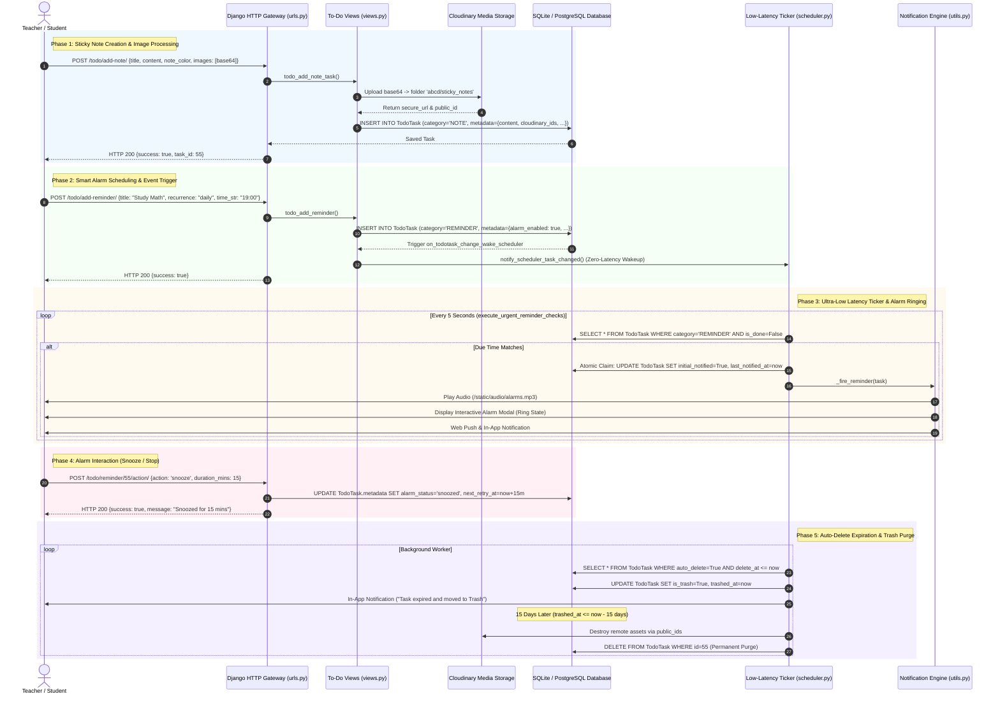

# ABCD Smart Campus — Systems Architecture Manual
## Domain: To-Do Hub, Productivity & Smart Alarms (`todo_hub`)

---

### 1. Executive Summary & Capabilities

The **To-Do Hub, Productivity & Smart Alarms System (`todo_hub`)** is ABCD Smart Campus’s personal task management, academic planning, and alarm scheduling workspace. Architected as an **Isolated Memory Buffer System**, the hub provides students, alumni, and faculty with a unified productivity desk that remains 100% decoupled from statutory financial models and academic enrollment databases, ensuring scratchpad notes never alter legal ledgers.

#### 1.1 Complete Feature Inventory
- **Polymorphic Task Management (`TodoTask`):**
  - A single model utilizing JSON metadata (`metadata`) to dynamically host five specialized productivity modules:
    1. **To Add Fees (`FEES`):** A teacher-exclusive scratchpad for staging prospective student fee collections, recording student names, amounts, and service details without mutating statutory accounting ledgers.
    2. **Breakdown Tasks (`BREAKDOWN`):** Hierarchical task decomposition enabling users to divide ambitious goals into ordered subtasks with allotted hours, reserve buffer pools (`reservePoolMs`), completion checkboxes, and overall project deadlines.
    3. **TO-DOs (`TODO`):** Color-coded personal checklists featuring priority sorting, drag-and-drop reordering, task pinning (`is_pinned`), and one-click completion.
    4. **Reminders & Alarms (`REMINDER`):** High-precision scheduling engine supporting one-time alarms (`recurrence='once'`) and multi-pattern recurrences (`daily`, `weekly`, `monthly`, `every_n_days`). Integrates interactive audio alarms (`/static/audio/alarms and reminders.mp3`), snooze controls, and email alerts.
    5. **Notebook / Sticky Notes (`NOTE`):** Visual pinboard featuring customizable sticky note colors (`#fef08a`), playful typography (`Playpen Sans`), random rotations, and multi-image attachments.
- **Ultra-Low Latency Smart Alarm Ticker (5-Second Evaluation):**
  - Background scheduler (`users/scheduler.py` via `execute_urgent_reminder_checks`) evaluates due alarms and reminders every **5 seconds**, providing near-zero latency dispatch instead of waiting for standard 60-second polling loops.
  - Features atomic task claiming (`update(initial_notified=True, last_notified_at=now)`), preventing duplicate alerts across concurrent worker threads.
  - Multi-tier alert cycle:
    - **Ringing State:** Dispatches Web Push, in-app notification with audio chime, and optional HTML email.
    - **Interactive Snooze:** Users can snooze alarms for customizable durations (default 15 minutes) via in-app modals or signed token URLs.
    - **Unattended 45-Minute Retry:** If an alarm is unacknowledged, it rotates once after 45 minutes before cleanly stopping to prevent notification fatigue.
- **Cloudinary Sticky Note Image Processing & Lifecycle:**
  - Automated image extraction pipeline (`process_note_images_and_upload_to_cloudinary`):
    - Uploads base64 data URIs pasted into notes directly to Cloudinary (`folder='abcd/sticky_notes'`).
    - Replaces inline binary payloads in the database with secure HTTPS URLs.
    - Tracks asset public IDs (`cloudinary_ids`). When notes are edited or permanently deleted, orphaned Cloudinary assets are automatically destroyed via `auto_delete_todotask_cloudinary_images` signal handlers.
- **Two-Tier Expiry, Auto-Delete & 15-Day Trash Purge:**
  - **Auto-Delete Timer:** Tasks can have optional expiration lifetimes (e.g., 6 hours for fee scratchpads, or custom project deadlines). When expired, tasks automatically move to Trash.
  - **15-Day Trash Retention:** Soft-deleted or auto-expired tasks remain in Trash for 15 days with live countdown timers (`purge_at = trashed_at + 15 days`). Users can recover tasks anytime, which resets timers to zero. On day 15, background workers permanently purge them.
- **Role-Gated Student Directory Picker (`todo_search_students`):**
  - Teacher-exclusive search endpoint for the "To Add Fees" module.
  - Aggregates enrolled students and approved alumni with service details (floor/seat for library, batch name for coaching) while enforcing teacher permission checks to prevent student directory scraping.

#### 1.2 Security Constraints & Permission Layers
| Security Layer | Enforcing Function / Middleware | Enforcement Mechanism |
| :--- | :--- | :--- |
| **Directory Scraping Protection** | `todo_search_students` | Guarded by `is_teacher(request.user)`. Rejects non-staff students with HTTP 403 Forbidden, protecting campus contact rosters. |
| **Statutory Ledger Isolation** | `TodoTask` Architecture | To-Do Hub fee scratchpads are entirely sandboxed inside `TodoTask.metadata`. No database foreign keys or triggers connect to `Payment` or `FeeTransaction`, preventing accounting corruption. |
| **Signed Remote Action Tokens** | `todo_reminder_action` | Notification action buttons verify requests using Django `TimestampSigner(salt='abcd-reminder-action')`, allowing secure one-click alarm dismissal from external notifications without session hijacking risks. |
| **Idempotent Alarm Claiming** | `process_todo_notifications()` | Uses atomic `.update()` locks on database rows prior to dispatching WebPush, audio, or email alerts, eliminating race conditions across worker threads. |
| **Cloudinary Asset Cleanup** | `auto_delete_todotask_cloudinary_images` | Django `post_delete` signal destroys remote Cloudinary image binaries when a note is permanently deleted, eliminating orphaned cloud storage charges. |

---

### 2. Codebase Touchpoints & File Trace

#### 2.1 Database Models Schema Breakdown (`abcd_web/users/models.py`)

```
===================================================================================================
                                   TO-DO HUB DATA SCHEMA
===================================================================================================

  +--------------------------------+               +--------------------------------------+
  |              User              |               |               TodoTask               |
  +--------------------------------+               +--------------------------------------+
  | id: AutoField (PK)             | 1           * | id: AutoField (PK)                   |
  | username: CharField            |<------------->| user_id: FK -> User (CASCADE)        |
  | email: EmailField              |               | category: CharField(20) [CHOICES]    |
  +--------------------------------+               |   ('FEES', 'BREAKDOWN', 'TODO',      |
                                                   |    'REMINDER', 'NOTE')               |
                                                   | metadata: JSONField (Polymorphic)    |
                                                   | auto_delete: BooleanField (def=True) |
                                                   | delete_at: DateTimeField [OPT]       |
                                                   | is_trash: BooleanField (def=False)   |
                                                   | trashed_at: DateTimeField [OPT]      |
                                                   | is_done: BooleanField (def=False)    |
                                                   | is_pinned: BooleanField (def=False)  |
                                                   | last_notified_at: DateTimeField [OPT]|
                                                   | initial_notified: BooleanField       |
                                                   | created_at: DateTimeField            |
                                                   | updated_at: DateTimeField            |
                                                   +--------------------------------------+
                                                                      |
                                                                      +--- Indexes:
                                                                           * todo_u_cat_tr_cr_idx
                                                                           * todo_u_tr_cr_idx
                                                                           * todo_done_trash_idx
                                                                           * todo_del_auto_idx
```

#### Polymorphic Metadata Formats per Category:
- **`FEES`:** `[{"id": "s_12", "name": "Rahul Verma", "amount": 500, "detail": "Library - Ground/G-12", "photo_url": "..."}]`
- **`BREAKDOWN`:** `{"title": "UPSC Syllabus Prep", "total_hours": 40.0, "reservePoolMs": 14400000, "subtasks": [{"name": "History", "hours": 10.0, "remaining_hours": 10.0, "is_done": false}]}`
- **`TODO`:** `{"task_name": "Submit Assignment", "description": "Chapter 4 Notes", "color": "#7b61ff", "order": 1, "is_pinned": false}`
- **`REMINDER`:** `{"title": "Study Session", "recurrence": "daily", "time_str": "19:00", "alarm_enabled": true, "alarm_status": "ringing", "email_notify": true}`
- **`NOTE`:** `{"title": "Formula Sheet", "content": "Physics Notes...", "note_color": "#fef08a", "rotation": -2, "images": ["https://res.cloudinary.com/..."], "cloudinary_ids": ["abcd/sticky_notes/..."]}`

#### 2.2 Complete File & Endpoint Traceability Table

| Category | File Path | Identifier / Name | Description & Architectural Responsibility |
| :--- | :--- | :--- | :--- |
| **Model** | [users/models.py](file:///B:/ABCD/abcd_web/users/models.py#L3004-L3053) | `TodoTask` | Polymorphic task entity storing metadata JSON payloads, lifecycle states, auto-delete timestamps, and trash flags. |
| **Signal** | [users/models.py](file:///B:/ABCD/abcd_web/users/models.py#L3055-L3071) | `auto_delete_todotask_cloudinary_images` | Django `post_delete` signal unlinking and destroying remote Cloudinary images when notes are purged. |
| **Signal** | [users/models.py](file:///B:/ABCD/abcd_web/users/models.py#L3345-L3353) | `on_todotask_change_wake_scheduler` | Event listener waking the scheduler loop with zero latency whenever reminders are updated. |
| **Scheduler** | [users/scheduler.py](file:///B:/ABCD/abcd_web/users/scheduler.py#L256-L284) | `execute_urgent_reminder_checks` | Ultra-low latency 5-second background daemon evaluating due alarms and dispatching notifications. |
| **Scheduler** | [users/scheduler.py](file:///B:/ABCD/abcd_web/users/scheduler.py#L286-L380) | `calculate_seconds_to_next_due_task` | Adaptive sleep calculator scanning database tasks to adjust scheduler sleep delays between 0 and 900 seconds. |
| **Worker** | [users/utils.py](file:///B:/ABCD/abcd_web/users/utils.py#L1211-L1406) | `process_todo_notifications` | Core background processor evaluating recurrence schedules, atomic claim locks, snooze cycles, and auto-delete expirations. |
| **View (UI)** | [users/views.py](file:///B:/ABCD/abcd_web/users/views.py#L18123-L18174) | `todo_hub_page` (`/todo/`) | Main To-Do Hub interface container adapting sidebar context across student, alumni, guest, and teacher roles. |
| **View (Search)** | [users/views.py](file:///B:/ABCD/abcd_web/users/views.py#L18176-L18233) | `todo_search_students` (`/todo/search-students/`) | Teacher-exclusive search endpoint returning enrolled students and alumni with seat and batch info. |
| **View (Fees)** | [users/views.py](file:///B:/ABCD/abcd_web/users/views.py#L18235-L18324) | `todo_add_fee_reminder` (`/todo/add-fee-reminder/`) | Creates a staged fee collection task in `TodoTask.metadata` without modifying statutory accounts. |
| **View (Fetch)** | [users/views.py](file:///B:/ABCD/abcd_web/users/views.py#L18326-L18469) | `todo_get_tasks` (`/todo/get-tasks/`) | Filtered task retrieval endpoint with full-text search across titles, descriptions, and polymorphic metadata. |
| **View (Lifecycle)**| [users/views.py](file:///B:/ABCD/abcd_web/users/views.py#L18471-L18523) | `todo_trash_task`, `todo_recover_task`, `todo_permanent_delete_task`, `todo_bulk_action` | Soft-deletion, 15-day trash recovery (with timer reset), and permanent deletion endpoints. |
| **View (Breakdown)**| [users/views.py](file:///B:/ABCD/abcd_web/users/views.py#L18608-L18671) | `todo_add_breakdown` (`/todo/add-breakdown/`) | Task decomposition creator calculating subtask hours, reserve pools, and auto-delete deadlines. |
| **View (Checklist)**| [users/views.py](file:///B:/ABCD/abcd_web/users/views.py#L18721-L18750) | `todo_add_todo_task` (`/todo/add-todo/`) | Standard personal checklist task creator supporting custom color themes and priority orders. |
| **View (Notes)** | [users/views.py](file:///B:/ABCD/abcd_web/users/views.py#L18752-L18848) | `process_note_images_and_upload_to_cloudinary` | Base64 image extractor, Cloudinary uploader, and orphan asset destroyer. |
| **View (Alarms)** | [users/views.py](file:///B:/ABCD/abcd_web/users/views.py#L18886-L19051) | `todo_add_reminder`, `todo_update_reminder` | Alarm schedule builder supporting one-time datetimes, recurring daily/weekly slots, and sound toggles. |
| **View (Actions)** | [users/views.py](file:///B:/ABCD/abcd_web/users/views.py#L19054-L19110) | `todo_reminder_action` (`/todo/reminder/<id>/action/`) | Handles `stop` and `snooze` actions from in-app alarm dialogs or external signed notification tokens. |
| **Template** | [users/templates/users/todo.html](file:///B:/ABCD/abcd_web/users/templates/users/todo.html) | Main Workspace UI | Full 14,500+ line interactive single-page app with Playpen Sans typography, sticky notes, sound alerts, and modal dialogs. |

---

### 3. Complete Data & Logic Flow Mermaid Diagram



---

### 4. State Machines & Edge Case Logic

#### 4.1 Alarm & Task Lifecycle State Machine

```
              [User Creates Task / Alarm]
                         |
                         v
              +---------------------+
              |    Status: Active   |
              |   is_done = False   |
              |   is_trash = False  |
              +---------------------+
                /        |        \
               /         |         \
   [Scheduled Time] [User Completes] [Timer Expires]
             /           |           \
            v            v            v
  +----------------+ +---------------+ +--------------------+
  | ALARM RINGING  | | Marked Done   | | Moved to Trash     |
  | Audio Chime +  | | is_done = True| | is_trash = True    |
  | Modal Dialog   | +---------------+ | trashed_at = now() |
  +----------------+                   +--------------------+
     |          |                               |
 [Snooze]     [Stop]                            | [User Recovers Task]
     |          |                               v
     v          v                      +--------------------+
+---------+ +-------------------+      | Recovered Active   |
| Snoozed | | Alarm Stopped     |      | Timer Reset to 0   |
| +15 Mins| | Marked Complete   |      +--------------------+
+---------+ +-------------------+               |
                                                | [15 Days Expire]
                                                v
                                       +--------------------+
                                       | PERMANENT PURGE    |
                                       | Delete Row & Destroy|
                                       | Cloudinary Assets  |
                                       +--------------------+
```

#### 4.2 Comprehensive Edge Cases & System Handlers

1. **Isolation from Statutory Ledgers:**
   - Teachers frequently use the "To Add Fees" scratchpad to tally tentative payments before bank transfers clear.
   - If a student is marked in a To-Do Hub fee card with `amount: 1000`, statutory accounting records in `Payment` and `FeeTransaction` are unaffected. To-Do Hub operations remain confined to `TodoTask.metadata`, guaranteeing audit integrity.
2. **Orphaned Cloudinary Assets from Sticky Note Edits:**
   - If a user deletes an embedded screenshot from a note, the image could linger in Cloudinary.
   - Handled inside `process_note_images_and_upload_to_cloudinary`:
     ```python
     if old_cloudinary_ids and has_cloudinary:
         orphaned = [pid for pid in old_cloudinary_ids if pid not in new_cloudinary_ids]
         for pid in orphaned:
             cloudinary.uploader.destroy(pid)
     ```
   - Automatically unlinks and deletes orphaned images from remote storage.
3. **Concurrent Alarm Dispatch Locks:**
   - The scheduler checks alarms every 5 seconds. In multi-threaded environments, two scheduler threads could evaluate the same due alarm simultaneously.
   - Prevented via atomic row-level claiming:
     ```python
     claimed = TodoTask.objects.filter(id=task.id, initial_notified=False, is_done=False).update(
         initial_notified=True,
         last_notified_at=now
     )
     if claimed == 0:
         continue
     ```
   - Only the thread executing the successful `.update()` lock dispatches notifications.
4. **Notification Fatigue & Unattended Alarm Shutdown:**
   - If a student leaves their device unattended while an alarm is ringing, infinite alert loops could drain batteries and trigger browser spam blocks.
   - Handled by a 45-minute single-retry rotation:
     ```python
     retry_count = int(meta.get('retry_count', 0))
     if retry_count < 1:
         meta['retry_count'] = retry_count + 1
         meta['next_retry_at'] = (now + timedelta(minutes=45)).isoformat()
     else:
         meta['alarm_status'] = 'stopped'
         meta['next_retry_at'] = None
     ```
   - Retries once after 45 minutes; if still ignored, the alarm permanently halts.
5. **Non-Destructive Trash Recovery Timer Reset:**
   - When a task expires and enters the Trash, its `delete_at` timer has elapsed.
   - If recovered by the user via `/todo/recover/<id>/`, restoring the old expired timer would cause the task to instantly re-expire.
   - The view resets the timer automatically: `task.auto_delete = False; task.delete_at = None`, restoring the task to an unexpired state.

---

### 5. User Journey & Feature Step-by-Step

#### 5.1 Teacher Journey: Fee Scratchpads & Staged Follow-ups
1. **Accessing the Hub:**
   - The teacher opens `/todo/` and selects the **"To Add Fees"** tab.
2. **Searching & Staging Students:**
   - Clicking **"Add Fee Reminder"** opens the directory picker.
   - The teacher types `"Rahul"`; the system calls `/todo/search-students/?q=Rahul` and displays enrolled students with seat info (`Library - Ground/G-12`).
   - The teacher enters an expected fee (`₹500`) and sets a staged expiry duration of 6 hours.
3. **Reviewing Staged Collections:**
   - The card displays total staged collections and individual student avatars.
   - The teacher can copy amounts or mark cards done as physical fees are deposited at the front desk.

#### 5.2 Student / General Journey: Task Breakdown, Sticky Notes & Alarms
1. **Goal Decomposition via Breakdown:**
   - The student opens the **"Breakdown Tasks"** tab and creates a project: *"Complete Organic Chemistry Revision"*.
   - They specify a deadline and 3 subtasks:
     - Subtask 1: *Alkanes & Alkenes (2 hours)*
     - Subtask 2: *Aromatic Compounds (3 hours)*
     - Subtask 3: *Reaction Mechanisms (4 hours)*
   - The system computes a 1-hour reserve buffer pool. As the student checks off items, the card's progress bar advances.
2. **Pinning a Sticky Note:**
   - The student switches to the **"Notebook"** tab and creates a yellow sticky note (`#fef08a`).
   - They paste an equation screenshot directly from the clipboard.
   - The backend processes the base64 paste, uploads it to Cloudinary, and displays the image on the pinboard with a subtle random tilt.
3. **Setting a Daily Study Alarm:**
   - The student creates an alarm: *"Evening Library Session"*, set to daily at 6:00 PM with audio enabled.
   - At 6:00 PM, the scheduler ticks, sounding an alarm chime and opening an interactive dialog.
   - The student clicks **"Snooze 15m"**; the system schedules a re-trigger for 6:15 PM.

---

### 6. Video Script Anchor Points

For architectural walkthroughs, technical demos, or stakeholder reviews, use these timestamped talking points and visual focal areas:

| Timestamp | Screen / Visual State | Anchor Script & Architectural Commentary |
| :--- | :--- | :--- |
| **00:00 – 01:15** | `/todo/` (To-Do Hub Split Workspace) | *"Welcome to the ABCD To-Do Hub. Architecturally designed as an Isolated Memory Buffer System, this productivity engine gives students and teachers an all-in-one planning desk that is completely decoupled from official financial models and academic enrollment ledgers."* |
| **01:15 – 02:30** | "To Add Fees" Tab & Directory Picker | *"For faculty, the 'To Add Fees' module acts as a fast scratchpad. Instructors search enrolled students, stage expected fee collections, and assign expiration timers without creating formal statutory accounting records. Our directory picker enforces strict role checks to prevent unauthorized roster scraping."* |
| **02:30 – 03:45** | "Breakdown Tasks" & "Notebook" Tabs | *"Here is our goal decomposition engine. Students divide complex study syllabi into time-allotted subtasks with reserve buffer pools. Meanwhile, our Notebook tab features visual sticky notes. When screenshots are pasted, our backend automatically extracts base64 payloads, uploads them to Cloudinary, and cleans up orphaned assets on note deletion."* |
| **03:45 – 05:00** | Reminders & Interactive Alarm Modal | *"Precision timing is driven by our ultra-low latency scheduler. Ticking every 5 seconds, it evaluates due alarms with atomic concurrency locks. When an alarm triggers, students receive audio alerts and interactive modals with snooze support, backed by an automated 45-minute single-retry rotation to prevent notification fatigue."* |
| **05:00 – 06:15** | Trash Tab & 15-Day Auto-Purge | *"Finally, our lifecycle management enforces storage discipline. Expired tasks move automatically to Trash with a 15-day purge countdown. Restoring a task cleanly resets its timers, while day-15 background workers purge records and delete remote Cloudinary assets permanently."* |
